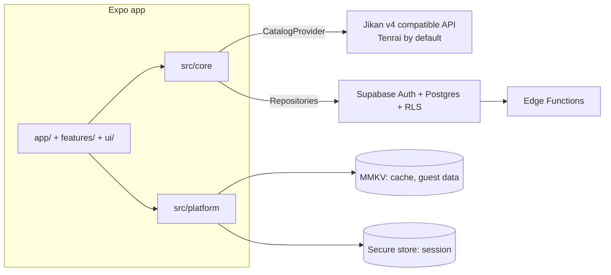
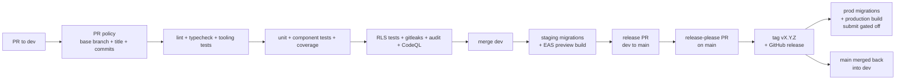

# Architecture

This document describes how Tsuzuki is built. Decisions and their rationale live in [`adr/`](./adr). Keep this file in sync with the code: any structural change updates it in the same PR.

## 1. Overview



- The **catalog** (titles, search, discovery) comes from an external provider behind the `CatalogProvider` interface: today a Jikan v4 compatible API, Tenrai by default or a self-hosted Jikan by configuration (ADR-0013).
- **User data**: the library (favorites included) lives in Supabase for signed-in users, and in MMKV for guests; the preferences and the recent searches stay on the device for both (§6, §7).
- The app never talks to a provider or to Supabase outside `src/core/`.

## 2. Folder structure

```
tsuzuki/
├── app/                              # expo-router routes (thin)
│   ├── _layout.tsx                   # composition root: app env, error reporter, storage, supabase client and auth repository (A-01, §8), monitored catalog provider, recent searches repository, guest library repository and account library factory (A-03), persisted query client, auth context, session library switch, preferences, i18n, theme + root Stack; token auto refresh bound to the app foreground
│   ├── (tabs)/
│   │   ├── _layout.tsx               # Tabs from expo-router/js-tabs, five tabs
│   │   ├── index.tsx                 # discovery, the route /
│   │   ├── search.tsx
│   │   ├── library.tsx
│   │   ├── favorites.tsx
│   │   └── settings.tsx
│   ├── media/[namespace]/[kind]/[id].tsx # media detail: raw params passed to the feature screen
│   ├── +not-found.tsx                # unmatched links: translated error, back to Discover
│   └── auth/                         # plain folder, not a group: the email link paths contain auth/ (ADR-0014, §8); root stack screens, no nested layout
│       ├── sign-in.tsx, sign-up.tsx, forgot-password.tsx
│       ├── callback.tsx              # confirmation link tsuzuki://auth/callback: raw params to EmailConfirmedScreen
│       ├── reset-password.tsx        # recovery link tsuzuki://auth/reset-password: raw params to ResetPasswordScreen
│       └── oauth-callback.tsx        # oauth redirect tsuzuki://auth/oauth-callback (A-02, ADR-0015): never reads its params; goes back, or shows "sign in did not finish"
├── src/
│   ├── core/                         # platform-agnostic, shareable with a future Next.js app
│   │   ├── domain/                   # entities, business rules (BR-xx), content filter
│   │   │   ├── media.ts              # MEDIA_KINDS, MediaKind, MEDIA_ID_NAMESPACES ('mal'), MediaIdNamespace, MediaKey { namespace, kind, externalId }, compareMediaKeys (the key order: namespace and kind in enum order, then externalId; 0 only for the same media), EXTERNAL_ID_MAX, isMediaKind; ANIME/MANGA/MEDIA_FORMATS, MEDIA_FORMATS_BY_KIND, SEARCHABLE_ANIME/MANGA_FORMATS (without oel and unknown), SearchableMediaFormat, SEARCHABLE_FORMATS_BY_KIND, MEDIA_STATUSES (publication), SEARCHABLE_MEDIA_STATUSES (ADR-0013)
│   │   │   ├── content-filter.ts     # BR-06: ADULT_GENRE_NAMES (lowercase const tuple), isAdultMedia (used by adapters), isAdultGenreName (the filters sheet's genre chips), applyContentFilter, DEFAULT_SHOW_ADULT (false, the default of the stored adult content preference) (§7)
│   │   │   ├── search-query.ts       # prepareSearchQuery(raw, maxLength) -> string | null: the query sent for a search field value; isSearchQueryMaxLength (§6)
│   │   │   ├── search-filters.ts     # FR-03: SearchFilters, EMPTY_SEARCH_FILTERS, YEAR_FROM_MIN/MAX, MIN_SCORE_OPTIONS (5..9), DEFAULT_SORT_DIRECTION, the genre cycle, setters, filtersForKind, activeFilterCount, hasActiveFilters, toSearchParams (§6)
│   │   │   ├── recent-searches.ts    # FR-02: RECENT_SEARCHES_MAX (10), normalizeRecentSearches, addRecentSearch (§6)
│   │   │   ├── database-limits.ts    # POSTGRES_INTEGER_MAX, the bound of the integer columns external_id, media_total_units and progress; MEDIA_TITLE_MAX_LENGTH (500), MEDIA_IMAGE_URL_MAX_LENGTH (2048); codePointLength(text), the postgres char_length (§5)
│   │   │   ├── library-entry.ts      # LIBRARY_STATUSES, LibraryStatus, isLibraryStatus, DEFAULT_LIBRARY_STATUS (planned), CalendarDate, LibraryMediaSnapshot, LibraryEntry, LibraryEntryChanges, LibraryWriteContext { now, today }, libraryWriteContextAt; createLibraryEntry, setFavorite, favoriteMedia (BR-05), updateLibraryEntry (BR-09 write convention); BR-07: SCORE_MIN (1), SCORE_MAX (10), NOTES_MAX_LENGTH (2000 code points), isValidScore, isValidNotes (§5)
│   │   │   ├── library-progress.ts   # BR-01 to BR-04: PROGRESS_MAX, progressMaxOf, isValidProgress, canIncrementProgress, setProgress, incrementProgress, setStatus; PROGRESS_WRITE_COALESCE_MS (500, BR-09) (§5)
│   │   │   ├── library-details.ts    # BR-07: setScore, setNotes (RangeError on an invalid value), notesFromInput (the notes editor text -> notes) (§5)
│   │   │   ├── library-snapshot.ts   # ADR-0009: isSameMediaSnapshot, refreshMediaSnapshot (the BR-09 write), withMediaSnapshot (display only) (§5)
│   │   │   ├── auth-credentials.ts   # the password policy of the supabase projects: PASSWORD_MIN_LENGTH (10 code points), PASSWORD_MAX_BYTES (72 utf-8 bytes, the bcrypt bound), PASSWORD_PROBLEMS, PasswordProblem, passwordProblems(password), isAcceptablePassword; EMAIL_MAX_LENGTH (254) (§8)
│   │   │   └── library-view.ts       # FR-14, BR-06: LIBRARY_SORT_FIELDS (updated, title, score), LIBRARY_FILTER_ALL, LibraryStatusFilter, LibraryKindFilter, LibraryViewOptions, DEFAULT_LIBRARY_VIEW, LibraryGroup, LibraryView; matchesLibraryFilters, compareLibraryEntries(sort), buildLibraryView(entries, options, showAdult); FR-15: favoriteEntries(entries), the favorites in their given order (§6 "Library")
│   │   ├── schemas/                  # zod schemas for user input, route params and db rows
│   │   │   ├── media-route-params.ts # media detail route params { namespace, kind, id } -> MediaKey, parseMediaRouteParams; toMediaRouteParams(key), its inverse, for links to the detail route
│   │   │   ├── year-input.ts         # yearInputSchema: the year field text of the filters sheet, exactly four ascii digits in YEAR_FROM_MIN..YEAR_FROM_MAX -> number; parseYearInput(text) -> number | null (blank text included); isBlankYearInput(text) (§6)
│   │   │   ├── progress-input.ts     # progressInputSchema: the progress field text, trimmed, 1 to 10 ascii digits, at most PROGRESS_MAX -> number; parseProgressInput(text) -> number | null; isBlankProgressInput(text); the bound by the total is the screen's (isValidProgress)
│   │   │   ├── timestamp.ts          # timestampSchema: an RFC 3339 timestamp with an offset -> the Date#toISOString form (UTC, milliseconds, truncated); calendarDateSchema: YYYY-MM-DD, a real date (§5)
│   │   │   ├── library-entry.ts      # libraryMediaSnapshotSchema, libraryEntrySchema (the database limits, BR-07) -> the domain types; toLibraryMediaSnapshot(summary): the snapshot written with an entry (FR-10, ADR-0009), a LibrarySnapshotError for a media no snapshot can hold (§5)
│   │   │   ├── app-env.ts            # build-time env (variant, https supabase url, anon key, optional sentry dsn, optional jikanBaseUrl), shared by app.config.ts and the startup reader (§10)
│   │   │   ├── app-links.ts          # APP_SCHEME ('tsuzuki', read by app.config.ts), AUTH_LINK_PATHS { confirmation: 'auth/callback', passwordReset: 'auth/reset-password', oauth: 'auth/oauth-callback' }, appLinkUrl(path) (§8, ADR-0014, ADR-0015)
│   │   │   ├── auth-link-params.ts   # parseAuthLinkParams(raw: unknown) -> AuthLinkParams: { kind: 'code', link: EmailLinkCode } | { kind: 'failed', reason: 'expired' | 'invalid' }; AUTH_CODE_MAX_LENGTH, AUTH_FLOW_ID_PARAM ('sb_flow_id') (§8)
│   │   │   └── auth-forms.ts         # emailSchema (trimmed, EMAIL_MAX_LENGTH, zod email), signInFormSchema, signUpFormSchema, emailFormSchema (forgot password, resend), newPasswordFormSchema (with its confirmation); parseAuthForm -> the value or a problem per field (AuthFormField, AuthFormProblem) (§8)
│   │   ├── catalog/
│   │   │   ├── catalog-provider.ts   # CatalogProvider interface (namespace, instanceId, searchQueryMaxLength, searchGenresMax, imageHosts) + normalized types; TopParams { kind, format?, page } (C-08), CatalogRequestPriority, CatalogRequestOptions { priority? } of the paged methods (C-06)
│   │   │   ├── catalog-failure-monitor.ts # monitorCatalogProvider(provider, { reporter, now? }): reports sustained provider failures through the ErrorReporter, results and errors unchanged, fields forwarded (§3)
│   │   │   ├── search-params.ts      # normalizeSearchParams: canonical SearchParams for the search query key (§6)
│   │   │   ├── image-url.ts          # toAllowedImageUrl(value, allowedHosts): an untrusted image url kept only when https on an allowed cdn host, else null; IMAGE_URL_MAX_LENGTH, the domain MEDIA_IMAGE_URL_MAX_LENGTH (2048) (§9)
│   │   │   ├── http/                 # catalog http client used by the adapters: rate limit, in-flight dedup, retries (§3, §6)
│   │   │   │   ├── rate-limiter.ts   # createRateLimiter(policy, { now? }) -> { acquire(signal?), acquireBackground(signal?) -> { granted, promote() }, pauseFor(ms) }: token buckets (GCRA), a foreground and a background FIFO queue (background only with a token kept for the foreground, C-06), one timer for the head that drains next; monotonic now, default performance.now()
│   │   │   │   ├── in-flight-dedup.ts # identical in-flight GETs (exact url) share one abortable operation with a caller count; nothing cached
│   │   │   │   ├── retry-policy.ts   # DEFAULT_RETRY_POLICY (4 attempts, equal-jitter backoff, 20 s deadline), parseRetryAfter
│   │   │   │   ├── abortable.ts      # sleep(ms, signal?), raceAbort(promise, signal) + abort listener helpers: aborted and add/removeEventListener only (RN AbortController polyfill)
│   │   │   │   └── catalog-http-client.ts # createCatalogHttpClient({ rateLimit, retry?, timeoutMs?, random?, now?, wallClock? }) -> { getJson(url, signal?, { priority? }?) }, one limiter and dedup map per client, a foreground caller promotes a background request in flight; now: monotonic (limiter, retry deadline), wallClock: Retry-After dates only
│   │   │   └── jikan/                # jikan v4 compatible adapter, one for every instance (C-03, §3, ADR-0013): requests through its own catalog http client
│   │   │       ├── jikan-catalog-provider.ts # createJikanCatalogProvider(instance, options?) -> CatalogProvider (namespace mal, instanceId, searchQueryMaxLength JIKAN_QUERY_MAX_LENGTH, searchGenresMax JIKAN_GENRE_IDS_MAX, imageHosts JIKAN_IMAGE_HOSTS), builds its client from instance.rateLimit; wired by the composition root
│   │   │       ├── jikan-instances.ts # JikanInstance { id, baseUrl, rateLimit }: TENRAI_INSTANCE (id tenrai, the default), selfHostedJikanInstance(baseUrl) (id jikan-self-hosted), jikanInstanceFor(baseUrl | undefined)
│   │   │       ├── jikan-urls.ts     # deterministic request urls relative to the instance base url, JIKAN_PAGE_LIMIT (25), JIKAN_QUERY_MAX_LENGTH (300), JIKAN_GENRE_IDS_MAX (25), input guards (RangeError), jikanStartDateFrom; the search type table shared by search and top (`type`)
│   │   │       ├── jikan-fields.ts   # jikan status and type values, display field normalization (titles, unit counts, score, year)
│   │   │       ├── jikan-schemas.ts  # zod schemas of the page, detail and genre list payloads; an item parses to a JikanEntry
│   │   │       ├── jikan-mappers.ts  # JikanEntry -> MediaSummary, MediaDetail, Page; genres, isAdult (BR-06), cover (JIKAN_IMAGE_HOSTS); a schema failure -> CatalogResponseError
│   │   │       ├── jikan-rate-limit.ts # TENRAI_RATE_LIMIT { 2 tokens, 1 per 750 ms }; SELF_HOSTED_JIKAN_RATE_LIMIT { 2 tokens, 1 per 750 ms } and { 10 tokens, 1 per 1.5 s } (§6)
│   │   │       └── __fixtures__/     # jikan-builders.ts (payload builders in the shape of the published openapi spec), jikan-endpoints.ts (the per-endpoint test cases), jikan-handlers.ts (msw handlers per instance base url); tenrai/: recorded Tenrai responses trimmed for the repository (JSON) and a README on how they were recorded and trimmed (§12)
│   │   ├── repositories/
│   │   │   ├── storage-adapter.ts    # StorageAdapter: synchronous string key-value storage, never secrets (MMKV on mobile)
│   │   │   ├── session-storage.ts    # SessionStorage: async auth session storage, supabase-js auth.storage shape (secure-store on mobile)
│   │   │   ├── recent-searches-repository.ts # RecentSearchesRepository: synchronous load, save(list), clear() (§6)
│   │   │   ├── library-repository.ts # LibraryRepository: async list, get, save, remove; GuestLibraryRepository adds clear (§4)
│   │   │   ├── auth-repository.ts    # AuthRepository (A-01 calls, A-02 oauthProviders and signInWithProvider), AuthSession { userId }, EmailCredentials, AuthRequestOptions { captchaToken? }, EmailLinkCode { code, flowId }, OAUTH_PROVIDERS, OAuthProvider; the captcha seam CaptchaAction, CaptchaTokenProvider, noCaptcha; the browser session port OAuthBrowser, OAuthBrowserResult (§4, ADR-0014, ADR-0015)
│   │   │   ├── profile-repository.ts
│   │   │   ├── supabase/             # supabase implementations, database.types.ts (generated)
│   │   │   │   ├── create-supabase-client.ts # client factory: anon key, injected SessionStorage, pkce with the flow id in redirects (§8)
│   │   │   │   ├── auth-repository.ts # createSupabaseAuthRepository(client, { confirmationRedirectUrl, passwordResetRedirectUrl, reporter, oauth? }) -> AuthRepository; oauth { browser, providers, redirectUrl }, absent: no provider (A-02); supabase errors mapped to AuthError, unknown ones reported (§4, §8)
│   │   │   │   ├── library-repository.ts # createSupabaseLibraryRepository(client, { userId, reporter }) -> LibraryRepository: one signed-in user's library_entries, paged list, session guard before every call, LIBRARY_PAGE_SIZE, LIBRARY_REQUEST_TIMEOUT_MS (A-03, §4)
│   │   │   │   ├── library-row.ts    # LIBRARY_ROW_COLUMNS (the explicit select list), parseLibraryRow(row: unknown) -> LibraryEntry | null (libraryEntrySchema), toLibraryRowPayload(entry): the writable columns (§4)
│   │   │   │   └── library-error-mapper.ts # toLibraryRemoteError(failure) -> LibraryRemoteError, libraryReportContext(operation, failure): the reason, the code and status tags (§4)
│   │   │   └── local/                # device and guest implementations (storage injected from platform)
│   │   │       ├── recent-searches-repository.ts # createLocalRecentSearchesRepository(storage, { maxQueryLength }): key recent-searches, JSON array parsed with zod (§6)
│   │   │       ├── library-store.ts  # the guest store document: readGuestLibrary (envelope and entry parsing, the problems found), serializeGuestLibrary, the list order (sortLibraryEntries, by compareLibraryEntries('updated') of library-view.ts), isSameMediaKey
│   │   │       ├── __fixtures__/memory-storage.ts # an in-memory StorageAdapter and a recording ErrorReporter for the local repository tests
│   │   │       └── library-repository.ts # createLocalLibraryRepository(storage, { reporter }) -> GuestLibraryRepository: key guest-library (GUEST_LIBRARY_STORAGE_KEY), versioned JSON envelope parsed on every read; created by the composition root (§4)
│   │   ├── hooks/                    # react hooks over the repository and CatalogProvider interfaces, consumed by feature screens (§6)
│   │   │   ├── catalog-context.ts, CatalogContextProvider.tsx, use-catalog-provider.ts   # the CatalogProvider given by the composition root; useCatalogProvider throws outside CatalogContextProvider
│   │   │   ├── recent-searches-context.ts, RecentSearchesContextProvider.tsx, use-recent-searches.ts   # the RecentSearchesRepository; useRecentSearches: { searches, add, clear }, throws outside its provider
│   │   │   ├── library-context.ts, LibraryContextProvider.tsx, use-library-context.ts   # the LibraryRepository, its LibraryWriter and their cache scope (LibraryContextValue { repository, writer, scope }); the old scope flushed then removed on a repository change (A-03, §6 "Writes"); useLibraryContext throws outside LibraryContextProvider (L-03)
│   │   │   ├── SessionLibraryContextProvider.tsx # SessionLibraryContextProvider({ guest, accountRepositoryFor, children }): LibraryContextProvider with the guest library signed out, the account library of the user signed in (one per user id), PENDING_LIBRARY_REPOSITORY while the session loads (A-03, §4 "Library switch")
│   │   │   ├── auth-context.ts, AuthContextProvider.tsx, use-auth-context.ts   # the AuthRepository, the CaptchaTokenProvider and the AuthSessionState from onAuthStateChange; useAuthContext (for the auth hooks) throws outside AuthContextProvider (A-01, §8)
│   │   │   ├── use-auth-session.ts   # useAuthSession() -> AuthSessionState { status: 'loading' | 'signed-out' | 'signed-in', session } (§8)
│   │   │   ├── use-auth-mutations.ts # one useMutation per action: useSignUp, useResendConfirmation, useSignIn, useRequestPasswordReset, useCompleteEmailLink, useCompletePasswordReset (exchange once, then update), useSignOut; a captcha token asked before the four protected calls; networkMode always, gcTime 0 (§8)
│   │   │   ├── library-writer.ts     # createLibraryWriter({ queryClient, repository, scope, now? }) -> { read, list, apply, flushAll }: optimistic entries under the keys of its scope, `+1` coalesced, repository calls serialized per key, idle keys pruned (§6 "Writes")
│   │   │   ├── library-list-data.ts  # the writer's list data helpers: mediaKeyId (scope-free), withListEntry (replace, insert at the front, drop), setListEntry(queryClient, scope, key, entry) (the cached ['library', scope] list, when it has data)
│   │   │   ├── use-library-entry.ts  # useLibraryEntry(key, { media }): the entry query read through the writer, shown with the catalog's fresh snapshot; a media no snapshot can hold fails it with a LibrarySnapshotError, in the library or not (§6 "Library")
│   │   │   ├── use-library-entry-actions.ts # useLibraryEntryActions(key, { media }) -> LibraryEntryActions: add, remove, setStatus, setProgress, incrementProgress, setScore, setNotes, toggleFavorite (FR-15, BR-05), error (held with the key values it belongs to), dismissError; no unmount guard (§6 "Library")
│   │   │   ├── use-library-list.ts   # useLibraryList(options: LibraryViewOptions, { showAdult, layoutKey, favoritesOnly? }): { query, view }: the list query read through the writer, filtered (the favorites only with favoritesOnly, L-05), sorted and grouped in select, covers re-checked against the provider's imageHosts, laid out as last shown until layoutKey or an option changes (keepLibraryLayout) (L-04, §6 "Library")
│   │   │   ├── use-debounced-value.ts # useDebouncedValue(value, delayMs)
│   │   │   ├── filtered-page.ts      # FilteredPage<T> (a Page plus hiddenCount), selectFilteredPage(showAdult): one stable select function per value (BR-06, §7)
│   │   │   ├── use-paged-catalog-list.ts # CatalogPageList (a paged list descriptor), CatalogPageRequest, usePagedCatalogList(request, { showAdult, placeholder }) -> PagedCatalogListResult { query, isPlaceholderFromOtherList }: one page of a search, top or season list (C-08, §6 "Catalog lists")
│   │   │   ├── use-prefetch-next-page.ts # usePrefetchNextPage(list | null, page, ShownPageState): the next page of a CatalogPageList fetched in the background when the page shown is settled (C-06, §6)
│   │   │   ├── use-search.ts         # SEARCH_DEBOUNCE_MS (400), useSearch(params | null, { showAdult }): usePagedCatalogList over provider.search (C-06, §6)
│   │   │   ├── use-top-media.ts      # useTopMedia(params: UseTopMediaParams { kind, format: SearchableMediaFormat | null, page }, { showAdult }): usePagedCatalogList over provider.getTop, the only TopParams builder (C-08, §6)
│   │   │   ├── use-current-season.ts # useCurrentSeason(page, { showAdult }): usePagedCatalogList over provider.getCurrentSeason (C-08, §6)
│   │   │   ├── use-media-detail.ts   # useMediaDetail(key, { showAdult }) -> VisibleMediaDetail ({ hidden: false, media } | { hidden: true }, BR-06): queryKeys.media, STALE_TIMES.mediaDetail (C-07, §6)
│   │   │   └── use-genres.ts         # useGenres(kind): the provider's genres of a kind, adult genres included, queryKeys.genres, STALE_TIMES.genres (§6)
│   │   ├── query/
│   │   │   ├── query-client.ts       # createQueryClient: a new client per call, gcTime 7 days, retry off; search keys default to the search stale and gc times (C-06)
│   │   │   ├── persister.ts          # createQueryPersister over StorageAdapter, createPersistOptions: success queries except search and library, never a mutation (§6, §8)
│   │   │   ├── keys.ts               # query key factory, SEARCH_KEY_ROOT and LIBRARY_KEY_ROOT (never persisted), LibraryScope (the library keys' writer scope, A-03) (§6)
│   │   │   ├── stale-times.ts        # STALE_TIMES per query family, SEARCH_GC_TIME (30 min), PERSISTED_CACHE_MAX_AGE
│   │   │   └── cache-schema-version.ts # CACHE_SCHEMA_VERSION, part of the persisted cache buster (§6)
│   │   ├── errors/
│   │   │   ├── catalog-errors.ts     # CatalogError base: CatalogHttpError (status, retryAfterMs), CatalogNetworkError, CatalogTimeoutError (timeoutMs), CatalogResponseError (malformed body, zod failure in adapters), CatalogAbortedError (name AbortError, Hermes has no DOMException); no url, query, search text, underlying message or cause (§9). isCatalogNotFoundError(error): a CatalogHttpError 404, a missing title (the failure monitor ignores it, the detail screen shows not found). CATALOG_FAILURE_KINDS and CatalogProviderFailureError (kind), reported by the failure monitor (§3)
│   │   │   ├── app-env-error.ts      # AppEnvError: invalid app env, lists the invalid field names only, never their values (ADR-0012)
│   │   │   ├── auth-errors.ts        # AUTH_ERROR_REASONS, AuthErrorReason, AuthError (reason, a fixed message per reason, no cause): every AuthRepository rejection (§8)
│   │   │   ├── library-errors.ts     # LibraryStorageError (reason: LibraryStorageReason), reported by the local library repository when the guest store is damaged; LibrarySnapshotError (a RangeError, fixed message), thrown by toLibraryMediaSnapshot for a media outside the database limits (§5); LIBRARY_REMOTE_REASONS, LibraryRemoteReason, LibraryRemoteError (reason, a fixed message per reason, no cause): every rejection of the account library but the save validation's RangeError (A-03); never stored content, a title, notes, a key or server text (§4)
│   │   │   └── error-reporter.ts     # ErrorReporter port (captureError) + ErrorContext (source, non-personal tags), implemented by src/platform/sentry.ts
│   │   ├── i18n/                     # i18next, the only place importing it (ADR-0011); public api: index.ts (@core/i18n/index, enforced by lint in routes, features and platform)
│   │   │   ├── en.json, fr.json      # single translation namespace, keys nested by feature; en.json is the key source
│   │   │   ├── languages.ts          # supported en/fr, fallback en, preference system | en | fr (default system)
│   │   │   ├── resolve-language.ts   # preference + device tags -> language; device-language-tags.ts parses the tags with zod
│   │   │   ├── locale-adapter.ts     # LocaleAdapter interface (useDeviceLanguageTags), implemented in platform
│   │   │   ├── create-i18n.ts        # a new i18next instance per call, bundled resources, onMissingKey callback
│   │   │   ├── I18nProvider.tsx, i18n-context.ts, use-translation.ts   # own react context (no react-i18next); useTranslation: t, language, formatNumber, formatDate
│   │   │   ├── format.ts             # number and date formatting with a required language
│   │   │   ├── media-labels.ts       # the media labels of search, discovery, detail and the library list, exported by index.ts: FORMAT_KEYS, STATUS_KEYS per kind, TOTAL_UNITS_LABEL_KEYS per kind (Episodes, Chapters), LIBRARY_STATUS_KEYS per kind (Watching, Reading…), LIBRARY_VIEW_STATUS_KEYS per LibraryKindFilter (the kind's words, kind-neutral ones for All: In progress, Planned…), LIBRARY_SORT_KEYS, PROGRESS_LABEL_KEYS per kind (progress texts, `+1` label, progress field label), YEAR_FORMAT, englishTitleOf, nativeTitleOf (pure mappings to translation keys)
│   │   │   └── i18next.d.ts          # keys typed from en.json (strictKeyChecks)
│   │   └── preferences/              # theme, language and adult content preferences, own react context like i18n; public api: index.ts (@core/preferences/index, by convention, not lint-enforced)
│   │       ├── preferences.ts        # THEME_PREFERENCES system | light | dark, ThemePreference, DEFAULT_THEME_PREFERENCE (system); the language preference stays in i18n/, the adult content default (DEFAULT_SHOW_ADULT) in domain/content-filter.ts
│   │       ├── preferences-storage.ts # loadPreferences (zod; invalid theme or language -> system, adult content anything but 'true' / 'false' -> false), saveThemePreference, saveLanguagePreference, saveShowAdultPreference over StorageAdapter; keys preferences.theme, preferences.language, preferences.showAdult (L-06)
│   │       └── PreferencesProvider.tsx, preferences-context.ts, use-preferences.ts   # controlled provider holding no state; usePreferences: theme, language, showAdult, setTheme, setLanguage, setShowAdult
│   ├── features/                     # screen components rendered by the routes, e.g. discovery/DiscoveryScreen.tsx
│   │   ├── media-list/               # shared by search, discovery and library (C-08, L-04): MediaPageList (states, stale note, hidden note, list, Pagination footer), MediaSummaryRow (memoized MediaSummary -> MediaListItem), mediaSummaryKey; ChoiceChips (a labelled radio group of radio chips: Discover sections and formats, library filters and sort)
│   │   ├── search/                   # SearchScreen (field, kind switch, recent searches or results in a MediaPageList), SearchKindSwitch, RecentSearchesList; FiltersButton (active count), FiltersSheet (draft, Apply, Reset) and its sections (format, genres, status, year, minimum score, sort) (C-05); the page, held with the search it belongs to (C-06)
│   │   ├── discovery/                # DiscoveryScreen (section chips, manga format chips, the page held with its list), TopMediaSection, SeasonSection (one per hook), DiscoveryPageList (their MediaPageList: prefix discover, discovery.empty.*) (C-08)
│   │   ├── library/                  # L-04, FR-14, L-05 (§2 "Library screen"): LibraryEntriesScreen (shared by the library and favorites tabs: options, loading, error with retry, empty state with a Search action, testID prefix), LibraryScreen (every entry), LibraryList (filters, hidden note, status headers and rows in one List, no match with reset; testID prefixes), LibraryFilters (kind, status and sort ChoiceChips), LibraryEntryRow (memoized row with its heart, its `+1` and its write error), library-list-items (the groups flattened into header and entry items, their keys and item types); __fixtures__/library-entries.ts
│   │   ├── media-detail/             # MediaDetailScreen (parses the route params, invalid link state), MediaDetailView (useMediaDetail: not found, offline, generic error, loading, hidden, content), MediaDetailContent (FR-06: cover, titles, the `library` slot, facts, genres, synopsis) (C-07); LibrarySection (with the favorite heart and the unsupported media message, L-05), LibraryEntryPanel, the Status, Progress, Score, Notes and Remove sheets, useSheetDraft (L-03, FR-10 to FR-13); __fixtures__/media-details.ts (details from the recorded Tenrai responses, a synthetic adult one)
│   │   ├── favorites/                # FavoritesScreen: the library's LibraryEntriesScreen with the favorites only, testID prefix favorites (L-05, FR-15)
│   │   ├── auth/                     # A-01 (§8): SignInScreen, SignUpScreen (form, then the check-your-email state with a resend), ForgotPasswordScreen (form, then a neutral sent state), EmailConfirmedScreen (callback link), ResetPasswordScreen (recovery link); auth-error-keys.ts: AUTH_ERROR_KEYS (AuthErrorReason -> translation key), authErrorKey(error) (anything else: the unknown key), authErrorReason(error), rejectsEmail(error) (`invalid-email`); AuthScreen (the scrolling frame) and AuthMessage (a heading and its message), AuthFields (EmailField, PasswordField: autofill kind, no capitals or autocorrect), use-auth-form.ts (useAuthForm(schema): the field values, parseAuthForm on submit, the translated problem of each field), use-email-field.ts (useEmailField(form, call): the email field props, with the call's `invalid-email` as the field's problem), auth-form-texts.ts (the text of each field problem, with the policy numbers of auth-credentials.ts), auth-routes.ts (AUTH_PATHS, SETTINGS_PATH)
│   │   └── settings/                 # SettingsScreen: AccountSection (A-01), ThemePicker, LanguagePicker, AdultContentSetting (switch with a confirmation sheet, L-06)
│   ├── ui/                           # the only layer that uses NativeWind
│   │   ├── index.ts                  # public api: routes and features import from @ui/index
│   │   ├── theme/
│   │   │   ├── colors.ts, spacing.ts, radii.ts, typography.ts, sizes.ts   # design tokens (sizes: touch target, text area min height, icon, cover sizes sm, md, lg; lg for the detail screen)
│   │   │   ├── css-variables.ts      # color token -> css variable (--color-<token>)
│   │   │   ├── tailwind.config.ts    # tailwind scales built from the tokens
│   │   │   ├── global.css            # tailwind entry compiled by nativewind in metro
│   │   │   ├── ThemeProvider.tsx     # system/light/dark, palette variables, status bar, navigation theme, native root view background
│   │   │   └── theme-context.ts      # useThemeColors, for props that take a color value
│   │   └── components/               # primitives: Screen, Box, Stack, Row (optional accessibilityRole 'radiogroup' with a required accessibilityLabel: a named radio group of single-select chips), Spacer, Text (heading), Button, IconButton, TabBarIcon, Card, Input (multiline: a text area of at least TEXT_AREA_MIN_HEIGHT; autoComplete email, password or new-password for autofill and password managers, also set as the ios textContentType), InlineError (a compact alert inside a screen, message and optional action, announced on mount), Chip (selected, excluded; role 'radio': radio role, checked state), RadioGroup, Spinner, EmptyState, ErrorState, Pagination, List (FlashList; header, empty, footer, scrollToTopKey, itemTypeOf), CoverImage (expo-image), MediaListItem (an optional trailing action rendered beside the row's pressable), Fact (label and value, one accessible element), Sheet (react-native Modal, slide-up), SheetActions (a sheet footer: Cancel, then the confirm action), Switch (react-native Switch in the theme colors, role switch, checked state)
│   │       ├── icons.ts              # glyph table by meaning (IconButton) + outline/filled pair per tab (TabBarIcon)
│   │       ├── layout/               # token -> class tables shared by the primitives
│   │       └── pagination/           # page window logic, PageButton, JumpToPage
│   └── platform/
│       ├── locale.ts                 # expo-localization device language tags implementing core LocaleAdapter
│       ├── storage.ts                # createStorage: one unencrypted MMKV instance (id tsuzuki) implementing core StorageAdapter
│       ├── secure-session.ts         # createSecureSessionStorage: chunked expo-secure-store implementing core SessionStorage, crash-safe generation switch, calls queued per key (§8)
│       ├── app-state.ts              # subscribeToForeground(listener: (foreground: boolean) => void) -> unsubscribe: react-native AppState, 'active' is foreground; called at once with the current state (§8)
│       ├── app-version.ts            # APP_VERSION from expo-constants, part of the persisted cache buster
│       ├── intl-polyfills.ts         # Intl.PluralRules polyfill, imported first by the root layout
│       ├── app-env.ts                # readAppEnv(parse): reads extra.env from expo-constants and re-parses it with the injected core parseAppEnv (platform imports core types only)
│       ├── sentry.ts                 # @sentry/react-native: initSentry (errors only), isSentryEnabled, createErrorReporter implementing core ErrorReporter; the only production file allowed to use console
│       └── sentry-scrub.ts           # pure scrubbers: scrubEvent (beforeSend), scrubBreadcrumb (beforeBreadcrumb)
├── supabase/
│   ├── migrations/
│   ├── functions/delete-account/
│   ├── tests/                        # pgTAP
│   └── seed.sql
├── e2e/                              # Maestro flows
├── test/                             # shared test infrastructure (see §12)
│   ├── core/                         # core project setups (setup.ts with the msw server, setup-dom.ts), determinism helpers shared with the mobile setup (fixed-clock.ts, fail-on-console.ts, no-network.ts), msw server factory, i18n catalog parity checker (i18n-catalog-parity.ts), catalog provider contract suite (catalog-provider-contract.ts: describeCatalogProviderContract(harness), run by every adapter, §3), the catalog provider contract boundary cases (catalog-provider-contract-boundaries.ts: search text limit, cover allowlist), an in-memory recent searches repository (fake-recent-searches-repository.ts), the library repository contract suite (library-repository-contract.ts: describeLibraryRepositoryContract(name, createRepository), run by every LibraryRepository implementation, §4; library-repository-contract-support.ts: invalid entries, reference order) and valid library entries (library-entry-fixtures.ts), the library hook doubles (fake-library-repository.ts: an in-memory LibraryRepository whose calls a test holds or fails one by one, createDeferred; library-writer-support.ts: setupWriter, a writer over the fake and a real query client, with library changes and flushMicrotasks; library-hooks-support.tsx: libraryWrapper, renderLibraryEntry and the catalog data MEDIA, FRESH_MEDIA, UNSTORABLE_MEDIA), the auth doubles (fake-auth-repository.ts: createFakeAuthRepository, createSessionSource, createSessionAuthRepository; auth-hooks-support.tsx: authWrapper, flushSessionReports); the strict fake catalog provider lives in `src/core/catalog/__fixtures__/fake-catalog-provider.ts` (createStrictFakeCatalogProvider: every method not overridden rejects; instance `fake-instance`, limit 42, so a test proves the limit is forwarded), their tests; core lint bans apply
│   ├── app/                          # route tests (renderRouterAsync); kept out of app/, where every .tsx is a route (root-layout-library.test.tsx: the guest library wiring; root-layout-auth.test.tsx: the supabase client and auth wiring; auth-routes.test.tsx: the auth routes). helpers: app-routes.ts (APP_ROUTES, the in-memory route map), native-header.ts (NATIVE_HEADER_HOST, headerTitles, visibleBackButtons: the native stack header queries)
│   └── mobile/                       # mobile project setup and its tests, helpers (renderRouterAsync, renderWithTheme, renderWithProviders: real catalogs and a missing key failing the test, options `{ language?, authRepository?, catalogProvider?, recentSearchesRepository?, queryClient?, showAdult? }` with a fresh query client, a signed-out fake auth repository, the strict fake catalog provider, an in-memory recent searches repository and the adult content setting off by default; TestPreferences: fixed preferences with a given `showAdult`, rerendered to change it; renderSearchScreen, renderLibraryScreen (over a fake library repository, with settle and textsInListOrder: texts in list item order, FlashList rendering cells in recycling order), classesOf, shared-mmkv, fake-jikan-module, fake-supabase-module: the supabase client and auth factories replaced in every route test that loads the root layout), .css stub
├── tools/                            # repository tooling, tested with node:test
│   ├── ci/                           # base branch policy for the PR policy workflow; eas-preview-scope.mjs: whether a push to dev runs the preview build (§10)
│   ├── commitlint/                   # commitlint.config.mjs tests
│   ├── expo/                         # resolve-ts-imports.cjs: node resolve hook loaded first by app.config.ts, so it can import the core app env schema (node >= 22.18); eas-update.mjs: `pnpm update:publish <variant>` (§10); their tests
│   ├── jest/                         # jest.config.mjs tests (tsconfig alias mapping, test globs)
│   └── eslint/                       # rule tables for eslint.config.mjs (layers.mjs, import-bans.mjs, syntax-guards.mjs, text-guards.mjs, test-hygiene.mjs and helpers), their regression tests, case tables (layers-*-cases.mjs) and probe tables (layers-text-probes.mjs)
│       └── plugin/                   # local eslint rules: backlog-reference, file-name-case
├── docs/  (ARCHITECTURE.md, BACKLOG.md, adr/)
├── .github/
│   ├── actions/setup/                # composite action: pnpm install --frozen-lockfile, store cached on the lockfile hash
│   └── workflows/                    # ci.yml, pr-policy.yml, codeql.yml, release-please.yml, eas-preview.yml, release.yml, back-merge.yml (see §10)
├── babel.config.js, metro.config.js  # nativewind scoped to src/ui (see below); metro built on getSentryExpoConfig
├── app.config.ts, eas.json           # app variant by APP_VARIANT, env validated into extra.env, config plugins (expo-router, expo-secure-store, expo-localization, @sentry/react-native with the org/project slugs and eu url), expo-updates; eas build profiles, channels and environments, remote app version source (§10)
├── .env.example                      # build-time env variables with placeholders (.env.local is git-ignored)
└── release-please-config.json, .release-please-manifest.json
```

Layer rules are defined in `CONTRIBUTING.md` §4 and enforced by ESLint; their tables live in `tools/eslint/layers.mjs` (`layerRules`, `LAYERS`, `LAYER_ZONES` and the network constants) and `tools/eslint/import-bans.mjs` (the banned import tables `BANNED`, `CANONICAL_PATHS` and `PLATFORM_CORE_TYPE_ONLY`).

- Only the root layout `app/_layout.tsx`, the composition root, wires the repository and catalog provider implementations (`src/core/repositories/supabase/`, `src/core/repositories/local/`, `src/core/catalog/jikan/`). Every other route, nested layouts included, and every feature goes through `src/core/hooks/`. Everything else in `src/core/` (domain, schemas, query, errors, i18n, hooks, and the interface files at the root of `repositories/` and `catalog/`) and in `test/core/` depends only on the repository and `CatalogProvider` interfaces, never on the implementation folders.
- Only provider adapters use the catalog http client (`src/core/catalog/http/`). Routes and features, `app/_layout.tsx` included, never import it: they reach the catalog through `src/core/hooks/`. Nor does the rest of `src/core/`, i.e. every file outside the provider adapter folders (`CATALOG_ADAPTER_FOLDERS` in `tools/eslint/layers.mjs`, today `catalog/jikan/`) and the http folder itself, the root files of `src/core/catalog/` and the repository implementations (`repositories/supabase/`, `repositories/local/`) included, or `test/core/`: they depend on the `CatalogProvider` interface (two lint zones in `tools/eslint/layers.mjs`, regression cases in `tools/eslint/layers-cases.mjs`).
- Routes, features and UI components have no direct network access: `app/`, `src/features/` and `src/ui/` never use `fetch`, `XMLHttpRequest`, `WebSocket`, `EventSource`, `expo/fetch` or Expo internals (`expo/src/…`, `expo/build/…`). Network access lives in `src/core/` (catalog adapters and repositories), with `src/platform/` for mobile SDKs.
- Every file under `src/` belongs to one of the four layers (`src/core/`, `src/features/`, `src/ui/`, `src/platform/`), so each file gets the rules of exactly one layer.
- Import paths are written canonically, because the package bans and barrel rules read the specifier text: in every layer, `CANONICAL_PATHS` rejects a `node_modules` path, a `..` segment after another segment (`@core/../x`), a `.` segment after the first one and empty segments (`@core/./i18n/x`, `@core//i18n/x`, a trailing `/`), which would otherwise bypass the barrel rules. Leading `./`, `.` and `../` segments stay allowed. It applies to static imports, re-exports, `import()` and jest module calls; its cases are in `tools/eslint/layers-canonical-cases.mjs`.
- Jest module calls (`jest.mock`, `doMock`, `requireActual`, `unmock`, `setMock`…) take a string literal and follow the package bans and canonical paths of their layer, like imports; `jest` is imported from `@jest/globals` under its own name and its methods are called by name, directly on `jest`: aliases, computed access, calls chained on a returned `jest` and re-exports of `@jest/globals` are rejected (a returned `jest` stored in a variable is beyond a syntax check).
- Production code (non-test files in `app/` and `src/`) never imports the test infrastructure in `test/`: only tests do.
- NativeWind is applied to `src/ui/` only (ADR-0007). `babel.config.js` enables its JSX transform through an override scoped to `src/ui/` (applied globally, it would pull `react-native-css-interop`, and React Native with it, into `src/core/`), and `metro.config.js` compiles `src/ui/theme/global.css` with `src/ui/theme/tailwind.config.ts`, whose `content` scans `src/ui/` only. A `className` anywhere else produces no style, and lint rejects it: `className` and its variants (`*ClassName` props and object keys) are used only inside `src/ui/`, and `nativewind` / `react-native-css-interop` imports are banned in every other layer.
- The tokens in `src/ui/theme/` (colors, spacing, radii, typography, sizes) are the single source of the Tailwind scales. `tailwind.config.ts` replaces Tailwind's default color, spacing, radius, font size, font weight and opacity scales (`theme`, not `theme.extend`), so only token classes exist for them (`p-lg`, `rounded-md`, `text-title`, `bg-surface-muted`) and a raw value cannot slip in; lengths are written in px, mapped 1:1 to dp. Each color is a CSS variable (`rgb(var(--color-<token>) / <alpha-value>)`), so no `dark:` variant is needed. Props that take a color value instead of a class (spinner, placeholder, icon) read the active palette with `useThemeColors`, internal to `src/ui/`.
- `ThemeProvider` resolves the preference (`system`, `light` or `dark`; `system` follows the device setting) to a scheme, sets the palette variables of that scheme on the whole tree, drives the native appearance through NativeWind and renders the status bar. The preference is held and persisted by the composition root (`app/_layout.tsx`, see "Root layout"), and changed by the settings theme picker through `PreferencesProvider` (see below).
- `ThemeProvider` also provides the navigation theme: it wraps its children in expo-router's `ThemeProvider` with a theme built from the active palette (`dark` = the resolved scheme; colors `primary` → `primary`, `background` → `background`, `card` → `surface`, `text` → `text`, `border` → `border`, `notification` → `danger`; `fonts` from expo-router's `DefaultTheme`), so navigator backgrounds, headers and the tab bar follow the palette and dark mode shows no light flash during transitions. Whenever the scheme changes it also sets the native root view background to the palette background with `expo-system-ui` (`SystemUI.setBackgroundColorAsync`), so an explicit dark preference on a light system does not flash the light root view. A failure of that call goes to the optional `onError(error: unknown)` prop, which the composition root wires to the `ErrorReporter` (`src/ui/` imports neither core nor platform); without it the failure is dropped. Raw palette values still never cross the `@ui/index` barrel. `src/ui/` thus imports `expo-router` (for the theme only) and `expo-system-ui`; its lint entry allows both.
- `src/ui/` also wraps the two rendering packages of the lists (§6), so screens get them only through primitives: `List` over `@shopify/flash-list` and `CoverImage` over `expo-image` (both installed with `pnpm exec expo install`). They are imported only in `src/ui/`: a banned group `uiOnlyPackages` (`^expo-image($|/)`, `^@shopify/flash-list($|/)`, `tools/eslint/import-bans.mjs`) applies to every other layer, `src/core/` (where the `expo` group already covers `expo-image`), `src/platform/`, routes and features with their test code, with cases in the layer case tables. A cover therefore renders only through `CoverImage`, which takes the `imageUrl` of a catalog item as given (§9).
- `I18nProvider` (`src/core/i18n/`, ADR-0011) creates with `useMemo` one never-mutated i18next instance per `[language, onMissingKey]` (no global singleton), initialized synchronously with the bundled `en.json` and `fr.json`, fallback `en`, and exposes it through the module's own React context. `t` comes from `instance.getFixedT(language, 'translation')`, so the render that receives a new language already translates with it: no stale frame, no shared state mutated during render. react-i18next is not used: its `useTranslation` caches `t` per language and revision, not per instance, so it would keep a stale `t` and handler, and the binding is a few lines. `onMissingKey` must be stable (module level or memoized). The language preference (`system`, `en` or `fr`) is held and persisted by the composition root like the theme preference (default `system`) and changed by the settings language picker through `PreferencesProvider`. The composition root reads the device language tags through the core `LocaleAdapter` hook, implemented in `src/platform/locale.ts` with `expo-localization`'s reactive `useLocales()` so the tags follow OS changes, and resolves the language with the pure `resolveLanguage`: an explicit preference wins, `system` takes the first device tag whose primary subtag is supported, otherwise `en`. The tags are untrusted and parsed with Zod (a non-array gives none, invalid entries are dropped). The composition root reports, in every build, missing keys, i.e. keys found in no catalog of the chain (each key once per language; a key present only in `en.json` resolves through the fallback and is not reported; the parity test catches it), and once a missing `Intl.PluralRules` (i18next would fall back silently to a one/other rule, wrong for French 0; `src/platform/intl-polyfills.ts` should make it unreachable). Both go through the `ErrorReporter`: Sentry in release builds, the console in development.
- Routes and features translate with `useTranslation` from `@core/i18n/index`, the module's public API (like `@ui/index`, enforced by lint, see below; `createI18n`, `resources` and the device tag Zod schema are internal, and their tests import their modules). `useTranslation()` throws outside `I18nProvider` and returns `t` with keys typed from `en.json` (`strictKeyChecks`: an unknown key fails typecheck), the active `language`, and `formatNumber` / `formatDate`, which always format with that language, never the machine locale. Catalogs are one `translation` namespace with keys nested by feature; plurals use i18next suffixes selected by `Intl.PluralRules` (French needs `_one`, `_many` and `_other`). `i18next` is imported only inside `src/core/i18n/`; lint bans `i18next` and `react-i18next` everywhere else. The i18n hook lives with its module; `src/core/hooks/` is for data hooks over the repository and `CatalogProvider` interfaces.
- `PreferencesProvider` (`src/core/preferences/`, a React context like i18n) exposes the theme, language and adult content preferences to routes and features, which import the module through its public API `@core/preferences/index` by convention (not lint-enforced). The provider is controlled and holds no state: it takes `theme`, `language`, `showAdult`, `onThemeChange`, `onLanguageChange` and `onShowAdultChange` props, and `usePreferences()` returns `{ theme, language, showAdult, setTheme, setLanguage, setShowAdult }`, memoized, and throws outside the provider. The composition root owns the three states and persists them through the core `StorageAdapter` with `src/core/preferences/preferences-storage.ts`: `loadPreferences` reads `preferences.theme`, `preferences.language` and `preferences.showAdult` synchronously and parses them with Zod (a missing or unknown theme or language gives `system`; the adult content setting is stored as the exact strings `'true'` / `'false'`, and anything else, a missing value included, gives `false`: fail closed, BR-06), `saveThemePreference` / `saveLanguagePreference` / `saveShowAdultPreference` write a choice. The adult content preference (L-06, FR-32) is stored on the device only (MMKV on mobile), for guests and signed-in users alike: the three preferences are not synced to `profiles.preferences` (§5, §7, A-03). Its default is `DEFAULT_SHOW_ADULT` (`false`, `src/core/domain/content-filter.ts`). `THEME_PREFERENCES` (`system`, `light`, `dark`), `ThemePreference` and `DEFAULT_THEME_PREFERENCE` (`system`) are declared in core because core cannot import `src/ui/`; a type test proves `ThemePreference` equals ui's `ColorSchemePreference`. The language preference type and default stay in `src/core/i18n/`.
- Routes and features never hard-code user-facing text. In production files of `app/` and `src/features/`, lint rejects text, a string or template literal containing a letter of any script (`\p{L}`; punctuation, digits and spaces stay allowed): JSX text and string literal children (`{'…'}`); text props (`label`, `title`, `placeholder`, `message`, `description`, `text`, `hint`, `error`, `aria-label`, `aria-valuetext`, and names ending in `Label`, `Hint`, `Title`, `Text`, `Message`, `Placeholder` or `Description`) and the same keys of objects held by a prop, given or spread (`action={{ label }}`, `accessibilityActions={[{ label }]}`); every value of `labels` / `*Labels` objects, label functions with an expression body included; the navigation keys `title`, `headerTitle`, `headerBackTitle`, `tabBarLabel`, `tabBarAccessibilityLabel` and `drawerLabel` anywhere in the file, even as another call's data (`track({ title: 'opened' })`); `Alert.alert` / `Alert.prompt` arguments and the text keys of their objects (button `text`). Text is found directly or through at most 3 nested wrappers (`MAX_NESTING`): `?:` branches, `&&`, `||`, `??`, `+`, templates, array elements (children `{['Hi', t('a')]}`, array-valued props), `as` / `satisfies` and arrow bodies. An object key is matched from the nearest prop or alert call through at most 6 intermediate nodes (`MAX_OBJECT_PATH`) of objects, arrays, spreads, conditionals, logical operands and type assertions; a function or a call ends the path, so a text key inside a callback or a call argument (`onPress={() => track({ label: 'save_button' })}`, `action={makeAction({ label: 'retry_action' })}`) is that code's data and is not reported. Beyond a syntax check: a string stored in a variable first, a label function with a block body, a key computed at run time, a literal behind more than 3 wrappers, an object key more than 6 nodes deep. Test code of these folders (`*.test.ts(x)`, `__tests__/`, `__fixtures__/`) is exempt: it gets a separate layer entry with the same import bans and style guards. The guards live in `tools/eslint/text-guards.mjs` (`TEXT_GUARDS`), their cases in `tools/eslint/layers-text-cases.mjs` with the probes in `tools/eslint/layers-text-probes.mjs`; the `i18next` / `react-i18next` import ban cases are in `tools/eslint/layers-i18n-cases.mjs`, the i18n barrel cases in `tools/eslint/layers-i18n-barrel-cases.mjs`.
- Routes and features never style directly: no `StyleSheet` from `react-native` and no `style` or `*Style` JSX prop given an expression, directly or in an object literal spread as props (a string literal is a mode, as in `<StatusBar style="auto" />`; plain object keys such as navigation `tabBarStyle` stay allowed). They compose `src/ui/` primitives, which take token names only (`padding="lg"`, `surface="surfaceMuted"`, `variant="title"`), never raw values; a new visual need extends a primitive. The guards live in `tools/eslint/syntax-guards.mjs` (`STYLE_GUARDS`).
- Routes and features import `src/ui/` through its public barrel `@ui/index` only: deeper `@ui/...` paths and relative paths into `src/ui/` are rejected, including in `import()` and jest module calls, so internals such as `useThemeColors` (raw color values) stay inside the design system.
- Routes and features (production and test code) and `src/platform/` import `src/core/i18n/` through its public barrel `@core/i18n/index` only (ADR-0011), with the same rule shape (`i18nInternals` in `tools/eslint/import-bans.mjs`, built like `uiInternals`): any other `@core/i18n/...` specifier (`@core/i18n` alone included) and any relative path into `src/core/i18n/` (the barrel included) is rejected, type imports included, in static imports, re-exports, `import()` and jest module calls, so `createI18n`, `resources` and the catalogs stay internal. `src/platform/` imports the barrel as types only. The rest of `src/core/` and `test/` are not restricted. The `i18next` / `react-i18next` ban and this rule both cite ADR-0011 in their lint messages.
- Routes live in the root `app/`. Expo Router uses `src/app/` as the route root whenever it exists, so `src/app/` must never be created.
- Error reporting (ADR-0012): code reports errors through the core `ErrorReporter` port (`captureError(error, { source, tags })`; tags are short non-personal strings), injected by the composition root and implemented by `src/platform/sentry.ts`. ESLint `no-console` applies to every production file of `app/` and `src/` except `src/platform/sentry.ts`, whose reporter writes to the console in development, where Sentry is disabled. Test code is exempt: the console check (§12) is tested by calling `console` on purpose.
- Root layout: `app/_layout.tsx`, the composition root, at module level reads the app env (`readAppEnv(parseAppEnv)`: `src/platform/app-env.ts` reads `extra.env` and the root passes the core parser, since platform imports core types only; an invalid env throws before anything else is created, ADR-0012), initializes Sentry and creates the `ErrorReporter` (`createErrorReporter(initSentry(appEnv))`, `src/platform/sentry.ts`), and creates the app storage (`createStorage`, `src/platform/storage.ts`), the persist options (`createQueryPersister` over that storage, buster `` `${APP_VERSION}+${CACHE_SCHEMA_VERSION}` ``, §6), the catalog provider `monitorCatalogProvider(createJikanCatalogProvider(jikanInstanceFor(appEnv.jikanBaseUrl)), { reporter })` (§3; this is the only place that selects a provider or an instance, so an unset `EXPO_PUBLIC_JIKAN_BASE_URL` selects Tenrai) and the recent searches repository `createLocalRecentSearchesRepository(storage, { maxQueryLength: catalogProvider.searchQueryMaxLength })` (§6) and the guest library repository `createLocalLibraryRepository(storage, { reporter })` (§4) and the account library factory `accountLibraryFor = (userId) => createSupabaseLibraryRepository(supabase, { userId, reporter })` (A-03, §4; called by the session library switch, one repository per signed-in user id); in the component it creates the query client (`useState(createQueryClient)`). Module level, so each is one stable object for its context. Missing translation keys (each key once per language), a missing `Intl.PluralRules` and the ui `ThemeProvider` `onError` prop go through the reporter in every build (Sentry in release, console in development); a key and a language are not personal data. It loads the theme, language and adult content preferences synchronously on mount (`loadPreferences`, so the first frame already uses them) into `useState`; the change handlers (stable, `useCallback`) save the choice, then update the state. It wraps a root `Stack` from `expo-router` in `PersistQueryClientProvider`, then `AuthContextProvider` (the auth repository and `noCaptcha`; its mutations need the query client), then `CatalogContextProvider` (the catalog provider), then `RecentSearchesContextProvider` (the recent searches repository), then `SessionLibraryContextProvider` (`guest` the guest library repository, `accountRepositoryFor` the account library factory; it reads the session state, so it sits inside `AuthContextProvider`, and renders `LibraryContextProvider`, whose writer keeps the optimistic entries in the query cache, so it sits inside the query client provider; §4 "Library switch"), then `PreferencesProvider` (the preferences and their setters), then `I18nProvider`, then the ui `ThemeProvider`: the data dependencies sit next to the query client, outside the presentation providers, and none of them depends on another's context but the library switch, on the auth state. At module level it also creates the Supabase client (`createSupabaseClient`, §8) from the URL and anon key of the parsed app env, over `createSecureSessionStorage(reporter)`, and the auth repository `createSupabaseAuthRepository(client, { confirmationRedirectUrl: appLinkUrl(AUTH_LINK_PATHS.confirmation), passwordResetRedirectUrl: appLinkUrl(AUTH_LINK_PATHS.passwordReset), reporter })` (A-01; no `oauth` option until A-09, so no provider button shows, ADR-0015; the account library repositories share the client, A-03); in an effect, `subscribeToForeground` (`src/platform/app-state.ts`) drives `authRepository.setAutoRefresh`, unsubscribed on unmount. Root stack screens: `(tabs)` without a header; `media/[namespace]/[kind]/[id]` with a translated header title (`t('mediaDetail.title')`); `auth/sign-in`, `auth/sign-up`, `auth/forgot-password`, `auth/callback`, `auth/reset-password` and `auth/oauth-callback` with translated titles (`auth.*.title`); `+not-found` with a translated title. Every root stack screen gets `headerBackButtonDisplayMode: 'minimal'` and `headerBackButtonMenuEnabled: false` (`screenOptions`): the back button would otherwise show the route name of the screen below, the untranslated `(tabs)`, as its title or in the iOS back history menu. It exports `unstable_settings = { initialRouteName: '(tabs)' }`, so a cold deep link to a detail screen still has the tabs below it to go back to.
- Tabs: `app/(tabs)/_layout.tsx` uses `Tabs` from `expo-router/js-tabs` (the `Tabs` export of `expo-router` is deprecated in SDK 57; the unstable native tabs are not used). Five tabs: `index` (Discover, the route `/`; there is no `app/index.tsx`), `search`, `library`, `favorites` and `settings`. Each shows the navigator header with its translated title (`title` and `tabBarLabel` from `t('tabs.<name>')`), has `tabBarButtonTestID: 'tab-<name>'` (`tab-discover`, `tab-search`, `tab-library`, `tab-favorites`, `tab-settings`) and a `tabBarIcon` rendering the ui `TabBarIcon` (`{ icon, focused }`: icon chosen by meaning from `src/ui/components/icons.ts`, filled when focused, `primary` when focused and `textMuted` otherwise, read from the palette inside `src/ui/`). Tab buttons get a selected state from react-navigation, with the role `tab` on Android and `button` on iOS (which announces the position, "Discover, tab, 1 of 5"); icons are hidden from accessibility, so a tab is announced by its translated title.
- Routes are thin and render feature screens (`src/features/<feature>/<Name>Screen.tsx`). `LibraryScreen` and `FavoritesScreen` are described under "Library screen", `DiscoveryScreen` under "Discovery". `SettingsScreen` starts with `AccountSection` (A-01, testID `settings-account`; `useAuthSession`): a small `Spinner` while `loading`; signed out, Sign in and Create account buttons (`router.push('/auth/sign-in')`, `'/auth/sign-up'`; testIDs `settings-account-sign-in`, `settings-account-sign-up`); signed in, a "Signed in" text (no email: the session holds the user id only) and a Sign out button (`useSignOut`, no confirmation since nothing is deleted before A-06; a failure shows an `InlineError` with `authErrorKey`). Then it holds the theme and language pickers, built on the ui `RadioGroup` (generic over the value type: container role `radiogroup`, each option role `radio` with a `checked` state and a full-size touch target, token classes only) and wired through `usePreferences`, then the adult content setting. Language options are endonyms, identical in both catalogs ("English", "Français"); only "System" is translated. `AdultContentSetting` (L-06, FR-32, BR-06; testID `settings-adult-content`): a titled section with the ui `Switch` (testID `settings-adult-content-switch`, labelled "Show adult content", bound to `usePreferences().showAdult`) and a translated description. There is no age verification of any kind: showing adult content is at the user's own risk. Turning it on opens a confirmation `Sheet` (testID `settings-adult-content-confirm`) with a short translated warning and a `SheetActions` footer, Cancel (`-confirm-cancel`) and "Turn on" (`-confirm-confirm`); only "Turn on" calls `setShowAdult(true)`. The switch stays off while the sheet is open, and Cancel or closing the sheet (close button, back gesture, backdrop) keeps it off. Turning it off applies at once, without a confirmation. Screens under a navigator header and above the tab bar inset left and right only (`Screen` `edges`).
- Data dependencies reach hooks through React contexts in `src/core/hooks/`, one per injected dependency, built like the preferences module: `CatalogContext` (`catalog-context.ts`, `createContext<CatalogProvider | null>(null)`), `CatalogContextProvider({ provider, children })` and `useCatalogProvider()`; `RecentSearchesContext`, `RecentSearchesContextProvider({ repository, children })` and `useRecentSearches()`; `LibraryContext` (`library-context.ts`, a `LibraryContextValue { repository, writer, scope }`), `LibraryContextProvider({ repository, children })` and `useLibraryContext()`, read by the library hooks only (L-03), with `SessionLibraryContextProvider({ guest, accountRepositoryFor, children })` choosing its repository from the session state (A-03, §4 "Library switch"); `AuthContext` (`auth-context.ts`, an `AuthContextValue { repository, captcha, state }`), `AuthContextProvider({ repository, captcha, children })`, `useAuthContext()` (the auth mutation hooks) and `useAuthSession()` (A-01, §8). `LibraryContextProvider` must render inside the query client provider: it builds one cache scope and one `LibraryWriter` over it (`nextLibraryScope()`, `createLibraryWriter({ queryClient, repository, scope })`, §6 "Writes") per (query client, repository) pair in one `useMemo`, and when either changes (the repository switch on the auth state, A-03) or the provider unmounts, an effect cleanup removes the old scope's queries, calls the old writer's `flushAll()`, so the pending coalesced writes go to the repository they were made for, and removes the old scope's queries again once it settled (§6 "Writes"). The components end in `ContextProvider`, so none clashes with the `CatalogProvider` interface. A provider passes the given object as the context value (the library provider a memoized `{ repository, writer, scope }`), so the object must be stable (module level in the composition root, one per test); each hook throws outside its provider with a message naming it, like `usePreferences`. One context per dependency rather than one shared object: a hook test wraps only what the hook uses, and the library repository, which changes with the auth state (A-03), does not re-render catalog consumers. Hooks are imported by file (`@core/hooks/use-search`); there is no barrel.
- Search screen (`src/features/search/`, C-04, FR-01, FR-02, BR-06): the screen holds the field text and the kind (`anime` by default; `SearchKindSwitch`, a radio group labelled `search.kind.label` of two radio `Chip`s, Anime and Manga) and the applied `SearchFilters` (C-05, FR-03, §6; `EMPTY_SEARCH_FILTERS` at first, not persisted). The field (`Input`) is capped at `useCatalogProvider().searchQueryMaxLength` (`maxLength`), with return key `search` and autocorrect off. The raw text and the applied filters decide what is shown, without delay: when `prepareSearchQuery(text, max)` is `null` and no filter is active (`hasActiveFilters`), the recent searches (`RecentSearchesList`: a tap puts the entry in the field and searches it, a clear-all action empties the list); otherwise the results, so active filters search even with an empty field. The query sent is `prepareSearchQuery(useDebouncedValue(text, SEARCH_DEBOUNCE_MS), max)`, and the params `toSearchParams(kind, query, filters, page)` (memoized, `null` while that query is `null` and no filter is active; `page` from the pagination bullet below) go to `useSearch(params, { showAdult })` with `usePreferences().showAdult`; a kind change is not debounced. Adult genres of the applied filters (L-06, BR-06): the applied filters are sent as they are, whatever the setting, so toggling it never changes a request or refetches (ADR-0004); an adult genre applied while the setting was on stays searched once it is off, its results hidden client-side with the hidden note, and its chip stays shown in the filters sheet so it can be removed (see "Search filters"). The screen branches on the raw text first, never on `data`: with placeholder data a cleared field could still hold the last results. The results are a `MediaPageList` (see "Media lists") with the search empty state (`search.results.empty.*`) and the testID prefix `search` (the testIDs of C-04 and C-06 are kept), the previous results staying visible with a small spinner while a new key loads. Pressing a row records the search, then opens `router.push({ pathname: '/media/[namespace]/[kind]/[id]', params: toMediaRouteParams(item.key) })`. A search is recorded on submit of the field (the prepared raw text, when not `null`) and when a result is opened (the query of the results shown, kept in a ref), never on a debounced keystroke. A submit or a tapped recent search is searched at once, without waiting for the debounce; typing stays debounced.
- Media lists (`src/features/media-list/`, C-08): the paged result list shared by search and discovery, and `ChoiceChips` (a radio group named by `accessibilityLabel`, one radio `Chip` per option, `onChange` never called for the chosen one), shared by Discover and the library filters. `MediaPageList` props: `page` (`FilteredPage<MediaSummary> | undefined`), `error`, `isFetching`, `isPlaceholderData`, `isPlaceholderFromOtherList` (from `PagedCatalogListResult`, §6), `onRetry`, `onOpen(item)` (stable), `currentPage` (the requested page), `onPageChange(page)`, `scrollToTopKey`, `testIDPrefix` (`<prefix>-error`, `-loading`, `-empty`, `-results`, `-updating`, `-hidden-note`, `-pagination`, and the rows' prefix `<prefix>-result`) and the screen's translated `emptyTitle` / `emptyMessage`. Without own data (no page, or only a placeholder), it shows in this order of precedence: while an error is shown and its refetch runs (`isFetching`), the loading `Spinner` in its place, so a retry tap never cancels and restarts the request; an `ErrorState` (a `CatalogNetworkError` gives the offline message, any other error a generic one; its action calls `onRetry`); a `Spinner` on the first load. Its own page is shown even when a refetch fails, so a cached list stays readable offline: an `EmptyState` when no item is left and none was hidden, with the stale note and its retry above it when its refetch failed (as above the rows); otherwise a `List` of `MediaSummaryRow`s, headed after a failed refetch by a stale note (testID `<prefix>-stale-note`; offline or generic wording, `mediaList.stale.*`, with a Try again action, replaced by the small updating spinner while the retry runs), with a small updating spinner above the items while `isPlaceholderData`, and, when `hiddenCount` is above 0, a subtle translated note (plural) saying that adult titles were hidden, also above an empty list. `MediaSummaryRow` props: `item`, `onOpen(item)` (stable), `testIDPrefix` (testID `<prefix>-<namespace>-<kind>-<externalId>`); memoized, list key `mediaSummaryKey(item)` = `<namespace>:<kind>:<externalId>`; a `MediaListItem` with the cover, the title, the English title (`englishTitleOf`), the translated format (an unrecognized one reads "Unknown format"), the year and the score (`formatNumber`). Shared labels are `mediaList.*` keys (loading, updating, hidden, score, openHint, error.offline, error.generic, error.retry, stale.offline, stale.generic, pagination); the empty state stays per screen.
- Search filters (`src/features/search/`, C-05, FR-03): a Filters button next to the kind switch shows the translated label with the active count (`activeFilterCount`, hidden at 0) and opens `FiltersSheet` on the ui `Sheet` primitive. The sheet edits a draft copied from the applied filters when it opens: Apply commits the draft and closes, Reset sets the draft to `EMPTY_SEARCH_FILTERS` (Apply still needed), closing without Apply (close button, back gesture, backdrop) discards it. Sections, all translated: format (radio `Chip`s from `SEARCHABLE_FORMATS_BY_KIND[kind]`, a tap on the selected chip clears it), genres (`useGenres(kind)` in `GenresFilter`, one `Chip` per genre cycling with `cycleGenre(draft, id, useCatalogProvider().searchGenresMax)`, an included chip selected, an excluded one in the `Chip` excluded state, its accessibility label naming the state; while the adult content setting is off (the sheet's `showAdult` prop, `usePreferences().showAdult`), a chip with `isAdultGenreName(name)` is hidden only while it is neutral in both the draft and the applied filters (`GenresFilter` prop `appliedFilters`, the sheet's `filters`): an adult genre included or excluded in either stays shown, so an applied one can be removed, and a chip cycled back to neutral stays in place until the sheet closes; loading, error with retry (only without cached genres: a failed background refetch keeps the cached chips; while the retry runs, the loading state replaces the error) and empty states), status (`SEARCHABLE_MEDIA_STATUSES`, single-select, anime and manga wording per kind from `STATUS_KEYS`, `@core/i18n/index`), year from (numeric `Input`, `parseYearInput`, §6), minimum score (`MIN_SCORE_OPTIONS`, single-select) and sort (relevance plus `SEARCH_SORT_FIELDS`, single-select; ascending and descending chips shown when a field is chosen). The single-select sections share `FilterChoice` (a titled group of chips; format, status and minimum score clear on a tap of the selected chip). A kind change applies `filtersForKind` to the applied filters. A search run by filters alone is not recorded in the recent searches (only text is recorded).
- Search pagination (`src/features/search/`, C-06, FR-04): `SearchScreen` holds the page together with the search it belongs to (kind, prepared query, applied filters), so any change of these starts again at page 1: the page is reset by a state update during render when the search identity (`JSON.stringify([kind, query, filters])`) changes, with no effect; going back to an earlier search does not bring back its old page. `MediaPageList` (see "Media lists") renders the ui `Pagination` (page window, previous and next, jump to page; labels from `mediaList.pagination.*`) as the `footer` of the list, with `page` = the requested page and `pageCount` = the larger of the `lastPage` of the page shown and the requested page (a requested page past the last one stays shown, so the user can go back); while the placeholder shown belongs to another list (`isPlaceholderFromOtherList`: the results of the search before), `pageCount` = the requested page, so no tap can ask for a page past the new list's last one. It is also shown, when the requested page is above 1, under the `EmptyState` (a Jikan-compatible instance answers an empty page past the last one) and under the `ErrorState` or the spinner of its retry, so a failed page stays a way back; never with the first-load `Spinner` or a single page (`Pagination` renders nothing for one page). While a new page loads, the previous page stays shown with the small updating spinner (placeholder data, see "Catalog lists" in §6), and the next page is prefetched in the background once the page shown is settled (§6). The ui `List` gains `footer` (rendered after the items) and `scrollToTopKey` (when it changes, the list scrolls back to the top without animation); the screen passes a key of the search and the page (`MediaPageList` `scrollToTopKey`), so a new search and a page change both start at the top. Position restore: the media detail route is pushed on the root stack above the tabs, which stay mounted, so going back keeps the page and the list scroll offset; nothing is persisted across app restarts. A row press still records the search, then opens the detail.
- Media detail (`src/features/media-detail/`, C-07, FR-06, BR-06): `MediaDetailScreen` parses the route params (see "Deep links and route params") and renders `MediaDetailView` with the key, which calls `useMediaDetail(key, { showAdult })` with `usePreferences().showAdult`. While nothing is cached (`data` undefined), in this order of precedence: an error first, a 404 (`isCatalogNotFoundError`) giving a translated not found `ErrorState` whose action goes back to Discover (`router.dismissTo('/')`, navigation only, as for an invalid link), a `CatalogNetworkError` the offline message and any other error a generic one, both with a retry (`refetch`), the centered `Spinner` replacing them while the retry runs (`isFetching`), so a tap never cancels and restarts the request; then a centered `Spinner` on the first load. Once data is cached it is shown even when a refetch fails, so a viewed title stays readable offline while the app runs (after an offline cold start, see the limit in §6, "Media detail"). A hidden detail (BR-06, an adult title while the setting is off, §7) shows a translated `EmptyState` (testID `media-detail-hidden`) and nothing of the media: no title, cover, genres or synopsis; its message names the "Show adult content" setting, and its "Open settings" action goes to the settings tab (`router.dismissTo('/settings')`, navigation only: the setting changes there, after its confirmation), like the way out to Discover: the root stack pops back to its single `(tabs)` route, which selects the settings tab, where a navigate would push a second tab navigator above the hidden title. Otherwise `MediaDetailContent` (in a scrolling `Screen`) shows the FR-06 content: the cover (`CoverImage` size `lg`, with the detail's `imageUrl` as given, the allowlisted url or `null` for the placeholder, §9), the title (variant `title`, announced as a heading), the English title (`englishTitleOf`: present and different from the title ignoring case) and the native title (`nativeTitleOf`: present and different), each with a translated accessibility label naming it and left out when absent; the facts format, status (the anime or manga wording per kind: airing or publishing), total units (labelled Episodes or Chapters per kind, `TOTAL_UNITS_LABEL_KEYS`, the number alone with `formatNumber`), score (`formatNumber`) and year (`formatNumber` without grouping, `YEAR_FORMAT`), each a ui `Fact`, one accessible element read "label, value"; a missing total or year reads a translated "Unknown", a missing score "Not scored", an unrecognized format "Unknown format"; the genres as static `Chip`s (no `onPress`, so no button role), a translated empty text without genres; the synopsis as plain text, a translated empty text when `null`. Section titles are `Text` with `heading`. The stack header title is static and translated (`t('mediaDetail.title')`, root layout): the media title is never the header title, so a hidden adult title never shows there either. Library section (L-03, FR-10 to FR-13): only for a visible title (a hidden one reads nothing of the library), `MediaDetailContent` renders its `library` slot right under the cover and titles row, so the main action stays in view: `LibrarySection` (testID `media-detail-library`, a heading) calls `useLibraryEntry(key, { media })` and `useLibraryEntryActions(key, { media })` with the shown detail as `media` (§6 "Library"). While the entry loads, a small `Spinner`; for a media no snapshot can hold (the `useLibraryEntry` select throws a `LibrarySnapshotError`, in the library or not, §5), an `InlineError` without a retry, which could not succeed (`mediaDetail.library.unsupported`, testID `media-detail-library-unsupported`, L-05), and neither "Add to library" nor the heart; when it cannot be read otherwise, an `InlineError` with a retry (`refetch`, testID `media-detail-library-read-error`), replaced by the spinner while the retry runs; outside the library, an "Add to library" `Button`; in the library, `LibraryEntryPanel`: the status (per-kind wording, `LIBRARY_STATUS_KEYS`), the progress (`PROGRESS_LABEL_KEYS`: "12 / 28 episodes", the progress alone when the total is unknown) with the `+1` `IconButton`, disabled when `canIncrementProgress(entry)` is false (at or above the known total, BR-01), the score ("8 / 10" or "No score") and the notes, each a `Fact` with an Edit button opening its sheet, and a Remove button. The sheets (ui `Sheet`, footer ui `SheetActions`: Cancel, then Save) edit a draft copied from the entry each time they open (`useSheetDraft`; a refetch while open leaves the draft alone) and call their action on Save with a changed value only; closing discards the draft. Status: a `RadioGroup` of `LIBRARY_STATUSES`. Progress: a number `Input` parsed with `parseProgressInput`, then bounded with `isValidProgress(value, totalUnits)`; invalid text or a value above the known total shows a translated error and disables Save. Score: a `RadioGroup`, "No score" then 1 to 10 (BR-07). Notes: a multiline `Input` with a counter in code points (`codePointLength`, as Postgres counts); text over `NOTES_MAX_LENGTH` or not storable (`isValidNotes`) shows a translated error and disables Save; blank text clears the notes (`notesFromInput`, §5). Remove: a confirmation whose danger button removes the entry, score and notes included. A failed write shows a translated `InlineError` (testID `media-detail-library-write-error`) between the heading and the body, with a Dismiss action, until it is dismissed or the next action runs. Favorite toggle (L-05, FR-15, BR-05): once the entry is read (in the library or not; never while it loads or fails), the heading row has a heart `IconButton` (testID `media-detail-library-favorite`, filled `favorite` glyph and `selected` when the entry is a favorite, `favorite-outline` otherwise; label "Add to favorites" or "Remove from favorites") calling `toggleFavorite` with the detail as `media`: a media outside the library is added as a planned favorite, unfavoriting keeps the entry (§6 "Library"). The favorite toggle is drawn with the heart glyph (`GLYPHS.favorite`, the favorites tab icon), so it is not confused with the score; the heart is on the detail and on library list rows only (library and favorites tabs), not on catalog rows (search, Discover). Every state of a valid link has the testID `media-detail-screen` (the invalid link `media-detail-invalid`), which the route tests and the search flow wait on. It is opened from the search and Discover rows (`router.push` with `toMediaRouteParams(item.key)`). The rows and the detail share their media labels through `src/core/i18n/media-labels.ts` (`FORMAT_KEYS`, `STATUS_KEYS`, `TOTAL_UNITS_LABEL_KEYS`, `YEAR_FORMAT`, `englishTitleOf`, `nativeTitleOf`: pure mappings to translation keys, imported through `@core/i18n/index`), the filters sheet `FORMAT_KEYS` and `STATUS_KEYS` too, the Discover format chips `FORMAT_KEYS`.
- Discovery (`src/features/discovery/`, C-08, FR-05, FR-04, BR-06): `DiscoveryScreen` (testID `discover-screen`) holds the section, three radio `Chip`s in a `ChoiceChips` group (Top anime, the default; Top manga; This season), the manga format (`null` for All, or one of `SEARCHABLE_MANGA_FORMATS`: a `ChoiceChips` radio group "All" plus the formats, labels `FORMAT_KEYS`, shown on Top manga only and kept while another section is shown) and the page, held with its list: a section or format change resets the page to 1 by a state update during render when the list identity (`JSON.stringify([section, format])`) changes, like the search page. Hooks cannot be called conditionally, so each section kind is its own component: `TopMediaSection` (`useTopMedia({ kind, format (null for All), page }, { showAdult })`, the format only on Top manga) and `SeasonSection` (`useCurrentSeason(page, { showAdult })`), each rendering a `MediaPageList` (see "Media lists") with the testID prefix `discover` (rows `discover-result`), the empty state `discovery.empty.*` and a `scrollToTopKey` of the list identity and the page. `DiscoveryScreen` reads `showAdult` from `usePreferences()` and passes it to the section shown. A page change keeps the page before as placeholder; another section or format starts with the first-load spinner (placeholder `same-list`, §6 "Catalog lists"). Only the next page of the list shown is prefetched in the background; the other sections are not: each opens with a foreground request, which keeps cold-start requests minimal under Tenrai's per-IP limit. Rows open the detail with `router.push({ pathname: '/media/[namespace]/[kind]/[id]', params: toMediaRouteParams(item.key) })`. Coming back keeps the section, format, page and scroll offset (the tabs stay mounted); nothing is persisted across restarts. This season lists Tenrai's titles still airing from earlier seasons too (§3).
- Library screen (`src/features/library/`, L-04, FR-14, BR-06; favorites tab L-05, FR-15): `LibraryScreen` and `FavoritesScreen` (`src/features/favorites/`) both render `LibraryEntriesScreen` with `favoritesOnly` (false, true), a `testID` prefix (`library`, `favorites`: `<prefix>-screen`, `-loading`, `-error`, `-empty`, `-list`, `-filters`, the list parts and filter groups under the last two; rows keep `library-entry-…` in both tabs) and the translated texts of the empty state. `LibraryEntriesScreen` holds the `LibraryViewOptions` (`DEFAULT_LIBRARY_VIEW` at first; kept per tab while the tabs stay mounted, not persisted) and calls `useLibraryList(options, { showAdult, layoutKey, favoritesOnly })` with `usePreferences().showAdult`, reading `{ query, view }`; `layoutKey` is a counter bumped by `useFocusEffect` (stable callback) each time the screen gains focus (mount, tab switch, back from the detail). While the user acts on the list the layout stays as shown: a row's values update in place, a status change (BR-02, BR-03) neither moves the row to another group nor hides it under a status filter, and quick successive taps land on the same title; the list is laid out again on an option change, an adult setting change or the next focus. A removed entry disappears, a new entry goes to the top of its group. Three `ChoiceChips` groups (`LibraryFilters`): kind (All, Anime, Manga), status (All, then `LIBRARY_STATUSES`, worded with `LIBRARY_VIEW_STATUS_KEYS[kind]`: the kind's words, kind-neutral ones such as "In progress" when the kind is All) and sort (`LIBRARY_SORT_FIELDS`, `LIBRARY_SORT_KEYS`, no direction toggle). The groups are rendered as one `List` of status section headers (headings, same wording, with their count) and entry rows (`library-list-items.ts`; `itemTypeOf` keeps headers and rows in separate recycling pools), so grouping holds with a status chosen too (one section); the list scrolls back to the top when the options change. A row (`LibraryEntryRow`) is a memoized `MediaListItem` with the cover (`CoverImage` with the url the hook checked, §6 "Library"), the title, the translated format (`FORMAT_KEYS`), the progress (`PROGRESS_LABEL_KEYS`) and the score; pressing it opens the detail (`toMediaRouteParams(entry.key)`), and its trailing actions, both of `useLibraryEntryActions(entry.key, { media: null })`, are a heart `IconButton` (L-05; testID `<row>-favorite`; the `favorite` glyph and `selected` for a favorite, `favorite-outline` otherwise; accessibility label naming the action and the title, `library.list.favorite.add` / `.remove`) calling `toggleFavorite`, then the `+1` `IconButton` (accessibility label naming the action and the title) calling `incrementProgress`, disabled when `canIncrementProgress(entry)` is false (BR-01); a failed write of either shows an `InlineError` with a Dismiss action under the row (testID `<row>-error`) until it is dismissed or the next tap. In the favorites tab, a row unfavorited there stays, its heart outlined, until the next layout (an option change or the next focus), like a status change in the library tab, so a mistaken tap is undone in place, the last favorite included. States: without data, an `ErrorState` with a retry (the spinner replacing it while the retry runs), else the first-load `Spinner`; with data, nothing to list (`totalCount` 0: the library is empty, or, in the favorites tab, holds no favorite, since `totalCount` counts the favorites there; and `visibleCount` 0, so a row kept by the layout stays until the next focus) shows the screen's `EmptyState` (`library.list.empty.*`, `favorites.empty.*`) with a Search action (`router.navigate('/search')`) and no filters; otherwise the list with the filters in its header, a no-match `EmptyState` when `visibleCount` is 0, with a reset action back to every kind and status (the sort kept), left out when the filters are already the defaults, and above the rows or the no-match state a subtle translated note (plural) when `hiddenCount` is above 0. A failed background refetch keeps the rows shown, with no stale note: the guest store is local, so a read failure there is not a connectivity state; the account library (A-03) keeps the same presentation until A-05 decides how offline reading of it is shown. The read error text (`library.list.error.message`) is neutral, true of the guest and the account library alike (A-03). A filter, sort or adult setting change re-selects the cached list and never refetches.
- `Sheet` (`src/ui/`, no new dependency): a react-native `Modal` (`animationType="slide"`, transparent, `onRequestClose` for the Android back button) with a backdrop that closes it, a title, a close `IconButton`, a scrollable body and a footer slot (the sheet's Reset and Apply buttons); every label is a prop, and its children are not rendered while it is closed. `Chip` gains a `role="radio"` single-select mode (radio role, `checked` state; used by every single-select chip group, each `FilterChoice` section being a radio group named by its title) and an `excluded` visual state (the danger fill with a glyph, never color alone; it wins over `selected`) and an optional `accessibilityLabel` read instead of the visible label; the feature's accessibility label names the state. `Screen` and `Sheet` share one nativewind registration of the safe area view (`components/layout/safe-area-view.ts`). L-03 adds `InlineError` (a compact error inside content that stays usable, where `ErrorState` replaces a whole screen: role `alert`, announced on mount with `AccessibilityInfo.announceForAccessibility` on both platforms, the message stacked above an optional ghost action button `${testID}-action`) and `Input` `multiline` (a text area of at least `TEXT_AREA_MIN_HEIGHT`, typed from the top, the return key adding a line). L-06 moves `SheetActions` (a sheet footer: a secondary Cancel button, then the confirm button, `primary` or `danger`, optionally disabled; testIDs `${testID}-cancel` and `${testID}-confirm`) from `src/features/media-detail/` to `src/ui/`, with a required `cancelLabel` since ui cannot translate, and adds `Switch`: a react-native `Switch` in the theme colors (`primary` track when on, `border` track when off, `surface` thumb, read with `useThemeColors`), role `switch` with its `checked` state and a required `accessibilityLabel`.
- Deep links and route params: `app/media/[namespace]/[kind]/[id].tsx` (deep link `tsuzuki://media/mal/anime/52991`) passes the raw `useLocalSearchParams()` to `MediaDetailScreen`, which parses them with `parseMediaRouteParams(raw: unknown): MediaKey | null` (`mediaRouteParamsSchema` in `src/core/schemas/media-route-params.ts`). `namespace` must be exactly one of `MEDIA_ID_NAMESPACES` (ADR-0013) and `kind` exactly one of `MEDIA_KINDS`; `id` must be a string of decimal digits without sign, leading zero, space, decimal point or exponent (`^[1-9][0-9]*$`), at most `EXTERNAL_ID_MAX` (the Postgres `integer` bound of `library_entries.external_id`, §5); a missing or repeated (array) value is rejected, other params are ignored. The former two-segment path `media/<kind>/<id>` matches no route and shows the not-found screen; it changed before any release, so no shipped link breaks. Invalid params show a translated `ErrorState` whose action goes back to Discover (`router.dismissTo('/')`: the tabs stay the only entry below, no second Discover; navigation only); valid params render `MediaDetailView` with the parsed key, which reads the catalog (`useMediaDetail`, `getDetail`) and, for a visible title, the library entry (`useLibraryEntry`, `get` through the library writer; see "Media detail"), and a missing id shows its translated not found state. A deep link never triggers a write (CONTRIBUTING §7): the route and the screen write only when the user taps a library action, and viewing writes nothing. Snapshot refresh (ADR-0009, FR-10), implemented under that rule: the detail shows the entry with the catalog's fresh snapshot (`withMediaSnapshot` in the `useLibraryEntry` `select`, display only, so the fresh total already bounds the progress and enables `+1`), and persists it with the next library action taken on the detail screen (`refreshMediaSnapshot` inside the action's change, §5), never on view alone: a refresh on view would be a write triggered by opening a link. An entry that is viewed but never acted on keeps its stored snapshot (the library list, L-04, shows that one). `app/+not-found.tsx` replaces expo-router's untranslated default screen for unmatched links with a translated `ErrorState` and the same action back to Discover. The auth email links (`auth/callback`, `auth/reset-password`) pass their raw params to their screens, which parse them with `parseAuthLinkParams` and exchange the code only on a user action (§8, ADR-0014). The OAuth redirect route (`auth/oauth-callback`) never reads its params: the code it carries is exchanged only by the sign-in call that opened the browser session (§8, ADR-0015).
- Typed routes are off (`experiments.typedRoutes` not set, no `tsconfig.json` change): expo-router generates the route types into `.expo/types` only when `expo start` runs, which CI never does, so `tsc` would check hrefs locally but not in CI. Param safety comes from Zod at the route boundary. To revisit if a later item needs typed hrefs.
- Expo Router API routes (`+api`) are not used: server logic lives in Supabase Edge Functions. `tsuzuki/file-name-case` rejects them, and accepts dotfiles and dot-folders outside `app/` whose name after the leading dot is kebab-case (`.prettierrc.mjs`, `.github/`).
- Path aliases `@core/*`, `@features/*`, `@ui/*` and `@platform/*` map to the four `src/` layers. They are declared in `tsconfig.json` `paths` and resolved natively by Expo's Metro config, with no Babel plugin.
- Dependencies are installed with pnpm in its default isolated mode (no hoisting). pnpm settings, when needed, live in `pnpm-workspace.yaml`; `.npmrc` holds only auth and registry settings.

`src/ui/` components never call i18n: routes and features translate and pass every label (visible text and accessibility labels) as props, as strings or as label functions for computed text (`PaginationLabels.page(n)`). This keeps `ui` independent of `core`.

## 3. Catalog provider adapter

All catalog access goes through one interface, so the Jikan-compatible provider can be replaced or complemented (AniList, MangaUpdates) without touching screens.

```ts
// src/core/catalog/catalog-provider.ts
// MediaKind, MediaIdNamespace, MediaKey ({ namespace, kind, externalId }), the format and status types and
// their const arrays live in src/core/domain/media.ts. a key names whose ids it holds (namespace 'mal' for
// every jikan v4 compatible instance), never the server that returned it (ADR-0013)
import type {
  MediaFormat, MediaIdNamespace, MediaKey, MediaKind, MediaStatus, SearchableMediaFormat, SearchableMediaStatus,
} from '../domain/media';

export interface Genre {
  readonly id: number;                   // scoped to the provider's namespace (a mal genre id)
  readonly name: string;
}

export interface MediaSummary {
  readonly key: MediaKey;
  readonly title: string;
  readonly titleEnglish: string | null;
  readonly imageUrl: string | null;
  readonly format: MediaFormat;          // tv, movie, manga, manhwa, light_novel… or unknown
  readonly status: MediaStatus;          // ongoing, finished, upcoming, hiatus, discontinued
  readonly totalUnits: number | null;    // episodes or chapters, null when unknown
  readonly score: number | null;
  readonly year: number | null;
  readonly genres: readonly Genre[];
  readonly isAdult: boolean;             // set by the adapter with isAdultMedia (see §7)
}

export interface MediaDetail extends MediaSummary {
  readonly synopsis: string | null;
  readonly titleNative: string | null;
}

export const SEARCH_SORT_FIELDS = ['score', 'popularity', 'title', 'start_date'] as const;
export type SearchSortField = (typeof SEARCH_SORT_FIELDS)[number];
export const SORT_DIRECTIONS = ['asc', 'desc'] as const;
export type SortDirection = (typeof SORT_DIRECTIONS)[number];

export interface SearchParams {
  readonly kind: MediaKind;
  readonly query?: string;
  readonly formats?: readonly MediaFormat[];
  readonly genresIncluded?: readonly number[];
  readonly genresExcluded?: readonly number[];
  readonly status?: SearchableMediaStatus;  // ongoing, finished, upcoming (FR-03)
  readonly yearFrom?: number;               // four digits: started on or after Y-01-01, still running or not
  readonly minScore?: number;
  readonly sort?: { readonly field: SearchSortField; readonly direction: SortDirection };
  readonly page: number;                    // 1-based
}

export interface TopParams {
  readonly kind: MediaKind;
  readonly format?: SearchableMediaFormat;  // one format of the kind with a provider type (FR-05 chips); absent: every format
  readonly page: number;                    // 1-based
}

export interface Page<T> {
  readonly items: readonly T[];
  readonly page: number;
  readonly lastPage: number;
  readonly hasNextPage: boolean;
}

export interface CatalogProvider {
  readonly namespace: MediaIdNamespace;  // of every key it returns and accepts; part of every catalog query key
  readonly instanceId: string;           // short non-personal id (tenrai, jikan-self-hosted) for error reports; never a url, never in a key
  readonly searchQueryMaxLength: number; // longest accepted search text, utf-16 code units after trimming
  readonly searchGenresMax: number;      // most genre ids accepted in genresIncluded, and in genresExcluded
  readonly imageHosts: readonly string[]; // lowercase cdn hosts of its image urls, the ones its adapter keeps
  search(params: SearchParams, signal?: AbortSignal, options?: CatalogRequestOptions): Promise<Page<MediaSummary>>;
  getDetail(key: MediaKey, signal?: AbortSignal): Promise<MediaDetail>;
  getTop(params: TopParams, signal?: AbortSignal, options?: CatalogRequestOptions): Promise<Page<MediaSummary>>;
  getCurrentSeason(page: number, signal?: AbortSignal, options?: CatalogRequestOptions): Promise<Page<MediaSummary>>;
  getGenres(kind: MediaKind, signal?: AbortSignal): Promise<readonly Genre[]>;
}

export type CatalogRequestPriority = 'foreground' | 'background';

export interface CatalogRequestOptions {
  readonly priority?: CatalogRequestPriority; // foreground (default): what the user sees; background: a prefetch
}
```

- `MediaStatus` is the publication status of the title (MAL "On Hiatus" and "Discontinued" included); it never reuses the library status names (`current`, `planned`, `completed`, `paused`, `dropped`, §5).
- The format and status const arrays (`ANIME_FORMATS`, `MANGA_FORMATS`, `MEDIA_FORMATS`, `MEDIA_STATUSES`, `SEARCHABLE_MEDIA_STATUSES`, `SEARCH_SORT_FIELDS`, `SORT_DIRECTIONS`) are the single source for the adapters' `z.enum` schemas and the filter chips. An unrecognized provider type maps to `unknown`. The format chips use `SEARCHABLE_FORMATS_BY_KIND` (`SEARCHABLE_ANIME_FORMATS`, `SEARCHABLE_MANGA_FORMATS`, type `SearchableMediaFormat`): the kind's formats without `unknown` (the adapter fallback) and `oel`, which have no provider search type; `MEDIA_FORMATS_BY_KIND` keeps every format of each kind.
- Formats per kind: `SearchParams` stays one interface, not a union keyed on `kind`, and `formats` stays an array. An adapter rejects, with a `RangeError` before any request, a format of the other kind, a format without a search type, or more formats than it can send (the Jikan-compatible adapter: one); the filters state (`src/core/domain/search-filters.ts`, §6) only builds valid params: one searchable format of the current kind, cleared on a kind change. `TopParams.format` (C-08) follows the same rule: a format of the other kind or one without a provider type is a `RangeError` before any request; the Discover manga chips offer only `SEARCHABLE_MANGA_FORMATS`. It is a field of the params, not a request option, because it changes the result and the cache key (`queryKeys.top`, §6), which the request options never do.
- The interface file holds types only, no Zod: raw payloads are parsed inside each adapter.
- Request priority (C-06): the paged methods (`search`, `getTop`, `getCurrentSeason`) take an optional last `CatalogRequestOptions`. `priority: 'foreground'`, the default, is for what the user is looking at; `'background'` is for a prefetch (the next page of the search, top or season list shown, §6 "Catalog lists"), which never delays a foreground request in the provider's rate limiter, and which a foreground call of the same request joins and promotes (§6, "Rate limiting"). It is a scheduling hint only: the result, the errors and the cache key do not depend on it. `getDetail` and `getGenres` take no options: nothing prefetches them. An adapter that ignores it treats every request as foreground; the Jikan-compatible adapter passes it to its http client, and the failure monitor forwards it with the other arguments.
- Media identity (ADR-0013): a `MediaKey` is `{ namespace, kind, externalId }`. The namespace (`MEDIA_ID_NAMESPACES`, today only `mal`) says whose ids `externalId` holds, never which server returned them: Tenrai and a self-hosted Jikan both serve `mal` keys, so switching instance keeps the cache and the library rows. A provider returns keys in its `namespace` only and rejects any other namespace with a `RangeError` before any request. `instanceId` identifies the configured instance in error reports only.
- Search text limit: `searchQueryMaxLength` (a positive safe integer) is the longest search text the provider accepts, in UTF-16 code units after trimming; longer text, and text with a lone surrogate, is a `RangeError` before any request. It is on the interface because routes and features cannot import an adapter: the search field is capped with it, and `prepareSearchQuery` (`src/core/domain/search-query.ts`, §6) cuts and cleans the text with it, so a prepared query is always accepted. The Jikan-compatible adapter exposes `JIKAN_QUERY_MAX_LENGTH` (300, Tenrai's `q` maximum) for every instance.
- Genre limit: `searchGenresMax` (a positive safe integer) is the most genre ids `search` accepts in `genresIncluded`, and separately in `genresExcluded`, counted after normalization (deduplicated, `normalizeSearchParams`); more ids in either list is a `RangeError` before any request. It is on the interface for the same reason as the text limit: the filters sheet passes it to the genre cycle (`cycleGenre`, §6), which never fills a list beyond it, so the genre filters it builds are always accepted. The Jikan-compatible adapter exposes `JIKAN_GENRE_IDS_MAX` (25, Tenrai's maximum per list) for every instance.
- Image hosts (L-04): `imageHosts` lists the lowercase CDN hosts the provider's image URLs come from, the hosts its adapter keeps with `toAllowedImageUrl` (§9). It is on the interface because a library snapshot cover read back from storage is untrusted (the entry schema checks only `https://`, the length and storable text): the library list passes the cover of each entry of the provider's namespace through `toAllowedImageUrl(url, provider.imageHosts)` before rendering, and gives `null` for any other namespace (§6 "Library"). The Jikan-compatible adapter exposes `JIKAN_IMAGE_HOSTS` for every instance, so a configured base URL never widens it.
- Year filter: `yearFrom` Y (four digits, 1000..9999) means "from Y onwards": titles whose airing or publishing started on or after Y-01-01, still running or not; the end of airing is never bounded. Decided in C-05 from the recorded Tenrai probe (2026-10-14, `__fixtures__/tenrai/year-probe-*.json`): `start_date` bounds the start of airing and `end_date` its end, so One Piece (mal 21, airing since 1999-10-20) is missing from `start_date=1999-01-01&end_date=1999-12-31` and listed with `start_date=1999-01-01` alone. A year range ("aired entirely within Y") dropped titles still airing or spanning two years. "Started in Y" would need a forced start-date sort and a client-side cut at the first later year, which overrides the user's sort (FR-03) and breaks server pagination (FR-04, every page would have a variable size); dropping the filter would lose an FR-03 filter.

Adapter rules:

- Raw provider responses are parsed with Zod inside the adapter, then mapped to the normalized types. Nothing provider-specific (field names, GraphQL documents, query parameters, hosts) exists outside the adapter folder: lint rejects `jikan.moe` and `tenrai.org` literals outside `src/core/catalog/jikan/` (`tools/eslint/syntax-guards.mjs`), and the layer zones keep the implementation folders out of everything but `app/_layout.tsx` (§2).
- Every request goes through the provider's `CatalogHttpClient` (`getJson(url, signal?, options?)`, `src/core/catalog/http/`, §6), which rate limits, deduplicates and retries: one client, hence one rate limiter with that instance's own limits, per provider instance, used only by that adapter; the adapter never calls `fetch` itself and passes the caller's `AbortSignal` through, and the request priority of the paged methods. Adapters build deterministic https URLs (stable parameter order, from `normalizeSearchParams` for search), so equivalent requests share one dedup key, parse the body with Zod and map a parse failure to `CatalogResponseError`. The client is GET only: a POST provider (AniList GraphQL) would extend it with a dedup key that includes the body.
- The adapter never filters adult content in requests (ADR-0004).
- Contract suite: every adapter passes `describeCatalogProviderContract(harness)` (`test/core/catalog-provider-contract.ts`, written against the `CatalogProvider` interface only), run once per adapter and per instance: the Jikan-compatible adapter runs it for Tenrai and for a self-hosted instance. The harness creates the provider and serves the adapter's own payloads for the scenarios page, empty-page, detail, genres, adult-genre, adult-rating, server-error, rate-limited, malformed, hanging and foreign-image (a page whose covers are outside the adapter's image allowlist: another host, `http`), and supplies the adapter's predicate telling whether a request carries a content filter and its image hosts (`allowedImageHosts`; the Jikan-compatible harness passes `JIKAN_IMAGE_HOSTS`). Search text limit cases: `searchQueryMaxLength` is a positive safe integer; a query of exactly that many code units is sent (one request); one unit more rejects with a `RangeError` and sends no request. Genre limit cases, the same shape for `genresIncluded` and for `genresExcluded`: `searchGenresMax` is a positive safe integer; exactly that many distinct genre ids (1..max) are sent (one request); one distinct id more rejects with a `RangeError` and sends no request; max + 1 ids holding one duplicate (max distinct) are sent, since the limit counts after normalization. Cover cases (§9): on the page and detail scenarios every `imageUrl` is `null` or equal to `toAllowedImageUrl(imageUrl, allowedImageHosts)`, and at least one is not `null` (the payload has covers); on foreign-image every `imageUrl` is `null`.
- Adding a provider = a new folder next to `jikan/` (added to `CATALOG_ADAPTER_FOLDERS`, `tools/eslint/layers.mjs`), with its own namespace unless it decides a mapping to an existing one, its fixtures, and the contract suite.
- The provider and its instance are selected only in the composition root (`app/_layout.tsx`, §2); hooks and screens see the `CatalogProvider` interface.

Sustained failure reporting (`src/core/catalog/catalog-failure-monitor.ts`, ADR-0013): `monitorCatalogProvider(provider, { reporter, now? })` wraps any `CatalogProvider`, platform-agnostic, with the clock and the `ErrorReporter` injected, and returns its results and errors unchanged. It passes every call's arguments through unchanged (the request options included, so a prefetch stays background), and forwards the provider's fields as they are (`namespace`, `instanceId`, `searchQueryMaxLength`, `searchGenresMax`, `imageHosts`; a test asserts each).

- Counted kinds (`CATALOG_FAILURE_KINDS`, `src/core/errors/catalog-errors.ts`): `server_error` (HTTP 500 or above), `rate_limited` (429), `client_error` (any other non-2xx but 404), `timeout`, `malformed_response`, as the provider surfaces them, after the http client's own retries.
- Ignored, neither counted nor resetting the streak: a 404 (`isCatalogNotFoundError`, shared with the detail screen's not found state; a normal answer for a missing title: gaps in MAL ids, a stale library row, a deep link to a missing id), network errors (an offline device would look like an outage until A-05 brings connectivity), aborts, input `RangeError`s and unknown errors. A success clears the streak. Accepted trade-off: a self-hosted base URL with a wrong path answers only 404s, so the monitor never reports it.
- Sustained = 3 counted failures since the last success, each within 2 minutes of the latest one. Reaching the threshold reports the kind of the failure that reached it, at most once per kind per 30 minutes per instance, and clears the streak.
- The report is `captureError(new CatalogProviderFailureError(kind), { source: 'catalog', tags: { instance: instanceId, kind } })`: the instance id and the kind only, never a URL, query, status code or response text (§9).

Jikan-compatible adapter (`src/core/catalog/jikan/`, C-03, ADR-0013):

- One adapter for every Jikan v4 instance. Instances (`jikan-instances.ts`): `JikanInstance { id, baseUrl, rateLimit }`; `TENRAI_INSTANCE` (id `tenrai`, base `https://api.tenrai.org/v1`, `TENRAI_RATE_LIMIT`) is the default; `selfHostedJikanInstance(baseUrl)` (id `jikan-self-hosted`, `SELF_HOSTED_JIKAN_RATE_LIMIT`); `jikanInstanceFor(baseUrl | undefined)` gives Tenrai for `undefined` and a self-hosted instance for a URL. The composition root passes the optional `jikanBaseUrl` of the parsed app env (`EXPO_PUBLIC_JIKAN_BASE_URL`, §10). The instance id is a fixed constant, never derived from the URL.
- Factory: `createJikanCatalogProvider(instance, options?)` returns a `CatalogProvider` with namespace `mal`, `instanceId` the instance id, `searchQueryMaxLength` `JIKAN_QUERY_MAX_LENGTH`, `searchGenresMax` `JIKAN_GENRE_IDS_MAX` and `imageHosts` `JIKAN_IMAGE_HOSTS`, and builds its own catalog http client from `instance.rateLimit`; `options` are the client options without `rateLimit` (`retry`, `timeoutMs`, `random`, `now`, `wallClock`, for tests). Client errors pass through unchanged. The composition root creates it, wrapped in the failure monitor (§2).
- Endpoints (`jikan-urls.ts`), relative to the instance base URL: `search` → `/anime` or `/manga`; `getDetail` → `/{kind}/{externalId}`; `getTop` → `/top/{kind}`, with `type` from the search type table below when `format` is set (`/top/{kind}?type=…&page&limit`; probed on Tenrai in C-08: `/top/manga?type=manhwa` returns only Manhwa items), never a filter; `getCurrentSeason` → `/seasons/now`, parsed as anime, without the `continuing` parameter: Tenrai still lists titles airing from earlier seasons, and discovery keeps them (C-08), since a client-side cut by season and year would give pages of variable size and a wrong `lastPage` (the reason "started in Y" was rejected for the year filter); a self-hosted Jikan without `continuing` lists only the season's new titles, an accepted difference (C-10); `getGenres` → `/genres/{kind}`, every category, explicit genres included. Paginated requests end with `page` and `limit=25` (`JIKAN_PAGE_LIMIT`: the public Jikan maximum and Tenrai's default, so every Jikan v4 instance accepts it; Tenrai allows 100). URLs are built as strings, the search text with `encodeURIComponent`, never with `URL` / `URLSearchParams`, whose React Native polyfills are incomplete. Search params go through `normalizeSearchParams`, then are written in a fixed order, absent ones left out: `q`, `type`, `status`, `min_score`, `genres`, `genres_exclude`, `start_date`, `order_by`, `sort`, `page`, `limit`; `end_date` is never sent (year filter, above). No content filter is ever sent: no `sfw`, `sfw-strict`, `rating`, `unapproved` or `continuing`, though Tenrai supports `rating` (ADR-0004).
- Search values: status `ongoing` / `finished` / `upcoming` → `airing` / `complete` / `upcoming` for anime, `publishing` / `complete` / `upcoming` for manga; sort `popularity` → `order_by=members` (MAL `popularity` is a rank, 1 the most popular, so `members` keeps the meaning of `asc` / `desc`), the other sort fields by name; `minScore` rounded to two decimals; genre ids comma-separated. Jikan takes one `type` per search: `formats` holds at most one format, which needs a Jikan search type (`light_novel` → `lightnovel`, `one_shot` → `oneshot`, `doujinshi` → `doujin`, the others by name); `oel` and `unknown` have none and are not searchable. `yearFrom` Y → `start_date=Y-01-01` alone (`jikanStartDateFrom`, the only place reading a year as a date), never `end_date`: "from Y onwards" (see "Year filter" above; the year probe `year-probe-open.json` is the recorded evidence that `start_date` alone keeps titles still airing).
- Input guards: each method builds its URL before calling `getJson`, so invalid input throws a `RangeError` before any request; the message holds no value and never the search text. Rejected: an unknown kind, status or sort, a page that is not a positive safe integer, a detail key outside the `mal` namespace, an external id outside 1..`EXTERNAL_ID_MAX`, a genre id that is not a positive safe integer, more than 25 included or more than 25 excluded genre ids (Tenrai's maximum per list), a minimum score outside [0, 10], a `yearFrom` that is not a four-digit integer, several formats, a search or top format of the other kind or one without a search type, search text longer than 300 UTF-16 code units (Tenrai's `q` maximum), and search text with a lone surrogate (`encodeURIComponent` cannot encode it).
- Parsing (`jikan-schemas.ts`, `jikan-fields.ts`, from the published OpenAPI spec, checked against the recorded Tenrai responses; unknown keys stripped): the whole response fails with `CatalogResponseError` when an item's identity (`mal_id`, an integer in 1..`EXTERNAL_ID_MAX`), default title (the first non-blank `Default` entry of `titles[]`, else the deprecated `title`), status (one of the documented anime or manga statuses; `null` fails) or BR-06 inputs (§7) are wrong, or when the pagination (`last_visible_page`, `has_next_page`) is missing or malformed; the Zod issues are dropped, since they could quote provider text. Display fields never fail a response; a missing or invalid one becomes `null`: English and native titles (`titles[]`, then the deprecated field), synopsis (trimmed, blank is `null`), score (in (0, 10]; Jikan sends 0 or `null` for an unscored title), episode or chapter count (a positive integer within the Postgres `integer` bound of `media_total_units`), year (four digits: anime `year`, then `aired.prop.from.year`; manga `published.prop.from.year`) and cover (§9). A `null` or unrecognized `type` maps to the `unknown` format, and so do `CM` and `PV`; `TV Special` maps to `special`. An id repeated within a page keeps its first item, adult when any copy of the id is adult (BR-06 fails closed); the page's `page` is the requested page and `lastPage` at least 1. A detail response for another `mal_id` than the requested `externalId` fails.
- Genres: an item's `genres` are its `genres`, `explicit_genres`, `themes` and `demographics`, in that order, deduplicated by id (the first wins); `getGenres` deduplicates the same way, in the provider's order. The cover is the first allowed URL among `webp.large_image_url`, `jpg.large_image_url` and `jpg.image_url`.
- Recorded facts (Tenrai, 2026-10-14, `__fixtures__/tenrai/`): response `type` values are capitalized as documented ("TV", "ONA", "Movie", "Manhwa"…); `titles[].type` values include `Default`, `Japanese`, `English`, `Synonym` and language names; no `null` anime status was observed (a `null` still fails the response); every item of search, top, season and detail carries the four genre arrays and, for anime, the `rating` key, so the fail-closed BR-06 inputs (§7) hold; `pagination` has extra keys (`current_page`, `items`), which are stripped.

## 4. Repositories

```ts
// src/core/repositories/library-repository.ts (types only)
export interface LibraryRepository {
  list(): Promise<readonly LibraryEntry[]>;          // updatedAt desc, ties by key ascending
  get(key: MediaKey): Promise<LibraryEntry | null>;
  save(entry: LibraryEntry): Promise<LibraryEntry>;  // insert or replace; resolves to the stored entry
  remove(key: MediaKey): Promise<void>;              // no-op when missing
}

export interface GuestLibraryRepository extends LibraryRepository {
  clear(): Promise<void>;                            // after a successful merge (BR-08) and on sign out (FR-25)
}
```

Two implementations: `supabase/` for signed-in users (A-03) and `local/` for guests (L-02). The active one is chosen from the session state by `SessionLibraryContextProvider` (see "Library switch" below); hooks do not know which one they use.

- Async, so one interface fits the device store and the network. Entries are whole domain `LibraryEntry` values (§5): callers build them with the L-01 rules and skip `save` when a rule returns the same reference (BR-09); there is no partial input type.
- No filter parameter: a library is small (hundreds of entries), so `list()` returns every entry and the hooks filter, group and sort with `select` over the one list query `['library', scope]` (L-04; the favorites tab of L-05 too, `favoritesOnly`, §6), the adult filter included (BR-06, `applyContentFilter`, §7), so a filter change never refetches. The Supabase implementation reads the rows page by page with `range` inside `list()` (see "Account store" below), ordered on `(updated_at desc, id_namespace, media_kind, external_id)`, a total order.
- Order: `updatedAt` descending, then the key ascending (namespace and kind in the order of `MEDIA_ID_NAMESPACES` and `MEDIA_KINDS`, the Postgres enum order, then `externalId`), defined on the returned values: the Supabase implementation sorts after normalizing the timestamps to milliseconds, since two rows apart by microseconds can become equal.
- Every returned entry has passed `libraryEntrySchema` (§5): within the database limits, timestamps in the `Date#toISOString` form, so `updatedAt` values compare as plain strings.
- `save` inserts the entry of `entry.key` or replaces it and resolves to the stored entry, which callers keep: the local implementation returns the entry normalized by the schema, the Supabase one the row with the server `createdAt` / `updatedAt` (§5). Replacing keeps the stored `createdAt` in both, since a client never writes `created_at`. An entry the schema rejects (database limits, BR-07) rejects with a `RangeError` whose message holds no value, and nothing is written; the UI validates user input first (`isValidScore`, `isValidNotes`, `isValidProgress`), so this is a programming error, not a user-facing one.
- Concurrency: the interface does not order concurrent calls; the library hooks serialize every repository call of one key through the library writer's per-key queue (L-03, §6 "Writes"): writes, and reads too, which first start the key's pending coalesced change, so a read never returns a state older than a write. Calls of different keys stay independent. Storage and network failures reject the promise, never swallowed: the guest store with the storage's error, the account store with a `LibraryRemoteError` (below).
- One repository instance holds one owner's library for its whole life: the account store is created for one user id and never follows a later session (see "Account store", the session guard).
- `clear` exists only on `GuestLibraryRepository`: the account library is removed only by account deletion (A-06).
- Guest merge (BR-08, A-04): the Supabase side gains a merge method backed by a Postgres function (§5), declared then on an account-side interface extending `LibraryRepository`; `mergeGuestLibrary()` reads `guest.list()`, sends every entry in one call, and calls `guest.clear()` only after it succeeds, so a failed merge loses nothing and can be retried. The local store only ever holds entries the database accepts (`save` validates), so the merge cannot fail on a constraint.
- Personal data: entries hold notes and titles; implementations never log them and never put them, or a key, in an error message or a report tag.

Guest store (`src/core/repositories/local/library-repository.ts`, L-02): `createLocalLibraryRepository(storage, { reporter })` returns a `GuestLibraryRepository` over the core `StorageAdapter` (MMKV on mobile) and the `ErrorReporter`. The composition root creates it at module level over the app storage and gives it to `LibraryContextProvider` (§2, "Root layout"; L-03).

- One key, `guest-library` (`GUEST_LIBRARY_STORAGE_KEY`), holding a JSON envelope `{ "version": 1, "entries": [...] }` of entries in the domain shape.
- No in-memory cache: the storage is the single source of truth. Each method reads, changes and writes synchronously inside the call, with no `await` between the read and the write, so calls never interleave and apply in call order.
- Every read parses the stored content, which is untrusted: invalid JSON or an invalid envelope (an unknown version included) reads as an empty library; an entry `libraryEntrySchema` rejects is dropped; of entries with the same key, the most recent `updatedAt` is kept (the first stored on a tie). Each kind of problem is reported through the reporter with a `LibraryStorageError` (`src/core/errors/library-errors.ts`; `reason` a `LibraryStorageReason`: `invalid-json`, `invalid-envelope`, `invalid-entries`, `duplicate-keys`; `{ source: 'library-storage', tags: { reason } }`), at most once per repository instance and reason, and never thrown on read: the stored content, a title, notes or a key never appear in the message or the tags. The next write replaces the stored document with the entries read plus the change: a damaged store loses what could not be read (accepted: it could not be merged either).
- `save` validates with `libraryEntrySchema` before writing and stores the normalized entry; `remove` of a missing key writes nothing; `clear` deletes the key. A failed storage write rejects the promise.
- Envelope versions: a later version must stay readable by the version 1 reader, or use a new key. An older bundle can run on newer data (an EAS update rolled back, or expo-updates returning to the embedded bundle after a failed launch, §10): its reader would read a newer version as empty and replace it on the next write, losing the guest's only copy. The same holds for the entries: an older reader drops an entry its `libraryEntrySchema` rejects and the next write deletes it, so the guest entry schema may only be widened in a way older readers accept; a change that adds an enum value older readers do not know (a new `MediaIdNamespace` such as `anilist`, a format or a status) or tightens a check needs a new envelope version under a new key, with a migration from the old one.
- Cost: each call parses the whole document and each write serializes it, linear in the library size; fine for hundreds of entries, and `+1` taps are coalesced into one write (BR-09, §6).

Account store (`src/core/repositories/supabase/library-repository.ts`, A-03, FR-23): `createSupabaseLibraryRepository(client: SupabaseClient<Database>, { userId, reporter }: SupabaseLibraryRepositoryOptions)` returns the `LibraryRepository` of one signed-in user over the app's Supabase client (§8): `userId` is the `AuthSession.userId` it is created for, `reporter` the `ErrorReporter`. The composition root passes the module-level factory `accountLibraryFor` (§2 "Root layout") to the library switch, which creates one instance per user id. No `clear`: the account library is removed by account deletion only (A-06); the merge method arrives with A-04.

- Rows (`library-row.ts`, next to the implementation: column names are the Supabase implementation's concern, and the value rules it reuses already live in `src/core/schemas/library-entry.ts`). `LIBRARY_ROW_COLUMNS` is the explicit select list, never `*`: `id_namespace, media_kind, external_id, media_title, media_image_url, media_format, media_total_units, media_is_adult, status, progress, score, notes, is_favorite, started_at, finished_at, created_at, updated_at` (no `id`, no `user_id`). `parseLibraryRow(row: unknown): LibraryEntry | null` requires an object holding every selected column, maps it to the domain shape (`key` from `id_namespace`, `media_kind`, `external_id`; `media` from the `media_*` columns; the rest by name) and parses that with `libraryEntrySchema`, the only value check, so the account side accepts exactly what the guest side does; `timestampSchema` turns the `+00:00` microsecond timestamps of PostgREST into the `toISOString` form (§5). `toLibraryRowPayload(entry)` is the inverse for writes, typed from `TablesInsert<'library_entries'>`: every writable column (§5 "Grants"), never `id`, `user_id`, `created_at` or `updated_at`, and always `id_namespace` (no default, ADR-0013) and `media_is_adult` from the snapshot (no default, BR-06, §5).
- `list()`: pages of `LIBRARY_PAGE_SIZE` (1000, the `max_rows` of `supabase/config.toml` and of the hosted projects' defaults) read with `.select(LIBRARY_ROW_COLUMNS, { count: 'exact' })`, `.eq('user_id', userId)` on top of RLS, `.order()` on `updated_at` descending, then `id_namespace`, `media_kind`, `external_id` ascending, and `.range(offset, offset + LIBRARY_PAGE_SIZE - 1)`. The offset advances by the rows received, never by the page size, and reading stops at a page without rows or once the offset reaches the count of that response: a project whose `max_rows` is below the page size returns shorter pages, which are never taken for the end, so the list is never truncated. The rows are then parsed, deduplicated by key keeping the most recent `updatedAt` (a row updated on another device between two pages can be read twice), and sorted in the interface order after the timestamp normalization (`compareLibraryEntries('updated')`, `src/core/domain/library-view.ts`), since two rows apart by microseconds can become equal. Accepted: a row moved the other way between two pages is missed until the next refetch; it needs more than one page (over 1000 entries) and a write on another device during the read, and the list is always revalidated (§6).
- A row `parseLibraryRow` rejects (a value a newer app version wrote, such as a format or a status this version does not know) is left out of `list()`, never deleted or rewritten, and reported (`invalid-row`, below); `get` of its key rejects with `LibraryRemoteError('invalid-row')`, so the detail shows its read error and the user cannot overwrite a newer version's row by adding the media again. Unlike the guest store, which drops what it cannot read on its next write (above), nothing is lost: the row stays on the server for the newer version.
- `get(key)`: the same columns, `.eq()` on `user_id`, `id_namespace`, `media_kind` and `external_id`, `.maybeSingle()`: no row is `null`.
- `save(entry)`: validates with `libraryEntrySchema` first (a `RangeError` with no value and nothing sent, like the guest store), then `.upsert(toLibraryRowPayload(entry), { onConflict: 'user_id,id_namespace,media_kind,external_id' }).select(LIBRARY_ROW_COLUMNS).single()`, and resolves to the returned row, parsed: the server `createdAt` (kept on a replace, since the payload never holds `created_at`) and `updatedAt` (set by the trigger). `user_id` takes its `auth.uid()` default on insert, which the conflict target matches. A returned row the schema rejects rejects with `invalid-row` (the write happened; the writer then refetches the entry).
- `remove(key)`: `.delete()` with `.eq()` on `user_id` and the key, no returned row; a missing key is a no-op.
- Session guard: before every call, reads and writes, the repository reads `client.auth.getSession()` and goes on only when it holds a session whose user id is `userId`; otherwise (no session, another user, or an error reading it) the call rejects with `LibraryRemoteError('signed-out')` and sends nothing. `list()` checks once, before its first page. Reason: after a switch the old writer flushes its pending changes to the repository they were made for (§6 "Writes"); without the guard, user A's change would be sent as anon after sign out (refused by the grants), or into user B's library after A → B through an email link (accepted by RLS, since the request would carry B's token). Accepted residual window: supabase-js reads the token again for the request itself, so a session change landing between the guard and that read still sends the request with the new token; RLS keeps it inside the token's own library, and the window is one session storage read. Cost: one more session read (the secure store on mobile) per call.
- Timeout: each request carries an `AbortSignal` (`.abortSignal()`) aborted after `LIBRARY_REQUEST_TIMEOUT_MS` (15 s), per page for `list()`. React Native's fetch has no timeout of its own, and a stalled request would keep the library loading and block the writer's queue of its key (and the `flushAll` of a switch). A timeout rejects with `network`; an aborted write may still have been applied, which the writer's refetch after the failure then shows.
- Errors: every rejection but the save validation's `RangeError` is a `LibraryRemoteError` (`src/core/errors/library-errors.ts`) with a `reason` from `LIBRARY_REMOTE_REASONS`, mapped by `toLibraryRemoteError` (`library-error-mapper.ts`) from the PostgREST response: `network`, no response (status 0: a lost connection, the timeout) or a gateway status 502, 503 or 504; `signed-out`, the session guard, or a 401 response (an expired or invalid token); `rejected`, any other 4xx response (a check, not-null, unique or privilege refusal, an RLS refusal, an unknown column or enum value): `save` validates first and the payload names granted columns only, so this is a programming error or a schema drift (an older binary against a newer database); `invalid-row`, a row `parseLibraryRow` rejects; `unknown`, anything else (another 5xx, an error thrown by the client, a response without its row). The message is fixed per reason; no `cause`, no server text: a PostgREST message or detail can quote the row (a `23505` detail holds the user id and the media key). The screens show one neutral read error and the write error, and do not branch on the reason in A-03.
- Reporting, through the injected `ErrorReporter` like the auth repository: `{ source: 'library-remote', tags: { operation, code?, status? } }` (`libraryReportContext`), `operation` one of `list`, `get`, `save`, `remove`; `code` the Postgres or PostgREST error code only when it matches `^(?:[0-9A-Z]{5}|PGRST[0-9]{3})$` (a SQLSTATE such as `23514`, or `PGRST204`); `status` the HTTP status when a response came. `rejected` and `unknown` are reported each time, `invalid-row` at most once per repository instance (whatever the number of rows, never a count, a key or a value); `network` and `signed-out` are expected and never reported.

Library switch (`src/core/hooks/SessionLibraryContextProvider.tsx`, A-03): `SessionLibraryContextProvider({ guest, accountRepositoryFor, children })`, with `guest: LibraryRepository` and `accountRepositoryFor: (userId: string) => LibraryRepository`, both stable (module level in the composition root), reads `useAuthSession()` and renders `LibraryContextProvider` with the repository of the session state:

- `signed-out`: `guest`.
- `signed-in`: `accountRepositoryFor(session.userId)`, memoized on the user id (`useMemo`): a token refresh keeps the instance (the session state keeps its object, §8), and another user, or the same user signed in again after a sign out, gets a new one.
- `loading`: `PENDING_LIBRARY_REPOSITORY`, a module constant whose calls never settle, so the library screens show their loading state until the session is known: never the guest library to a signed-in user, nor an empty library. No write ever reaches it (library actions are enabled once an entry is loaded, which never happens there); its scope's queries are removed at the switch (§6 "Writes"), after which its writer and its never-settling calls are unreachable and collected.
- Never mixed, not even for one frame: the repository, its writer and its cache scope change in the same render (`LibraryContextProvider` builds them together), and every library query key holds the scope (§6 "Query keys"), so the first frame after a switch reads keys of the new scope only, which have no data yet (the loading state).
- The guest library stays on the device, untouched, while a user is signed in, and shows again after sign out; the merge into the account is A-04, the sign out purge A-06 (§8).

Authentication also goes through a repository, so Supabase stays confined to `src/core/repositories/supabase/`:

```ts
// src/core/repositories/auth-repository.ts (types, OAUTH_PROVIDERS and noCaptcha, A-01, A-02, ADR-0014, ADR-0015)
export interface AuthSession { userId: string }                  // no email: nothing personal in app state
export interface EmailCredentials { email: string; password: string }
export interface AuthRequestOptions { captchaToken?: string }    // left out while the captcha is disabled
export interface EmailLinkCode { code: string; flowId: string }  // parsed by parseAuthLinkParams
export const OAUTH_PROVIDERS = ['google', 'apple'] as const;
export type OAuthProvider = (typeof OAUTH_PROVIDERS)[number];

export interface AuthRepository {
  signUp(credentials: EmailCredentials, options?: AuthRequestOptions): Promise<void>;   // sends the confirmation email
  resendConfirmation(email: string, options?: AuthRequestOptions): Promise<void>;
  signIn(credentials: EmailCredentials, options?: AuthRequestOptions): Promise<AuthSession>;
  readonly oauthProviders: readonly OAuthProvider[];             // this build's providers, [] until A-09
  signInWithProvider(provider: OAuthProvider): Promise<AuthSession | null>; // browser session + pkce; null: closed or declined
  requestPasswordReset(email: string, options?: AuthRequestOptions): Promise<void>;     // sends the recovery email
  completeEmailLink(link: EmailLinkCode): Promise<AuthSession>;  // pkce exchange, on a user action only
  updatePassword(newPassword: string): Promise<void>;
  signOut(): Promise<void>;                                      // this device only
  onAuthStateChange(listener: (session: AuthSession | null) => void): () => void; // current session first
  setAutoRefresh(active: boolean): void;                         // foreground only
}

export type CaptchaAction = 'sign-up' | 'sign-in' | 'password-reset' | 'resend-confirmation';
export interface CaptchaTokenProvider { getToken(action: CaptchaAction): Promise<string | null> } // null: disabled
export const noCaptcha: CaptchaTokenProvider; // always null, until A-08

export type OAuthBrowserResult = { type: 'redirect'; url: string } | { type: 'closed' };
export interface OAuthBrowser {                                  // browser auth session port, src/platform/ (A-09)
  openAuthSession(url: string, redirectUrl: string): Promise<OAuthBrowserResult>;
}
```

Implemented by `createSupabaseAuthRepository(client, { confirmationRedirectUrl, passwordResetRedirectUrl, reporter, oauth? })` in `src/core/repositories/supabase/auth-repository.ts`, with `oauth: { browser: OAuthBrowser; providers: readonly OAuthProvider[]; redirectUrl: string }` (without it, `oauthProviders` is `[]`); the redirect URLs are given by the composition root, so a web app passes https ones.

- Every rejection is an `AuthError` (`src/core/errors/auth-errors.ts`) with a `reason` from `AUTH_ERROR_REASONS`: `invalid-credentials`, `invalid-email`, `email-not-confirmed`, `weak-password`, `same-password`, `rate-limited`, `captcha-failed`, `link-invalid` (expired, used, or no matching verifier on this device), `oauth-failed` (a failed or mismatched OAuth redirect, a failed OAuth exchange, A-02), `network`, `unknown`. The message is fixed per reason; no email, password, code, token or server text, no `cause`. Supabase errors map by `code`: `invalid_credentials`, `email_not_confirmed`, `weak_password` and `same_password` to their reason; `over_email_send_rate_limit`, `over_request_rate_limit` and any 429 to `rate-limited`; `captcha_failed` to `captcha-failed`; `email_address_invalid` (GoTrue's address check, which differs from `z.email()`) to `invalid-email`, not reported; `flow_state_not_found`, `flow_state_expired`, `bad_code_verifier` and a missing verifier (`isAuthPKCECodeVerifierMissingError`) to `link-invalid`; a retryable fetch error (`isAuthRetryableFetchError`, a lost connection or a 5xx) to `network`; anything else to `unknown`. `completeEmailLink` rejects every failure as `link-invalid`: supabase-js deletes the flow's verifier on every failed exchange (a lost connection, a 5xx or a 429 included), so the link can never be retried; a cause the mapping reads as `unknown` is still reported with operation `complete-email-link`.
- `unknown` is the only reason reported, through the injected `ErrorReporter`: `{ source: 'auth', tags: { operation, code } }`, with the operation name (`sign-up`, `sign-in`…) and the Supabase error code only when it matches `^[a-z0-9_]{1,64}$` (a server-defined identifier such as `email_address_not_authorized`, which tells a misconfigured project apart). The other reasons are expected user errors, never reported.
- No account enumeration: `signUp`, `resendConfirmation` and `requestPasswordReset` resolve the same way whether or not an account exists, and the implementation never reads `user.identities` to tell them apart.
- `onAuthStateChange` maps every supabase-js event to `{ userId }` or `null`; the user id is parsed with Zod (a uuid), a session without one reads as signed out and is reported as `unknown`. The supabase-js callback is synchronous and only maps and forwards the session; listeners set state, async work belongs to the hooks.
- `signInWithProvider` (A-02, ADR-0015) resolves the session, or `null` when the user closed the browser or declined consent; it rejects with `oauth-failed`, `network` (the exchange lost the connection; a new tap starts a new flow), `rate-limited` (the exchange was rate limited) or `unknown` (a provider outside `oauthProviders`, a browser session that cannot start). The browser step is mobile-only and injected as an `OAuthBrowser` from `src/platform/` (A-09), like the storage adapters.
- A-06 adds `deleteAccount(): Promise<void>` (the `delete-account` Edge Function).

## 5. Data model (Supabase)

The migrations in `supabase/migrations/` are the source of truth; this excerpt shows the design.

```sql
create type public.media_kind as enum ('anime', 'manga');
create type public.media_id_namespace as enum ('mal');  -- whose ids external_id holds (ADR-0013)
create type public.library_status as enum ('current', 'planned', 'completed', 'paused', 'dropped');

-- profiles: one row per auth user
create table public.profiles (
  id uuid primary key references auth.users on delete cascade,
  preferences jsonb not null default '{}'::jsonb,  -- unused: the preferences stay on the device (§7, A-03)
  created_at timestamptz not null default now(),
  updated_at timestamptz not null default now(),
  constraint profiles_preferences_object_check check (jsonb_typeof(preferences) = 'object'),
  constraint profiles_preferences_size_check check (octet_length(preferences::text) <= 4096)
);

create table public.library_entries (
  id uuid primary key default gen_random_uuid(),
  user_id uuid not null default auth.uid() references auth.users on delete cascade,
  id_namespace public.media_id_namespace not null,  -- no default: every write names its namespace
  media_kind public.media_kind not null,
  external_id integer not null,  -- the integer type caps it at EXTERNAL_ID_MAX (src/core/domain/media.ts)
  -- per-user snapshot of the media, refreshed from the detail screen with the next library action (ADR-0009, §2)
  media_title text not null,
  media_image_url text,
  media_format text not null,
  media_total_units integer,
  media_is_adult boolean not null,  -- no default: every write sets it from the snapshot (BR-06)
  status public.library_status not null default 'planned',
  progress integer not null default 0,
  score smallint,
  notes text,
  is_favorite boolean not null default false,
  started_at date,
  finished_at date,
  created_at timestamptz not null default now(),
  updated_at timestamptz not null default now(),
  constraint library_entries_external_id_check check (external_id > 0),
  constraint library_entries_media_title_check check (char_length(media_title) between 1 and 500),
  constraint library_entries_media_image_url_check
    check (media_image_url like 'https://%' and char_length(media_image_url) <= 2048),
  constraint library_entries_media_format_check check (char_length(media_format) between 1 and 32),
  constraint library_entries_media_total_units_check check (media_total_units > 0),
  constraint library_entries_progress_check check (progress >= 0),           -- BR-01 floor only
  constraint library_entries_score_check check (score between 1 and 10),     -- BR-07
  constraint library_entries_notes_check check (char_length(notes) <= 2000), -- BR-07
  constraint library_entries_user_media_key unique (user_id, id_namespace, media_kind, external_id)
);

create index library_entries_user_status_idx on public.library_entries (user_id, status);
create index library_entries_user_updated_idx on public.library_entries (user_id, updated_at desc);
create index library_entries_user_favorite_idx on public.library_entries (user_id) where is_favorite;

-- progress history for future statistics, written by trigger only
create table public.progress_events (
  id bigint generated always as identity primary key,
  entry_id uuid not null references public.library_entries on delete cascade,
  user_id uuid not null references auth.users on delete cascade,
  from_progress integer not null,
  to_progress integer not null,
  created_at timestamptz not null default now()
);

create index progress_events_entry_idx on public.progress_events (entry_id);
create index progress_events_user_created_idx on public.progress_events (user_id, created_at desc);
```

- The media snapshot is stored **per user** in `library_entries` instead of a shared `media` table: a shared table writable by clients would let any user alter titles or image URLs seen by everyone.
- Media identity (ADR-0013): a user has at most one entry per `(id_namespace, media_kind, external_id)`, the `MediaKey` of §3. `id_namespace` names whose ids `external_id` holds (today only `mal`), never the server that returned them, so switching catalog instance keeps every row. It has no default. The migration `*_media_id_namespace.sql` renamed `mal_id` to `external_id` (its column grants and check follow; the check is now `library_entries_external_id_check`), added `id_namespace` (a temporary default `'mal'` filled any existing row, then was dropped) and rebuilt `library_entries_user_media_key`. It ran before any user data existed and before any binary read or wrote `library_entries` (A-03), so it needed no data migration and no compatibility step (§10). An AniList adapter adds its own namespace (`anilist`) with a new enum value, unless the AniList item decides a mapping to MAL ids.
- `media_is_adult` has no default either (migration `*_library_media_is_adult_no_default.sql`, A-03): a default `false` failed open, so an insert that forgot it would show an adult title with the setting off (BR-06). Every insert names it, like `id_namespace` (an insert without it fails with `23502`); the account store always sends it from the snapshot (§4). Dropping a default changes no existing row, so it needs no data migration and no compatibility step (§10).
- `profiles` has no `username` in v1: no requirement uses it, and a unique username would let callers probe which names exist.
- The only progress check in the database is `progress >= 0`. There is no `progress <= media_total_units` check: BR-01's upper bound is enforced in the domain on user edits, and a snapshot refresh must never fail when the provider total drops below the saved progress. The UI shows progress above total gracefully.
- `updated_at` is set by a `before update` trigger on `profiles` and `library_entries`; client values are overwritten. `authenticated` has no insert or update grant on `created_at` and `updated_at` (see "Grants"), so on insert both take their `now()` default: for a signed-in user the stored timestamps are always the server's, and the Supabase repository returns them (§4).
- Library rules (L-01, `src/core/domain/library-entry.ts` and `library-progress.ts`): pure functions over a `LibraryEntry` (`MediaKey`, snapshot, status, progress, score, notes, favorite flag, `startedAt` / `finishedAt` calendar days, ISO `createdAt` / `updatedAt`) and a `LibraryWriteContext` (`now`, the ISO timestamp; `today`, the local calendar day). BR-09: every change returns a new entry with `updatedAt = now`, a no-op returns the same reference, so callers skip the write; the guest store keeps these client timestamps, which the BR-08 merge compares; for signed-in users the database sets both timestamps itself (see the `updated_at` note above). BR-01: an integer in 0..total when the total is known, else 0..`PROGRESS_MAX` (`POSTGRES_INTEGER_MAX`); an invalid manual value throws a `RangeError`, an unchanged value is a no-op even above a dropped total, and `+1` is a no-op at or above the total. BR-02: any progress change on a `planned` entry makes it `current` and sets `startedAt` when empty. BR-03: reaching the known total sets `completed` and `finishedAt` (from any status); decreasing keeps the status, the user reverts with `setStatus`. BR-04: `setStatus(completed)` sets the progress to the known total and `finishedAt`; `setStatus(current)` sets `startedAt` when empty; other transitions keep progress and dates; an explicit status never triggers BR-02 or BR-03. BR-05: `favoriteMedia` adds a missing media as a planned favorite; unfavoriting keeps the entry. BR-07 (L-03, `library-details.ts`): `setScore(entry, score | null, ctx)` and `setNotes(entry, notes | null, ctx)` throw a `RangeError` without the value on an invalid input (`isValidScore`, `isValidNotes`, checked first: the UI validates before, so this is a programming error), an unchanged value is a no-op; `notesFromInput(text)` turns the notes editor text into notes: blank text (as `String#trim` sees it) is `null`, any other text is kept exactly as typed, untrimmed. Snapshot (ADR-0009, L-03, `library-snapshot.ts`): `refreshMediaSnapshot(entry, snapshot, ctx)` is the BR-09 write of a fresher snapshot (the same reference when `isSameMediaSnapshot`, field by field), and never touches the status, the progress or the dates: a total dropped below the progress keeps the progress (`canIncrementProgress` then disables `+1`), and a total that drops to the progress does not complete the entry (BR-03 applies to progress changes only); `withMediaSnapshot(entry, snapshot)` is the same view without a write (`updatedAt` kept), for display. Coalesced `+1` taps (BR-09, §6) write the last optimistic entry.
- `progress_events` rows are written by an `after update of progress` trigger on `library_entries`, only when the progress value changes. There is no insert trigger: logging an insert or a guest merge would invent history.
- A `profiles` row is created by a trigger on `auth.users` insert, which never reads `raw_user_meta_data` (user-controlled at sign-up). `profiles` has no insert or delete policy.
- Every foreign key to `auth.users` cascades, so deleting the auth user removes the profile, the library entries and the progress events (account deletion, A-06).
- Library entry schemas (L-02, `src/core/schemas/`), the single boundary of every stored entry: the guest store parses with them on read and validates with them on save (§4), and the account store's `parseLibraryRow` (A-03, §4) maps a row to the same shape and parses it with them, so both sides accept exactly what the database accepts.
  - Limits (`src/core/domain/database-limits.ts`): `MEDIA_TITLE_MAX_LENGTH` (500) and `MEDIA_IMAGE_URL_MAX_LENGTH` (2048; `IMAGE_URL_MAX_LENGTH` of `image-url.ts` is this constant) mirror `library_entries_media_title_check` and `library_entries_media_image_url_check`. Postgres `char_length` counts code points, not UTF-16 units, so lengths are measured with `codePointLength(text)`; `isStorableText(text)` rejects what a Postgres `text` column cannot hold (U+0000, a lone surrogate), and `toStorableText(text)` removes NUL and replaces each lone surrogate with U+FFFD. BR-07 (`src/core/domain/library-entry.ts`): `SCORE_MIN` (1), `SCORE_MAX` (10), `NOTES_MAX_LENGTH` (2000 code points); `isValidScore(score)` (null or an integer in 1..10) and `isValidNotes(notes)` (null or storable text of at most 2000 code points) feed the entry schema, guard `setScore` / `setNotes` (L-03, "Library rules" above) and validate the notes sheet text (the score sheet offers valid scores only, §2 "Media detail").
  - `libraryMediaSnapshotSchema`: title of 1..`MEDIA_TITLE_MAX_LENGTH` code points; `imageUrl` `null` or starting with `https://` and at most `MEDIA_IMAGE_URL_MAX_LENGTH` characters; both storable text; `format` one of `MEDIA_FORMATS`; `totalUnits` `null` or an integer in 1..`POSTGRES_INTEGER_MAX`; `isAdult` a required boolean.
  - `libraryEntrySchema`: key with `namespace` in `MEDIA_ID_NAMESPACES`, `kind` in `MEDIA_KINDS`, `externalId` an integer in 1..`EXTERNAL_ID_MAX`; `status` in `LIBRARY_STATUSES`; `progress` an integer in 0..`PROGRESS_MAX`, never bounded by `totalUnits`, like the database (above); `score` per `isValidScore`; `notes` per `isValidNotes`; `isFavorite` a boolean; `startedAt` / `finishedAt` `calendarDateSchema` or `null`; `createdAt` / `updatedAt` `timestampSchema`. Both schemas produce the domain types.
  - Timestamps (`src/core/schemas/timestamp.ts`): `timestampSchema` accepts an RFC 3339 timestamp with an offset (`Z`, `±HH:MM`, `±HHMM` or `±HH`; uppercase `T`; no fraction or 1 to 9 digits; a real calendar date and time) and normalizes it to the `Date#toISOString` form `YYYY-MM-DDTHH:mm:ss.sssZ`: UTC, the fraction truncated to milliseconds, never rounded, so two timestamps keep their order or become equal; a result whose year is outside 0001..9999 is rejected (Postgres has no year 0). Supabase returns `+00:00` with microseconds and `libraryWriteContextAt` gives `toISOString`, so after normalization every `updatedAt` has one fixed-width format and the BR-08 comparison is a plain string comparison. `calendarDateSchema`: `YYYY-MM-DD`, a real date in the years 0001..9999.
  - Snapshot (FR-10, ADR-0009): `toLibraryMediaSnapshot(summary: MediaSummary)` builds the snapshot written with an entry, from a search or Discover row or the detail (`MediaDetail` extends `MediaSummary`). The title, which the Jikan-compatible adapter does not bound, is made storable with `toStorableText`, then cut to `MEDIA_TITLE_MAX_LENGTH` code points, never splitting a surrogate pair; `isAdult` is always copied from `summary.isAdult` (BR-06; the column has no default, see above); the result is then validated with `libraryMediaSnapshotSchema`, and anything else invalid (a title empty after cleaning included) throws a `LibrarySnapshotError` (`src/core/errors/library-errors.ts`, a `RangeError` with a fixed message, L-05), which the detail's library section tells apart from a read failure (§2 "Media detail") (the adapters already guarantee the image URL and the total, §3, §9).
- Guest merge (BR-08, A-04) goes through a Postgres function (`security invoker`, so RLS applies) doing last-write-wins between the guest entry's client `updatedAt` and the row's `updated_at`, since the `updated_at` trigger overwrites client values. The Supabase repository exposes it as a merge method on an account-side interface; the guest store is cleared only after the merge succeeds (§4, §8). To be finalized in A-04.

### Functions

All functions live in schema `private`, which the API does not expose and on which `anon` and `authenticated` have no usage. Each one sets `search_path = ''`, uses fully qualified names, and has `execute` revoked from `public`, `anon` and `authenticated`. `private.log_progress_event` and `private.handle_new_user` are `security definer`: clients have no insert grant or policy on `progress_events`, and the auth server's role has no grant on `profiles`. `private.set_updated_at` is `security invoker`.

### Row Level Security

One policy per command, `to authenticated` only:

```sql
alter table public.profiles enable row level security;
alter table public.library_entries enable row level security;
alter table public.progress_events enable row level security;

-- no insert or delete policy: created by trigger, removed by cascade
create policy profiles_select_own on public.profiles
  for select to authenticated using (id = (select auth.uid()));
create policy profiles_update_own on public.profiles
  for update to authenticated using (id = (select auth.uid())) with check (id = (select auth.uid()));

create policy library_entries_select_own on public.library_entries
  for select to authenticated using (user_id = (select auth.uid()));
create policy library_entries_insert_own on public.library_entries
  for insert to authenticated with check (user_id = (select auth.uid()));
create policy library_entries_update_own on public.library_entries
  for update to authenticated using (user_id = (select auth.uid())) with check (user_id = (select auth.uid()));
create policy library_entries_delete_own on public.library_entries
  for delete to authenticated using (user_id = (select auth.uid()));

-- read only: rows are written by the progress trigger
create policy progress_events_select_own on public.progress_events
  for select to authenticated using (user_id = (select auth.uid()));
```

### Grants

Least privilege, fail closed:

- `anon` has no grant on any table, sequence or function of the schemas `public` and `private` (extension objects aside), and no policy. The Supabase-managed schemas (`graphql_public`, `extensions`) keep their platform grants.
- Default privileges for role `postgres` in schema `public` revoke tables, sequences and functions from `anon` and `authenticated`, so a future object without explicit grants is unreachable instead of exposed.
- Per-schema default privileges cannot remove the global `PUBLIC` execute on new functions, so every function needs its own `revoke execute`; the pgTAP guard `010-privileges` fails when one is missing.
- `service_role` keeps the Supabase defaults (Edge Functions only).

| Table | `authenticated` |
| --- | --- |
| `profiles` | `select`; `update (preferences)` |
| `library_entries` | `select`, `delete`; `insert` and `update` on every column except `id`, `user_id`, `created_at`, `updated_at`. `id_namespace`, `media_kind` and `external_id` stay writable because PostgREST upserts list every payload column in `DO UPDATE SET` |
| `progress_events` | `select` only |

pgTAP (`supabase/tests/database/`) covers owner CRUD, cross-user denial, anon denial, the constraints (BR-01, BR-07; the snapshot limits rejected one past them and accepted exactly at them; the external id check and the unique key asserted by their constraint names), the media key (namespace required, unknown namespace rejected, one entry per key and user, PostgREST upsert on the key), the adult flag (no default, required) and the triggers. `000-rls-enabled` and `010-privileges` are lasting guards over every table and function. The generated types `src/core/repositories/supabase/database.types.ts` are committed and regenerated with `pnpm db:types`.

## 6. Caching and performance

| Concern | Implementation |
| --- | --- |
| Query cache | TanStack Query, `createQueryClient` (`src/core/query/query-client.ts`): a new client per call, owned by the composition root, one per test. `staleTime` (`STALE_TIMES`): media detail 24 h, top/season 6 h, search 10 min, genres 7 days, library 0 (always revalidated). `gcTime` 7 days (`PERSISTED_CACHE_MAX_AGE`), so restored queries are not collected right away. Query defaults for the keys starting with `SEARCH_KEY_ROOT` (`setQueryDefaults`): `staleTime: STALE_TIMES.search`, `gcTime: SEARCH_GC_TIME`, so a search page written with `setQueryData` by the prefetch (see "Catalog lists") gets the search lifetimes, not the 7-day default. Query `retry` is off (`query-client.test.ts`): retries and backoff belong to the catalog http client (see "Rate limiting"), so a request is never retried at two levels; hooks pass the query `signal` to the provider and never set `retry` |
| Persistent cache | `PersistQueryClientProvider` with a hand-written persister (`src/core/query/persister.ts`) over the synchronous core `StorageAdapter` (MMKV on mobile), under the key `query-cache`. Writes are throttled (at most one per second, with the latest state); only queries in `success` status are dehydrated, search queries excepted (`shouldDehydrateQuery` skips keys whose first element is `SEARCH_KEY_ROOT` (`'search'`, `src/core/query/keys.ts`), the root of `queryKeys.search`): every debounced prefix of a typed search would otherwise be stored for 7 days and re-serialized with each write, and search text stays out of the stored cache, the recent searches aside (below); library queries excepted too (keys whose first element is `LIBRARY_KEY_ROOT`, `'library'`, L-03): the repository is the source of truth (the guest store is already on the device), the throttled copy can lag it and an action fired before a restored entry refetches would write over newer data, a restored entry would skip `libraryEntrySchema`, and notes would be duplicated in the stored cache; the account library is not persisted either (A-03), so it is not readable after an offline cold start: A-05 decides offline reading of it; no mutation is ever dehydrated (`shouldDehydrateMutation: () => false`, A-01): the auth mutation variables hold passwords (§8); `maxAge` 7 days, equal to `gcTime`; `buster` = `` `${APP_VERSION}+${CACHE_SCHEMA_VERSION}` `` (`APP_VERSION` from `expo-constants`, `CACHE_SCHEMA_VERSION` in `src/core/query/cache-schema-version.ts`), so a new version drops the cache, and so does a bump of `CACHE_SCHEMA_VERSION`, required whenever a persisted query shape changes, because an EAS update keeps the app version. The stored envelope is untrusted: invalid JSON or a wrong envelope is removed and restores as an empty cache (cold start). Never holds secrets (§8). Instant start and offline reading |
| Query keys | Centralized factory `queryKeys` in `src/core/query/keys.ts`, readonly tuples of primitives: `['media', namespace, kind, externalId]`, `['top', namespace, kind, format, page]` (`queryKeys.top(namespace, { kind, format, page })`, an absent format as `null`, page last), `['season', namespace, page]`, `['genres', namespace, kind]`, `['library', scope]` (`queryKeys.library.all(scope)`, the list query of L-04), `['library', scope, namespace, kind, externalId]` (`queryKeys.library.entry(scope, key)`, prefixed by `['library', scope]`, so removing or invalidating a scope covers its list and every entry; the writer invalidates the list key alone with `exact: true`), both starting with `LIBRARY_KEY_ROOT` and never persisted. `scope` is a `LibraryScope` (a number, opaque to callers: a query key holds primitives only, and TanStack hashes keys as JSON, where a symbol would read as `null`), one per library writer (A-03, see "Writes"): the writer and the library hooks build every library key with the scope of `useLibraryContext()`, never a fixed one, and the search key `['search', namespace, kind, query, formats, genresIncluded, genresExcluded, status, yearFrom, minScore, sortField, sortDirection, page]`, built from `normalizeSearchParams` (`src/core/catalog/search-params.ts`: trimmed query, sorted deduplicated arrays, absent fields as `null`, page last), so equivalent params share one cache entry. `namespace` is the provider's `MediaIdNamespace` (ADR-0013), never the instance: equivalent servers of one namespace (Tenrai, a self-hosted Jikan) share the cache. `CACHE_SCHEMA_VERSION` was not bumped for the namespaced keys: no catalog query had ever been persisted; nor for the format in the top key (C-08): no top query had a consumer before C-08 and no version was released, so none was ever persisted. Library keys need no bump either, scope included (A-03): they are never persisted |
| Rate limiting | Catalog http client (`src/core/catalog/http/`): one `createCatalogHttpClient({ rateLimit, retry?, timeoutMs?, random?, now?, wallClock? })` per provider instance, with its own limiter and dedup map, shared by every request of that provider (no singleton: the adapter factory creates its own client from its instance's policy, and the composition root, which owns the provider, never builds a client itself). `getJson(url, signal?, options?: { priority? })` resolves the parsed JSON as `unknown`; per call, in this order: a non-https URL is rejected with a `RangeError` before any token or fetch; in-flight dedup by URL; the retry loop, where every attempt, retries included, takes a token (`acquire`; `acquireBackground` while the request is background, below), then calls `globalThis.fetch` (read at call time) with `Accept: application/json` and a per-attempt timeout covering headers and body (`REQUEST_TIMEOUT_MS`, 10 s; the fetch and the body read are raced against the attempt signal with `raceAbort`, so the timeout and the caller abort also end a transfer that ignores its signal); a status other than 2xx is a `CatalogHttpError` and its body is never read: the attempt's `AbortController` is aborted once the attempt settles (`finally`), which releases the connection on undici and in browsers (the future web app; React Native's XHR-based fetch buffers the body anyway) and is a no-op for an attempt whose body was already read. Limiter (`createRateLimiter(policy, { now? })` → `{ acquire(signal?), acquireBackground(signal?), pauseFor(ms) }`, `RateLimitPolicy = { buckets: { capacity, refillIntervalMs }[] }`): token buckets in their integer virtual-scheduling form (GCRA); a request is granted when every bucket allows it, and a bucket grants at most `capacity + floor(W / refillIntervalMs)` requests in any window W, background grants included. Priorities (C-06, FR-04): two FIFO queues. `acquire` joins the foreground queue; `acquireBackground` returns `BackgroundAcquire = { readonly granted: Promise<void>; promote(): void }` and joins the background queue. The foreground head is always served first. The background head is served only when the foreground queue is empty, no pause is running and every bucket keeps one token after the grant: its background ready time is `tat - (capacity - 2) * interval` for a capacity of 2 or more, one interval after the foreground ready time `tat - (capacity - 1) * interval`; a bucket of capacity 1 keeps no reserve (`tat`, the foreground time). So a granted prefetch never takes the token the next foreground request would use: with `TENRAI_RATE_LIMIT`, a prefetch waits for a full bucket, and a page opened right after it is still sent at once. A background waiter can wait indefinitely under sustained foreground traffic; its caller aborts it when it is no longer wanted. `promote()` moves a still-queued background waiter to the tail of the foreground queue (a no-op once granted or aborted). Still at most one timer, for the head that drains next (the foreground head, else the background head at its background ready time), and none when idle; a queued waiter of either queue whose signal aborts leaves without taking a token (`granted` rejects with `CatalogAbortedError`). `pauseFor` holds both queues, capped at `MAX_PAUSE_MS` (60 s). Background requests in the http client: a background call joins an in-flight request of the same URL (no extra token); otherwise it starts one whose attempts, retries included, take their token with `acquireBackground` while the request is background. A foreground call joining a URL in flight as background promotes it: the attempt still waiting for its token is promoted (`promote()`), and later attempts use `acquire`; a promoted request is never demoted, even when its foreground callers leave and only the prefetch remains (harmless: one request at most). Otherwise a background request is identical to a foreground one: same retry policy, timeouts, pauses (its 429 pauses everyone), dedup and abort handling. Clock (approved design change in C-03, after the C-02 review): the limiter, its pauses and the retry deadline read a monotonic clock, `performance.now()` by default (the injected `now`, which must never decrease, read on each call so fake timers apply), so a wall clock change (NTP step, manual change) never refills a bucket, shortens a pause, moves the deadline or stalls the queue; `Date.now` (`wallClock`) only resolves an HTTP-date `Retry-After`. The C-02 clamp of a backward wall clock jump was removed. Jikan-compatible instances (`src/core/catalog/jikan/jikan-rate-limit.ts`, ADR-0013), one policy per instance: Tenrai (`TENRAI_RATE_LIMIT`), one bucket of 2 tokens refilled one per 750 ms, from its documented 4 req/s and 120 req/min per IP: at most 3 requests in any 1 s window (a 4th needs 1.5 s) and 82 in any 60 s window, 80 per minute sustained, 25 % and 32 % under the limits. A self-hosted Jikan (`SELF_HOSTED_JIKAN_RATE_LIMIT`, formerly `JIKAN_RATE_LIMIT`): a bucket of 2 tokens refilled one per 750 ms and one of 10 tokens refilled one per 1.5 s, from the public Jikan's documented 3 req/s and 60 req/min, the conservative default for an instance whose limits are unknown: at most 3 requests in any 1 s window and 50 in any 60 s window (51 need 61.5 s), 40 per minute sustained, bursts of 2 then one per 750 ms until the 10-token bucket is spent. Reading limits as capacity = refill rate (3 per second, 60 per minute) would allow 6 requests in one second and 120 in one minute. The limiter is per device, while Tenrai counts per IP: every device behind one NAT (carrier-grade NAT on mobile networks, shared Wi-Fi) shares its limits, which no device can see. A 429 pauses the limiter for its `Retry-After` (below), sustained 429s are reported by the failure monitor (§3), and the mitigations beyond that are a shared server-side cache ("Dedicated backend", §11) or a self-hosted instance. Dedup (`in-flight-dedup.ts`): identical in-flight requests (key: the exact URL, GET only, per client) share one operation with its own `AbortController` and a caller count; a caller whose signal aborts rejects at once with `CatalogAbortedError` and detaches; when the last caller aborts, the shared operation (token wait, backoff or fetch) is aborted and dropped, so a later caller starts fresh. Nothing is cached, failures included. Retries (`DEFAULT_RETRY_POLICY`, `retry-policy.ts`): at most 4 attempts (3 retries) on 429, 5xx, network errors and attempt timeouts; never on other 4xx, malformed JSON or aborts. Delay = max(`Retry-After`, backoff); backoff with equal jitter `d/2 + random·d/2`, `d` = 1 s·2^(n−1) capped at 8 s for retry n (0.5–1 s, 1–2 s, 2–4 s); `Retry-After` honoured up to 10 s (a longer one is not retried: the `CatalogHttpError` surfaces with its `retryAfterMs`), parsed by `parseRetryAfter` as delta-seconds or an IMF-fixdate (strict regex + `Date.UTC`, not `Date.parse`, compared with `wallClock`), anything else ignored; no retry is scheduled more than 20 s after the call started (its first token wait included), or, for a request started in the background, after its first token grant (its background wait is not on the user's clock, even once promoted); a scheduled retry then queues for its token at the tail of its priority's queue like any request, so under a backlog it is sent later. Every 429, and every 503 with `Retry-After`, pauses the whole limiter (`pauseFor`) for the `Retry-After`, or the backoff without one, so every queued request waits, not only the retried one; the pause applies even when that request is not retried (last attempt, `Retry-After` over 10 s). Worst case before an error surfaces: about 30 s plus the token wait. Abort handling (`abortable.ts`) uses only `aborted` and `addEventListener` / `removeEventListener`: React Native 0.86 polyfills `AbortController` with the `abort-controller` package, without `reason`, `AbortSignal.any` or `AbortSignal.timeout`. Errors are the `CatalogError` classes of `src/core/errors/catalog-errors.ts` (§2, §9) |
| Catalog lists | `usePagedCatalogList(request: CatalogPageRequest, options: UsePagedCatalogListOptions): PagedCatalogListResult` (`src/core/hooks/use-paged-catalog-list.ts`, C-08): one page of a paged catalog list, wrapped by `useSearch`, `useTopMedia` and `useCurrentSeason`, never called by screens. A list is a `CatalogPageList { listKey, pageKey(page), fetchPage(page, signal, options?), staleTime }`: `listKey` is equal for every page of the list and differs for any other list (the wrappers use the page key of page 0, which no real page has), `fetchPage` calls the provider with the signal and the request options, and the wrapper memoizes the descriptor; the hook keys its aborts and placeholders on the hash of `listKey`, never on the descriptor's identity. `CatalogPageRequest` is `{ list, page }`, or `{ list: null, idleKey }` with nothing to fetch: TanStack's `skipToken` (the typed form of `enabled: false`) under `idleKey`, without data, placeholder or prefetch. Options `{ showAdult, placeholder }`, `placeholder: 'previous-key' \| 'same-list'`. `useQuery` with the key `list.pageKey(page)`; the query function passes the query `signal` to `fetchPage`, so a request whose key is left is aborted down to the http client; `staleTime: list.staleTime`, no `gcTime` (the client's: search keys get `SEARCH_GC_TIME` from their query defaults, every other list the 7-day default), no `retry` option. `placeholderData` keeps the data of the key just before (its hash, kept in a ref after each commit, equals the hash of the last query with data): with `'previous-key'` whatever list it belongs to, with `'same-list'` only when that key belongs to the same list (a page change), so another list starts with the first-load spinner; never on the idle key. Returns `PagedCatalogListResult { query, isPlaceholderFromOtherList }`: `query` is the TanStack result, kept whole so its tracked properties still apply; `isPlaceholderFromOtherList` is true while `query.isPlaceholderData` and the list of the last page shown with its own data differs from the current list (always false with `'same-list'`), so the pagination ignores a `lastPage` of another list (§2, "Search pagination"). `select` is `selectFilteredPage(showAdult)` (`filtered-page.ts`): one module-level function per value, so the selection is stable and recomputed only when the data or the setting changes; it returns a `FilteredPage<MediaSummary>`, the page with the visible items and `hiddenCount` (BR-06, §7). Next page prefetch (C-06, ADR-0005), `usePrefetchNextPage(list: CatalogPageList \| null, page: number, shown: ShownPageState)` (`use-prefetch-next-page.ts`; `ShownPageState { hasNextPage, isPlaceholderData, isFetching, dataUpdatedAt }` of the page shown), called by `usePagedCatalogList`: when the current key has its own data (not placeholder), is not fetching, its page has `hasNextPage`, and `list.pageKey(page + 1)` has no data yet, data older than `list.staleTime` or invalidated data, the hook calls `list.fetchPage(page + 1, signal, { priority: 'background' })` with its own `AbortController`, aborted only when the list (the hash of `listKey`) or the catalog provider instance changes (two instances may share a namespace), or on unmount, never on a page change within the list, so a page opened while its prefetch runs joins it at the http client (React runs effect cleanups before the query's fetch effect); it is skipped while the next key has a request in flight, and each target is tried at most once per data update of the page shown, so a failed prefetch never loops, and stores the fetched page with `queryClient.setQueryData(list.pageKey(page + 1), …)` only if that query still has no data newer than the prefetch start (search pages get the search lifetimes from the query defaults, "Query cache"). A failure is dropped on purpose: an abort is expected, any other failure is already counted by the catalog failure monitor (§3), and the page loads normally when it is opened. Not `queryClient.prefetchQuery`: it would put the next query in a fetching state, so a page opened meanwhile would wait on the background request, which TanStack Query cannot promote; with a direct call, the opened page's own foreground request joins the in-flight background request at the http client and promotes it ("Rate limiting") |
| Search | `useSearch(params: SearchParams \| null, { showAdult }): PagedCatalogListResult` (`src/core/hooks/use-search.ts`): `usePagedCatalogList` with the list of `params` without its page (`pageKey` = `queryKeys.search(provider.namespace, { ...params, page })`, `fetchPage` = `provider.search`, `staleTime: STALE_TIMES.search`, 10 min; the query defaults add `SEARCH_GC_TIME`, 30 min: searches pile up during a session and are not persisted) and `placeholder: 'previous-key'`, so the results of the search just before stay shown while a new search loads, as in C-04; when `params` is `null`, the idle key `queryKeys.searchIdle(namespace)` (`['search', namespace, 'idle']`), which no search key can equal (their third element is a kind) and which shows no placeholder, so a search typed after a cleared field starts without the results from before the clear. A request whose key is left (a new debounced text, another kind) is aborted down to the http client. The screen debounces the field text with `useDebouncedValue(value, delayMs)` (a timer restarted on each change and cleared on unmount; the first value is returned at once) and `SEARCH_DEBOUNCE_MS` = 400 (FR-01), exported by `use-search.ts`. The next page is prefetched in the background as for every catalog list (see "Catalog lists"): a search change (any param other than `page`) aborts it |
| Top and season | `useTopMedia(params: UseTopMediaParams, { showAdult }): PagedCatalogListResult` (`src/core/hooks/use-top-media.ts`) and `useCurrentSeason(page: number, { showAdult }): PagedCatalogListResult` (`use-current-season.ts`), C-08: `usePagedCatalogList` with `placeholder: 'same-list'`; top: `pageKey` = `queryKeys.top(provider.namespace, { kind, format, page })`, `fetchPage` = `provider.getTop({ kind, format?, page }, …)` (no `format` key when `format` is null, `exactOptionalPropertyTypes`), `staleTime: STALE_TIMES.top` (6 h); season: `queryKeys.season(provider.namespace, page)`, `provider.getCurrentSeason`, `STALE_TIMES.season` (6 h). Default gc time (7 days), persisted like every success query (only search keys are skipped by the persister), so a viewed Discover page reads after an offline cold start within the 7-day `maxAge`: once stale, its failed refetch keeps the cached page, with the stale note of `MediaPageList` (§2, "Media lists"). The next page of the list shown is prefetched in the background (see "Catalog lists"); no other section is prefetched (§2, "Discovery") |
| Genres | `useGenres(kind)` (`src/core/hooks/use-genres.ts`): `useQuery` with the key `queryKeys.genres(provider.namespace, kind)`, `staleTime: STALE_TIMES.genres` (7 days), persisted like every success query; the query function passes the query `signal` to `provider.getGenres`; no `retry` option, no `select` (the filters sheet hides adult genres itself, §7). Used by the filters sheet only, so the list is fetched when the sheet first needs it, then served from the cache |
| Media detail | `useMediaDetail(key, { showAdult })` (`src/core/hooks/use-media-detail.ts`, C-07): `useQuery` with the key `queryKeys.media(key)`, `staleTime: STALE_TIMES.mediaDetail` (24 h); the query function passes the query `signal` to `provider.getDetail`, so a request whose key is left is aborted down to the http client; no `retry` option. `select` is one module-level function per `showAdult` value (stable, like `selectFilteredPage`), built on `applyContentFilter`, returning `VisibleMediaDetail`: `{ hidden: false, media }` or `{ hidden: true }` (BR-06, §7). Persisted like every success query, so a viewed title reads after an offline cold start as long as its query is in `success` and the stored cache is under its 7-day `maxAge` (counted from the last cache write, not from the view; a restored query gets a new gc time). Known limit until A-05 wires `onlineManager`: opened offline once stale (24 h), the refetch fails, the query goes to `error` (its data kept and shown), and the next persister write leaves it out of the stored cache, so it is gone after the following offline cold start; with `onlineManager`, an offline refetch pauses instead of failing and the query stays persisted. Not seeded from search results (no `initialData` or `placeholderData` from a `MediaSummary`): a summary lacks the synopsis and the native title, so a partial render would jump when the detail arrives; the detail shows the spinner until its own query answers |
| Pagination | Interactive pages (FR-04, C-06, C-08), never infinite scroll, for search, top and season lists: one cache entry per list and page (the page is the last element of every list key), the page of the key just before kept as placeholder while a page loads (search: across searches; Discover: within the same list only), and the next page prefetched in the background when the page shown is settled (see "Catalog lists"), its requests behind every foreground request in the rate limiter (see "Rate limiting"). Each screen holds the page with its list and resets it to 1 on any change of the list (§2, "Search pagination", "Discovery") |
| Adult filter | Applied with `select` on cached data, by the catalog lists (`selectFilteredPage`: search, top, season), the media detail (`useMediaDetail`) and the library list (`useLibraryList`, `buildLibraryView`): toggling the setting never refetches, and never changes a request: the search filters are sent as applied (§2 "Search screen"). The screens read the setting with `usePreferences().showAdult` (L-06); its stored default is `DEFAULT_SHOW_ADULT` (`false`, `src/core/domain/content-filter.ts`) |
| Images | `CoverImage` (`src/ui/`) over `expo-image`: `source={{ uri }}` with the catalog item's `imageUrl` exactly (for a library row, the cover `useLibraryList` re-checked, see "Library"), `cachePolicy="memory-disk"`, `contentFit="cover"`, `recyclingKey` = the url (a recycled list cell never flashes the previous cover), a short transition, a 2:3 frame sized by a cover size token (`sizes.ts`), hidden from accessibility (the row's text names the title). A `null` url renders a placeholder frame with a glyph, never an image. It accepts only that url prop: no other source, no url built in the UI (§9) |
| Lists | `List` (`src/ui/`) over FlashList: generic over the item, `items`, `renderItem`, `keyOf`, optional `header`, `empty` and `footer` (rendered after the items) components, optional `scrollToTopKey` (when it changes, the list scrolls back to the top without animation; the search and Discover lists pass a key of the list and the page, C-06, C-08), optional `itemTypeOf` (FlashList `getItemType`: a list of mixed items, such as the library's headers and rows, recycles a cell for an item of its own type), `keyboardShouldPersistTaps="handled"` and `keyboardDismissMode="on-drag"` (a row tap works while the keyboard is open). Rows memoized (`React.memo`), stable keys `<namespace>:<kind>:<externalId>`. `MediaListItem` takes an optional `trailing` action rendered beside the row's pressable, not inside it (the library row's `+1`, L-04), so it is its own touch target and accessibility element |
| Library | Every library hook reads `{ writer, scope }` from `useLibraryContext()` and keys its queries with that scope, so a library switch (A-03, §4 "Library switch") moves every hook to keys of the new library in the same render. `useLibraryEntry(key, { media })` (`src/core/hooks/use-library-entry.ts`, L-03): `useQuery` with `queryKeys.library.entry(scope, key)`, the query function `writer.read(key)` (serialized with the writes of the key, see "Writes"), `staleTime: STALE_TIMES.library` (0: always revalidated), no `retry` option, never persisted. `media` is the catalog's current data of the media (`MediaSummary \| null`): with it, `select` (one per media value, memoized) shows the entry with the fresh snapshot (`withMediaSnapshot`, display only; the snapshot is built with `toLibraryMediaSnapshot` inside the selection, for a media outside the library too, so a media outside the database limits becomes the query error (`LibrarySnapshotError`), not a render crash, in the library or not, before any action could try to write it). `useLibraryEntryActions(key, { media })` (`use-library-entry-actions.ts`) returns callbacks stable while the key values and `media` are (`add`, `remove`, `setStatus`, `setProgress`, `incrementProgress`, `setScore`, `setNotes`, `toggleFavorite`), each fire and forget through `writer.apply` (`incrementProgress` coalesced), plus `error` (the last failure, cleared by each new action and by `dismissError`; held with the key values and the scope it belongs to, so a recycled list row never shows another entry's error, and a failure of the previous library, such as a pending change the old account store refused as `signed-out` after a switch, never shows on the next one; no unmount guard, a state update after unmount being a no-op) and `dismissError`. `add` creates a planned entry from `media` (`createLibraryEntry`; a no-op when present); the other rules apply to an entry in the library only (a no-op otherwise) and, with `media`, first refresh the snapshot inside the change (`refreshMediaSnapshot`), so the snapshot is persisted with a user action only (ADR-0009, §2 "Deep links and route params"); `setNotes` takes the editor text (`notesFromInput`). `toggleFavorite` (L-05, FR-15) flips `isFavorite` of the entry as the writer holds it, optimistic changes included, so two quick taps toggle twice: on an entry, `setFavorite(entry, !entry.isFavorite)` after the snapshot refresh when `media` is given, like the other rules (unfavoriting keeps the entry, BR-05); on a missing entry, `favoriteMedia` adds a planned favorite from `media` (BR-05), and without `media` it is a no-op (`null` over `null`, nothing written: a list row whose entry was removed meanwhile); not coalesced, so each tap starts its write at once (pending `+1` taps included, see "Writes"). A screen without catalog data passes `media: null`: no refresh. `useLibraryList(options: LibraryViewOptions, { showAdult, layoutKey, favoritesOnly? }): { query, view }` (`use-library-list.ts`, L-04, FR-14): `select` yields `{ fresh, current }` (the `buildLibraryView` of the options, and every entry by `libraryEntryId`, covers checked the same way), and `view` is `keepLibraryLayout(fresh, current, frozen)` (`library-view.ts`), `frozen` being the view last shown for the same `layoutKey`, options, adult setting, `favoritesOnly` and cache scope (null otherwise: laid out afresh, so the layout of one library is never kept for another, A-03); `favoritesOnly` (L-05, FR-15, false by default; the favorites tab) builds `fresh` from `favoriteEntries(entries)` (`library-view.ts`), so its counts, `totalCount` included, are the favorites', while `current` keeps every entry, so a kept row unfavorited meanwhile shows its new value until the next layout; the view last shown is state adjusted during render with the selection it came from (no ref read in render, no effect), so a render React discards never becomes the kept layout. `useQuery` with `queryKeys.library.all(scope)`, the query function `writer.list()` (optimistic entries shown, entry queries seeded, see "Writes"), `staleTime: STALE_TIMES.library`, no `retry` option, never persisted. `select` is one memoized function per (option values, `showAdult`, `favoritesOnly`, provider namespace and `imageHosts`): `buildLibraryView`, then the cover of each shown entry through `toAllowedImageUrl(imageUrl, provider.imageHosts)` when the entry's namespace is the provider's, else `null` (§3 "Image hosts"). Display only: an unknown host gives a `null` url and the stored entry is untouched; the check is never in `libraryEntrySchema`, whose rejection would drop the entry from the guest store (§4). A filter, sort or adult setting change re-selects and never refetches. List rows call `useLibraryEntryActions(key, { media: null })`: no snapshot refresh from the list, the ADR-0009 refresh is persisted from the detail only. View rules (`src/core/domain/library-view.ts`, pure): `matchesLibraryFilters(entry, options)`: the status and the kind each `LIBRARY_FILTER_ALL` or equal to the entry's. `compareLibraryEntries(sort)` returns a comparator: `updated` = `updatedAt` descending (ISO strings compare as text, §4); `title` = snapshot title ascending with one module-level `Intl.Collator('en', { sensitivity: 'base', numeric: true })` (catalog titles are in the provider's language, so one fixed collation keeps the order deterministic whatever the UI language); `score` = the entry's score (BR-07) descending, `null` last; every tie then falls back to the repository order (`updatedAt` descending, then the key ascending, §4), so the order is total. `buildLibraryView(entries, options, showAdult): LibraryView` filters by status and kind, then applies `applyContentFilter` on the snapshots' `isAdult` (BR-06: `hiddenCount` counts the adult entries matching the filters), sorts, and groups by status in `LIBRARY_STATUSES` order, empty groups left out; `visibleCount` is the entries in the groups, `totalCount` every entry before any filter |
| Writes | Library writer (`src/core/hooks/library-writer.ts`, L-03, BR-09): `createLibraryWriter({ queryClient, repository, scope, now? })` → `{ read(key), list(), apply(key, change, { coalesce? }), flushAll() }`, plain TypeScript over the `QueryClient`, one per `LibraryContextProvider` (§2); every key it reads, sets, cancels or invalidates is built with its `scope` (`queryKeys.library.entry(scope, key)`, `queryKeys.library.all(scope)`), and its per-key map uses the scope-free `mediaKeyId(key)` (the JSON of `[namespace, kind, externalId]`). A `LibraryChange` is `(entry \| null, ctx) => entry \| null`: `null` removes, the same value is a no-op. `apply`, in order: awaits `cancelQueries` of the entry key (exact), behind a per-key gate so the applies of a key compute in call order whatever each cancel waits for, then reads the cached entry (not loaded: rejects, a programming error since the UI enables actions once loaded), computes the change with `libraryWriteContextAt(now())` (a throw rejects with nothing changed), skips a no-op (nothing written), else `setQueryData` with the optimistic entry and bumps the key's version; when the list query `['library', scope]` has cached data, it is updated too (the entry replaced by key, a new one inserted at the front, a removed one dropped), so the list shows the optimistic entry at once. One pending value per key: the latest optimistic entry, which holds every earlier change, with the applies it carries; a coalesced apply (`+1`) restarts a `PROGRESS_WRITE_COALESCE_MS` (500 ms) debounce, any other apply starts the write at once, pending `+1` taps included. Each key has a serial queue of repository calls (`save`, `remove` for `null`, `get`). Success: the stored entry replaces the cached one only when no newer change came (same version), in the entry query and in the cached list data (`setListEntry`, `library-list-data.ts`), the list key `['library', scope]` is invalidated with `exact: true` (never an entry over a pending optimistic value), and the applies resolve. Failure: the entry key is invalidated, so it refetches the stored truth through `read`, after any newer pending change, and so is the list key (`exact: true`), and the applies reject: the error reaches the hook's `error`. `read(key)` first starts the key's pending change, then queues `get`, so a refetch never shows an older state. `list()` (L-04) resolves every stored entry in `repository.list()` order, where each key with a change not yet confirmed (pending, or being written) shows its optimistic entry instead (`null` left out, a new entry included); it seeds the entry query of every other listed key with its stored entry, so a list row's actions find their entry loaded, unless a write settled while listing (that write's invalidation then refetches the list). Known accepted window: an apply landing after `list()` read the writer state but before the query stores its result is overwritten in the list data by that older list until the write's list invalidation refetches it; self-healing, at most the coalesce window plus the write. `flushAll()` waits for the applies still at their cancel, starts every pending change and resolves once every queued call settled; it never rejects. Keys are independent. A key's state is pruned once idle (no pending change, no timer, no apply or repository call in progress), so the per-key map does not grow with the list; an apply holds its key from its call until its change has settled, not only while it waits at the gate, so the version its write compares stays on the same state. Offline writes are not queued or replayed yet (A-05): a failed write is shown and the entry refetched. Cache scope (A-03): `LibraryContextProvider` creates the scope with its writer, in the same `useMemo` per (query client, repository): `nextLibraryScope()`, a module-level counter in `LibraryContextProvider.tsx`, so every writer, hence every repository instance it is given, has its own scope (tests pass their own). Not an owner id (`'guest'`, the user id): the same user signing out and back in quickly would get the same keys, and the old writer's late flush (`setQueryData`, invalidation) and the cleanup's removal would hit the queries of the new tree; a per-writer scope never collides, so an old writer only ever touches keys no mounted hook reads, and no user id sits in a query key. Switch cleanup, in the effect cleanup of the old writer (a repository or query client change, or unmount), in this order: (1) `removeQueries({ queryKey: queryKeys.library.all(oldScope) })` at once: no mounted hook reads them any more (they read the new scope from the same render), their fetches are cancelled and the previous library's entries (notes) leave memory; (2) `writer.flushAll()`: the pending coalesced changes go to the repository they were made for (the account store refuses them with `signed-out` once its user is no longer the session's, §4); (3) once it settled, the same removal again, since a flushed write that succeeded set its entry query again (`setQueryData`); never only before the flush, never only after it. For the pending repository of the library switch (§4), (2) never settles and (3) never runs, and (1) left nothing. Accepted: an apply still waiting for its cancel at the switch finds its entry removed and rejects as not loaded; its change was made on the previous library, and its error is not shown on the next one (see "Library") |
| Database | Indexes above; select only needed columns (the account store selects `LIBRARY_ROW_COLUMNS`, never `*`); the library read whole by `LibraryRepository.list()`, page by page with `range` inside the Supabase implementation: `LIBRARY_PAGE_SIZE` (1000) rows asked, the offset advanced by the rows received, `count: 'exact'`, so a lower `max_rows` never truncates it (§4 "Account store"); a typical library is one request |
| Bundle | Hermes, lazy routes, no heavy dependency without justification |

Search text preparation (`src/core/domain/search-query.ts`): `prepareSearchQuery(raw, maxLength)` returns the query sent for a field value, or `null` when there is nothing to search. In this order: lone surrogates are removed (a high surrogate not followed by a low one, a low one not preceded by a high one), by a manual scan of the UTF-16 code units, because Hermes may lack `String.prototype.isWellFormed` / `toWellFormed`; the text is trimmed; it is cut at `maxLength` code units, one unit earlier when the cut would split a surrogate pair; trailing whitespace left by the cut is trimmed; an empty result is `null`. `maxLength` must be a positive safe integer (else a `RangeError`). The result is therefore always accepted by the provider (§3), and preparing it again returns it unchanged.

Recent searches (FR-02): local only, at most `RECENT_SEARCHES_MAX` (10), clearable, for both guests and signed-in users.

- Rules (`src/core/domain/recent-searches.ts`, pure): entries are prepared queries, newest first. `normalizeRecentSearches(list)` keeps the first (newest) of the entries equal ignoring case (`toLowerCase`, not locale-dependent) and caps the list at 10; `addRecentSearch(list, query)` = `normalizeRecentSearches([query, ...list])`, so re-running a search moves it to the top with its newest casing. Queries only: the kind is not recorded, a tap re-runs the text with the selected kind.
- Storage (`src/core/repositories/local/recent-searches-repository.ts`): `createLocalRecentSearchesRepository(storage, { maxQueryLength })` implements `RecentSearchesRepository` over the core `StorageAdapter` (MMKV on mobile), under one key, `recent-searches` (`RECENT_SEARCHES_STORAGE_KEY`), as a JSON array of strings. `load` reads it synchronously; its content is untrusted: invalid JSON or a value that is not an array (Zod) gives an empty list, an entry that is not a string or is not already prepared (`prepareSearchQuery(entry, maxQueryLength) !== entry`: blank, untrimmed, over the provider limit, a lone surrogate) is dropped, then `normalizeRecentSearches` applies. `save` writes the given list, `clear` deletes the key. The composition root passes the provider's `searchQueryMaxLength`.
- Hook: `useRecentSearches()` returns `{ searches, add(query), clear() }`. The state is initialised synchronously from `load` (`useState` initializer), so the first frame shows the list. `add` takes a prepared query, computes `addRecentSearch` from the latest list (not a stale closure), saves it, then sets the state; `clear` clears the repository, then the state. `add` and `clear` are stable. The search screen is the only consumer: the state is per hook instance.
- Privacy: recent searches are personal data. They are never logged and never put in an error or a report tag, and they are purged on sign out with the other local user data (FR-25, A-06, §8). They stay on the device; only the search text sent to the provider leaves it (§9).

Search filters (FR-03, C-05): pure rules in `src/core/domain/search-filters.ts`, which imports types only from the `CatalogProvider` interface file and `media.ts`.

- State: `SearchFilters { format, genresIncluded, genresExcluded, status, yearFrom, minScore, sort }`: `format` a `SearchableMediaFormat` or `null`, the genre lists `readonly number[]`, `status` a `SearchableMediaStatus` or `null`, `yearFrom` a year or `null`, `minScore` one of `MIN_SCORE_OPTIONS` (5, 6, 7, 8, 9) or `null`, `sort` a `SearchSort { field, direction }` or `null` (the provider relevance order). `EMPTY_SEARCH_FILTERS` has every field `null` or empty. The kind and the text are not part of it: the screen holds them.
- Rules: `setFormat`, `setStatus`, `setYearFrom` (an integer in `YEAR_FROM_MIN`..`YEAR_FROM_MAX`, 1000..9999, else a `RangeError`), `setMinScore` (one of `MIN_SCORE_OPTIONS`, else a `RangeError`), each with `null` to clear; `setSortField(filters, field | null)`: a newly chosen field starts with `DEFAULT_SORT_DIRECTION` (score, popularity and start date descending, title ascending), the current field keeps its direction, `null` is relevance; `setSortDirection` changes the direction of the chosen field, and leaves filters without a sort unchanged. Genres: `genreFilterState(filters, id)` gives `neutral`, `included` or `excluded` (`GENRE_FILTER_STATES`); `cycleGenre(filters, id, max)` moves a genre to its next state, neutral → included → excluded → neutral, skipping a list that already holds `max` ids (neutral → excluded when the included list is full, neutral stays neutral when both are full, included → neutral when the excluded list is full); the sheet passes the provider's `searchGenresMax` (§3), so no list exceeds it. `filtersForKind(filters)` clears the format and the genres, which belong to one kind, and keeps the rest. `activeFilterCount(filters)` counts one per field that differs from `EMPTY_SEARCH_FILTERS` (0 to 7, sort included); `hasActiveFilters` is a count above 0. `toSearchParams(kind, query, filters, page)` builds `SearchParams`, leaving out every field that does not filter (no `query` for `null`, `formats: [format]`, no empty genre list, no `null` field), never setting one to `undefined` (`exactOptionalPropertyTypes`).
- Year field: its text is parsed with `yearInputSchema` (`src/core/schemas/year-input.ts`, Zod): exactly four ASCII digits, no sign, space or other character, in `YEAR_FROM_MIN`..`YEAR_FROM_MAX`, to a number; `parseYearInput(text)` returns the year or `null`, for blank text as for any other invalid text. `isBlankYearInput(text)` tells them apart: blank text (empty or white space only) clears the year filter without an error; any other text that `parseYearInput` rejects shows a translated error and disables Apply.
- Adult genres (BR-06): `isAdultGenreName(name)` (`src/core/domain/content-filter.ts`) compares the trimmed, lowercased name with `ADULT_GENRE_NAMES`, the comparison `isAdultMedia` uses. While the adult content setting is off (`usePreferences().showAdult`), the sheet hides the chip of an adult genre that is neutral in both the draft and the applied filters; one included or excluded in either stays shown, so an adult genre applied while the setting was on can be removed (§2 "Search filters"). The filters are never rewritten for the setting: the search sends them as applied and hides the adult results client-side (§2 "Search screen").

## 7. Adult content filter

- Providers are always queried without content filters (ADR-0004).
- The BR-06 classifier `isAdultMedia({ kind, genreNames, isRxRated })` lives in `src/core/domain/content-filter.ts`: a title is adult when its genres include Hentai or Erotica (`ADULT_GENRE_NAMES`, compared trimmed and lowercased), or the anime rating is Rx. Adapters call it to set `isAdult`; no adapter reimplements the rule.
- The Jikan-compatible adapter (every instance, §3) passes the names of all four genre arrays, `genres`, `explicit_genres`, `themes` and `demographics` (MAL lists Hentai and Erotica under `explicit_genres`), and reads an anime rating as Rx when it starts with `Rx`, trimmed and case-insensitive (`Rx - Hentai`). It fails closed: a missing or malformed genre array, or a missing anime `rating` key, fails the whole response with `CatalogResponseError` instead of yielding a non-adult item; a `null` rating is an unrated anime.
- `applyContentFilter(items, showAdult)` in the same file is generic over `{ isAdult: boolean }` (catalog items and library snapshots) and returns `{ items, hiddenCount }`; it is applied in hook `select`. Default `showAdult = false` (`DEFAULT_SHOW_ADULT`).
- The setting (L-06, FR-32) is the adult content preference: stored on the device under `preferences.showAdult` (`'true'` / `'false'`, anything else read as `false`), held by the composition root and read with `usePreferences().showAdult` by search (results, filters sheet), Discover, the media detail and the library list (§2). It is turned on in the settings screen after a confirmation sheet, with no age verification: showing adult content is at the user's own risk; turning it off needs no confirmation (`AdultContentSetting`, §2). It stays on the device for guests and signed-in users alike, like the theme and language preferences, and is not synced to `profiles.preferences` (A-03): SPEC does not require it (FR-23 is the library), theme and language are device choices, and a synced value would add a server-written input to the BR-06 setting. `profiles.preferences` stays unused; a later sync would parse it with the same fail-closed rule (`showAdult` false unless exactly `true`).
- A filtered page can contain fewer items than the provider page size; the UI shows a subtle note instead of refetching.
- The media detail screen shows a translated hidden state, with nothing of the media, for an adult title while the setting is off (`useMediaDetail` `select`, §2 "Media detail", §6), with an "Open settings" action (navigation only).
- The library list hides adult entries by their snapshot's `isAdult` (`buildLibraryView` in the `useLibraryList` `select`, after the status and kind filters) and shows the hidden note when `hiddenCount` is above 0 (§2 "Library screen", §6 "Library"); a setting change lays the list out again (`keepLibraryLayout` keeps the last layout only for the same setting).
- App store rating: 17+ (App Store) / PEGI 18 equivalent (Play). The adult content toggle is shown on every platform (L-06); its iOS exposure is checked against the current App Store Review Guidelines (1.1.4) before release (R-05).

## 8. Auth, session and guest mode

- Supabase Auth: email + password (email confirmation required), Google and Apple via OAuth PKCE.
- Supabase client: `createSupabaseClient` (`src/core/repositories/supabase/create-supabase-client.ts`) takes the URL, the anon key and a core `SessionStorage`, and sets `auth.storage` to it with `persistSession`, `autoRefreshToken`, `flowType: 'pkce'`, `detectSessionInUrl: false` (the app parses its own deep links with Zod) and `experimental: { appendPkceFlowIdToRedirects: true }` (each email link and OAuth redirect carries its flow id, ADR-0014, ADR-0015). The URL and key come from the parsed app env (`EXPO_PUBLIC_SUPABASE_URL`, https only; `EXPO_PUBLIC_SUPABASE_ANON_KEY`, the publishable or legacy anon key, ADR-0012). The composition root creates it at module level with the auth repository (A-01, §2 "Root layout"); the Supabase library repository (A-03) shares it.
- Email accounts (A-01, FR-21, ADR-0014), through the `AuthRepository` (§4):
  - Sign up (`SignUpScreen`): email, password and its confirmation, validated by `signUpFormSchema`; `signUp` sends the confirmation email (`emailRedirectTo` = `tsuzuki://auth/callback`), then the screen shows a check-your-email state with the address typed, a Resend button (`resendConfirmation`, same redirect) and a way to sign in. An already registered email gives the same state. Email confirmations are required (`enable_confirmations`), so sign up never signs in.
  - Sign in (`SignInScreen`): `signInFormSchema` (a non-empty password within `PASSWORD_MAX_BYTES`, no policy check, which is the server's); `email-not-confirmed` offers Resend for the email in the form; a link to Forgot password. Success, like every completed flow, returns with `router.dismissTo('/settings')`, where the account section shows the signed-in state. Sign in pushes Forgot password and Create account; the way back to sign in (from sign up, forgot password and the confirmation link) is `router.dismissTo('/auth/sign-in')`, and the reset link's "new link" is `router.dismissTo('/auth/forgot-password')`: back to that screen when it is below, in place of the current one otherwise, so auth screens never pile up. Forms are parsed on submit (`useAuthForm`, `src/features/auth/use-auth-form.ts`), each problem shown under its field and cleared when the field is edited. An address the server rejects (`invalid-email`, GoTrue's check, stricter than the form's) on sign up, sign in or forgot password shows under the email field too, in place of the call's inline error, until the address is edited (`useEmailField`). Screens and their elements have testIDs `auth-<screen>-*` (`auth-sign-in-screen`, `auth-sign-in-email`, `auth-sign-in-email-error`, …), used by the Maestro auth flow (§12).
  - Forgot password (`ForgotPasswordScreen`): `emailFormSchema`, then `requestPasswordReset` (`redirectTo` = `tsuzuki://auth/reset-password`) and a neutral "if an account exists, we sent a link" state, also for an unknown email.
  - Validation: the password policy mirrors the projects' settings (`supabase/config.toml` `minimum_password_length = 10`, `password_requirements = "letters_digits"`): at least `PASSWORD_MIN_LENGTH` (10) code points, an ASCII letter and an ASCII digit, at most `PASSWORD_MAX_BYTES` (72) UTF-8 bytes, the bcrypt bound where Supabase rejects longer passwords (`passwordProblems`, `src/core/domain/auth-credentials.ts`; code points for the minimum and bytes for the maximum accept only what the server accepts, whichever way it counts). The email is trimmed, at most `EMAIL_MAX_LENGTH` (254), a Zod email; the password is never trimmed. Form problems are fixed codes per field (`AuthFormProblem`), translated by the screen. The hosted projects use the same policy (§10 "Environment setup (owner)").
- Email links (ADR-0014): Supabase checks the token of the email link server side, then redirects to `tsuzuki://auth/callback` or `tsuzuki://auth/reset-password` with `?sb_flow_id=<flow id>&code=<auth code>`, or with `error`, `error_code` and `error_description`. The routes pass `useLocalSearchParams()` to their screens, which parse them with `parseAuthLinkParams(raw: unknown)` (`src/core/schemas/auth-link-params.ts`): a `code` of `[A-Za-z0-9-]`, 1 to `AUTH_CODE_MAX_LENGTH` (128) characters, with an `sb_flow_id` of `[A-Za-z0-9_-]`, 8 to 64 characters (supabase-js's own check), gives `{ kind: 'code', link: { code, flowId } }`; an `error` or `error_code` gives `{ kind: 'failed', reason }`, `expired` for `otp_expired` and `invalid` otherwise, even with a code; a missing value, an array or anything else gives `invalid`. `error_description` is never shown or logged. The scheme and paths come from `src/core/schemas/app-links.ts` (`APP_SCHEME`, `AUTH_LINK_PATHS`, `appLinkUrl`), also read by `app.config.ts` (`scheme`).
  - No write on open (CONTRIBUTING §7). `EmailConfirmedScreen` (callback): with a code, "Email confirmed" (the server confirmed it before redirecting) and a Continue button, which calls `completeEmailLink` (`useCompleteEmailLink`) and signs in; `link-invalid` (any failed exchange, a lost connection included, since it consumes the verifier) then shows "your email is confirmed, sign in to continue" with Sign in, since the code is useless without this device's verifier (another device, a reinstall, five newer email requests since, which evict its verifier, or a link sent by someone else: PKCE also blocks login CSRF). `expired`: "this link expired", with Sign in, where `email-not-confirmed` offers Resend; `invalid`: an invalid link state with Sign in.
  - `ResetPasswordScreen` (recovery): with a code, a new password form with its confirmation (`newPasswordFormSchema`, the policy above); submit runs `useCompletePasswordReset`: `completeEmailLink` once, then `updatePassword`. When the exchange succeeded and the update failed (`weak-password`, `same-password`, `network`), the user is already signed in with the recovery session and a retry calls `updatePassword` only (the hook keeps the exchanged state per code). The hook tells an exchange failure from an update failure (A-02), and the screen shows the failed link state with a new link (Forgot password) for any exchange failure, whatever its reason, so a spent code is never resubmitted even by a repository breaking the `link-invalid` contract; `expired` offers a new link too. An update failure keeps the form with its error. Validating the password before the exchange keeps the user from being signed in by a link before choosing a valid password.
  - Accepted limitations: the links open only on the device that requested them; all variants share the scheme, so with two installed Android may ask which app opens a link (the wrong one fails as `link-invalid`); mail link scanners that follow links consume the token; verified https links need a domain (deferred).
- OAuth sign-in (A-02, ADR-0015), through `signInWithProvider` (§4):
  - Flow, all inside the user's tap: `signInWithOAuth({ provider, options: { redirectTo: 'tsuzuki://auth/oauth-callback', skipBrowserRedirect: true } })` builds the authorize URL locally, stores the verifier in its flow slot and returns `{ url, flowId }`; the injected `OAuthBrowser` opens `url` in a browser auth session (ASWebAuthenticationSession on iOS, Custom Tabs on Android) and resolves with the redirect or `closed`; the redirect is parsed with Zod in core: it must start with the redirect URL followed by `?` or `#`, its params are read from the query and the fragment (a param repeated within one part fails; only `error`, `error_code` and `error_description` may appear in both, since GoTrue may copy them into the fragment, and the query value wins, as in supabase-js; `code`, `sb_flow_id` or any other key in both fails), `error` / `error_code` win over a code (`error=access_denied` without an `error_code`, the user's own decline, resolves `null`; any other error fails, including an `access_denied` that Supabase sends with an `error_code` when it refuses on its side, such as disabled sign ups), `error_description` is never read, the code and `sb_flow_id` follow the bounds of `parseAuthLinkParams`, and the flow id must equal the one `signInWithOAuth` returned. Only then `exchangeCodeForSession(code, { flowId })`. Plain string rules, not the React Native `URL` polyfill (§9).
  - Route `auth/oauth-callback`: Android also hands the redirect to expo-router. The screen never reads or exchanges its params and writes nothing; on mount it goes back once (`router.back()`) when the screen below is sign in or sign up (`OAUTH_SOURCE_ROUTES`, `src/features/auth/auth-routes.ts`), whose hook awaits the result; `canGoBack()` alone is not enough, since a cold deep link gets the tabs below it (`unstable_settings`); otherwise (a cold start after the process was killed in the browser, or a stray link) it shows "sign in did not finish" with Sign in (`router.dismissTo('/auth/sign-in')`). On iOS the session captures the redirect, so only a stray link shows the route. An interrupted flow leaves its verifier in the 5-slot ring, evicted by later flows.
  - Buttons: sign in and sign up show "Continue with Google" / "Continue with Apple", plain text buttons, one per entry of `oauthProviders`, in that order, hidden while it is empty (every A-02 build: the composition root passes no `oauth` option until A-09, with the browser dependency, the provider setup, `EXPO_PUBLIC_AUTH_PROVIDERS` and the branded buttons). While a flow runs, the provider buttons are disabled. Success returns with `router.dismissTo('/settings')`, like the email sign in; `null` leaves the screen as it was, with no error.
  - Errors, translated with `authErrorKey` in an inline error: `oauth-failed` "sign in did not finish, try again", `network` the offline message, `rate-limited` the "too many attempts" one, `unknown` the generic one. A failed exchange consumes the verifier: a retry is a new tap and a new flow. A cause the mapping reads as `unknown` is reported with operation `oauth-sign-in`, whatever reason is returned. No captcha (Supabase does not protect `/authorize`).
  - Accounts: Supabase links the provider identity to an existing account with the same verified email; an unconfirmed email account with that email is not taken over. The app keeps the user id only (Apple's private relay email and first sign-in name are not read).
- Session state: `AuthContextProvider({ repository, captcha })` (`src/core/hooks/`) subscribes to `onAuthStateChange` in an effect and holds an `AuthSessionState` (`loading` until the first call, then `signed-out` with `session: null` or `signed-in` with `{ userId }`), keeping the same object when the user id is unchanged (token refreshes cause no re-render). `useAuthSession()` reads it.
- Auth hooks (`src/core/hooks/use-auth-mutations.ts`): one TanStack `useMutation` per action. Before `signUp`, `signIn`, `requestPasswordReset` and `resendConfirmation`, the hook asks the `CaptchaTokenProvider` for a token for its `CaptchaAction` and passes `{ captchaToken }` only when it is not null. Every auth mutation sets `networkMode: 'always'` (an offline call fails at once with `network`, never paused) and `gcTime: 0`, and the persister never dehydrates mutations (`shouldDehydrateMutation: () => false`, `src/core/query/persister.ts`): mutation variables hold passwords, and TanStack would otherwise persist a paused mutation, variables included, to MMKV once `onlineManager` follows the device connectivity (A-05). Screens translate an error with `authErrorKey(error)` (`src/features/auth/auth-error-keys.ts`; anything that is not an `AuthError` reads as `unknown`).
- Token refresh: supabase-js starts its auto refresh timer outside the browser; the composition root binds it to the app foreground (`subscribeToForeground`, `src/platform/app-state.ts`, AppState `active`) through `setAutoRefresh` (`startAutoRefresh` / `stopAutoRefresh`), the supabase-js React Native guidance: no refresh timer runs in the background, and returning to the foreground restarts it, which refreshes a token close to expiry.
- Captcha (ADR-0014): the seam above, `noCaptcha` until a provider is wired (A-08: hCaptcha or Turnstile, a WebView widget implementing `CaptchaTokenProvider`, its site key in the app env as `EXPO_PUBLIC_CAPTCHA_SITE_KEY`). A cancelled or failed challenge rejects with `captcha-failed`.
- Session storage: `src/platform/secure-session.ts` implements `SessionStorage` over `expo-secure-store`, with `keychainAccessible: WHEN_UNLOCKED_THIS_DEVICE_ONLY` (readable only while unlocked, never migrated to another device). A value is split by code point into chunks of at most 2048 UTF-8 bytes (at most 32 chunks, otherwise a `RangeError`) stored under `<key>.<generation>.<index>`, with the generation (0 or 1) the stored header does not point to; then the header `<generation>:<count>` is written last under `<key>` and parsed with Zod; then the chunks no header points to are deleted. The header write is the single switch from the whole old value to the whole new value: a failed or interrupted write leaves the old value readable, never a mix of old and new chunks. A failed chunk deletion is reported through the `ErrorReporter` and not thrown (the value is already whole); the next write or removal deletes the leftovers. A read fails closed (`null`) when the header is missing or invalid or a chunk is missing; a removal deletes the header first. A header in the F-09 format (a bare chunk count, chunks under `<key>.<index>`) is invalid: that session fails closed (the user signs in again) and its chunks are deleted by the next write or removal. Keys are limited to `[A-Za-z0-9_-]`: the dot is reserved for the chunk suffixes, so a key cannot collide with another key's chunk. Calls are serialized per key with a promise queue (`getItem`, `setItem` and `removeItem` on one key run one after another, other keys are independent): an overwrite spans several writes and supabase-js takes no lock, so without the queue a read during an overwrite could see mixed chunks, treat the session as invalid and remove it (silent sign-out). A failed call does not block the next one on its key. The `expo-secure-store` config plugin keeps the secure-store data out of Android auto backup (`configureAndroidBackup`) and requests no Face ID permission.
- MMKV (`src/platform/storage.ts`, one unencrypted instance) holds the preferences, the persisted query cache, the recent searches and the guest library (notes included), never the session: `src/core/repositories/supabase/session-isolation.test.ts` proves that sign-in, an authenticated persisted query, a token refresh and sign-out write no token to the `StorageAdapter`, and that a new client restores the session from `SessionStorage` alone. Leaving MMKV unencrypted is reviewed in R-04.
- Guest mode (FR-20) uses the `local` repositories: the guest library is the `GuestLibraryRepository` of `src/core/repositories/local/library-repository.ts`, on the device only (§4).
- Library and session (A-03, FR-23): signed in, the library hooks read and write the account library (`createSupabaseLibraryRepository`, one instance per user id); signed out, the guest library; while the session state is `loading`, neither, and the library screens show their loading state (§4 "Library switch"). The two are never shown together, not even for one frame (§6 "Query keys", "Writes"). The guest library stays on the device, untouched, while a user is signed in, and shows again after sign out. The preferences and the recent searches stay on the device in both states (§6, §7). Offline reading of the account library is not served: library queries are never persisted (§6), so a signed-in cold start offline shows the library read error with its retry until A-05 decides.
- Guest merge (A-04): on first sign-in, `mergeGuestLibrary()` reads `guest.list()`, merges every entry through the account-side merge method (most recent `updatedAt` wins, §5), then calls `guest.clear()`, only after the merge succeeded (BR-08, A-04).
- Sign out (A-01): `useSignOut` calls `signOut()`, local scope: this device's session is revoked and removed, other devices stay signed in. When the server revocation fails (offline) with a valid access token, supabase-js still removes the local session and the repository resolves: the device is signed out, and the unrevoked refresh token is no longer stored anywhere on it. With an expired access token, supabase-js must refresh it first; offline that fails, the session stays and `signOut` rejects with `network` (the user retries online). The repository resolves only once the session is gone from the device. Until A-06 sign out deletes no user data: the library switches back to the guest library, the account library's queries are removed from the cache with its scope (§6 "Writes"), and a change still pending for the account is refused by the session guard instead of being sent as anon (§4).
- Sign out purge (A-06, FR-25): `queryClient.clear()`, persisted cache and local user data purged, recent searches (`RecentSearchesRepository.clear`) and the guest library (`GuestLibraryRepository.clear`) included.
- Account deletion: `delete-account` Edge Function verifies the caller's JWT, then deletes the auth user with the service role key; cascades remove all rows.

## 9. Security

Baseline: OWASP MASVS L1. Rules are in `CONTRIBUTING.md` §7. Summary:

| Threat | Mitigation |
| --- | --- |
| Reading or writing another user's data | RLS on every table + pgTAP tests in CI. The account library store (A-03, §4) also filters every request on its own user id, and checks before every call that the client's session is still that user's, so a change left pending by user A at a switch is never sent as anon or into user B's library (one session read of residual window, accepted, RLS still bounding it to the token's own rows). Library query keys hold a per-writer scope, so one library's entries never show under another, and the previous library's queries are removed at the switch (§6 "Writes") |
| Leaked privileged key | Only the anon key ships in the app; service role only in Edge Function secrets; gitleaks in CI |
| Token theft on device | Session in Keychain/Keystore via secure-store |
| Malicious provider payload | Zod parsing at the adapter boundary (§3: identity, default title, status and BR-06 inputs fail the whole response with `CatalogResponseError`, display fields fall back to `null` or `unknown`), rendering as text only. Image URLs (`toAllowedImageUrl`, `src/core/catalog/image-url.ts`) are kept only when https, at most 2048 characters (`IMAGE_URL_MAX_LENGTH`, the database check on `media_image_url`), with a host exactly in the provider allowlist (`JIKAN_IMAGE_HOSTS`: `cdn.myanimelist.net`, for every Jikan-compatible instance, so a configured base URL never widens it), no userinfo, port, fragment, backslash or whitespace, and a path and query from a safe character set (unreserved characters, `/` and percent escapes, a `%` only followed by two hex digits; `=` and `&` in the query); anything else gives `null` (no cover). The checks are plain string rules, not a URL parser: React Native's `URL` polyfill lacks `hostname`, so Jest and the device would read a URL differently. Covers render only through the ui `CoverImage` with the item's `imageUrl` as given (`expo-image` and FlashList are imported only in `src/ui/`, §2); the contract suite proves every adapter returns allowlisted urls or `null` (§3) and the search row and detail content tests that the image source is exactly the item's url. Library snapshot covers read back from storage are untrusted too: the library list re-checks them with `toAllowedImageUrl` and the provider's `imageHosts` before rendering, display only (§3 "Image hosts", §6 "Library"). Catalog errors never carry the query or provider text: Zod issues are dropped and the adapter's `RangeError` messages hold no value |
| Malicious deep link | Route params validated with Zod at the route boundary (`mediaRouteParamsSchema`: exact namespace and kind, bounded decimal id, arrays rejected); invalid params and unmatched links show a translated error; a valid link only reads the catalog (`getDetail` through `useMediaDetail`) and the library entry (`useLibraryEntry`), and an id the provider does not have (404) shows the translated not found state; no write triggered by a link: library writes happen only on user taps, and the ADR-0009 snapshot refresh is shown on view but persisted only with the next library action on the detail screen (§2 "Deep links and route params"). Auth email links (ADR-0014, §8): params parsed with `parseAuthLinkParams` (bounded code and flow id, arrays rejected, `error_description` never shown); PKCE, so a code is useless without the verifier stored on the requesting device, which also blocks login CSRF and a hijacked `tsuzuki://` scheme; no tokens in any URL (no implicit flow, `detectSessionInUrl: false`); the code is exchanged only when the user taps Continue or submits a valid new password, never on open. OAuth redirect (ADR-0015, §8): parsed with Zod in core (prefix of the redirect URL, bounded code and flow id, repeated params rejected, `error_description` never read); only the URL returned by the browser session the user's tap opened is exchanged, and only when its flow id is the one that call started, so a code injected by another app or page fails before or at the exchange (PKCE); the `auth/oauth-callback` route never reads its params and writes nothing |
| Account takeover | Email confirmation required; password policy (10 code points, letters and digits, mirrored client side, §8) on every project; Supabase per-IP auth rate limits and the per-email `max_frequency`; no account enumeration by sign up, resend or reset (one narrow exception: a second email within 60 s for an existing account is rate limited, ADR-0014); sign out revokes the device's session; `secure_password_change` on. Captcha: provider-agnostic seam (`CaptchaTokenProvider`) on sign up, sign in, reset and resend, disabled (`noCaptcha`) until a provider is wired (A-08); until then bots are bounded by the rate limits only. OAuth (ADR-0015): PKCE with the flow id bound to the call, which blocks login CSRF (a session the user did not start) and code injection; no tokens in any URL; the provider page runs in a browser auth session, so the app never sees the provider password; Supabase links a provider identity only to an account with the same verified email, never taking over an unconfirmed one; `/authorize` has no captcha, only the per-IP rate limits |
| Credentials at rest | Passwords live only in form state and in the request: auth mutations are never paused or persisted (`networkMode: 'always'`, `gcTime: 0`, no mutation dehydrated, §8), never logged or reported; the session and the PKCE verifiers are in the secure store only (`SessionStorage`) |
| Vulnerable dependency | Dependabot alerts, recurring dependency update (M-01), `pnpm audit` (high blocks CI), CodeQL |
| Personal data in logs | No PII logging; `no-console` outside `src/platform/sentry.ts`; Sentry errors only (no tracing, no replay), `sendDefaultPii: false`, disabled in development and without a DSN; `beforeSend` and `beforeBreadcrumb` scrub emails, JWTs, bearer tokens and API keys, auth and cookie headers, request bodies and `request.env`, user fields and notes (structured fields, JSON/JS keys quoted or unquoted with either quote style: `"notes": ...`, `'notes': ...`, `notes: ...`, and free-text `notes=` up to `&` or end of line), and formatted phone numbers (international `+` forms and national numbers in separated groups; dotted digit groups are also replaced, a harmless over-scrub); `ErrorContext` carries non-personal tags only; recent searches and the guest library stay on the device and are never logged or reported (a damaged guest store is reported as a `LibraryStorageError` with its reason only, §4), and search queries are not persisted in the query cache (§6); catalog errors (`src/core/errors/catalog-errors.ts`) carry no URL, query string or search text, no underlying error message and no `cause`, since search text is user input and errors reach Sentry; the catalog failure monitor (§3) reports the instance id (a fixed constant, never the configured URL) and the failure kind only, never a URL, query, status code or response text; auth errors (`AuthError`, §4) carry a reason only, and only `unknown` is reported, with the operation and the Supabase error code, never an email, password, code, token or server message; account library errors (`LibraryRemoteError`, §4) carry a reason only, never the PostgREST message or detail, which can quote the row (user id, media key), and only `rejected`, `unknown` and `invalid-row` are reported, with the operation, the error code and the HTTP status; the app state holds the user id, never the email; EU data region (ADR-0012). Accepted limitations: native crash events do not pass through the JS `beforeSend`; they are covered server side by the Sentry project's Data Scrubber, default scrubbers and IP address storage prevention ("Environment setup (owner)"). Unseparated digit runs are not treated as phone numbers, which would also match ids and timestamps |
| Misconfigured or cleartext backend | Env validated with Zod at build time and again at startup; every env URL is `https:` (the optional catalog base URL `EXPO_PUBLIC_JIKAN_BASE_URL` also has no userinfo, query or fragment), no cleartext exception in the native config; the catalog base URL is build-time only, never switchable remotely (ADR-0013); the catalog http client rejects a non-https URL with a `RangeError` before taking a token or calling `fetch` |
| Third-party catalog provider | The provider sees the IP address and User-Agent of every device and the search text it is sent; Tenrai logs IPs and User-Agents for up to 90 days (its privacy policy). No user id, token, email or library data is sent to it. The privacy policy (R-05) names the provider and this logging; a self-hosted instance or a shared server-side cache (§11) removes the third party |

## 10. Environments and CI/CD

Each app variant (ADR-0012) has one name everywhere: `APP_VARIANT`, `eas.json` build profile, update channel and EAS environment.

| Variant | App id / name | Build profile | Supabase | GitHub Environment | Sentry | Built by |
| --- | --- | --- | --- | --- | --- | --- |
| `development` | `io.github.nidroz.tsuzuki.dev` / Tsuzuki (Dev) | dev client, internal distribution, Android APK | `tsuzuki-staging` | none | off (`__DEV__`), no source map upload | developer: `pnpm exec eas build --profile development --platform android` |
| `preview` | `io.github.nidroz.tsuzuki.preview` / Tsuzuki (Preview) | internal distribution, Android APK | `tsuzuki-staging` | `staging` | on, environment `preview` | `eas-preview.yml` on push to `dev` touching app paths |
| `production` | `io.github.nidroz.tsuzuki` / Tsuzuki | store build (Android app bundle) | `tsuzuki-prod` | `production` | on, environment `production` | `release.yml` on tag `v*` |

- `APP_VARIANT` is set in the `env` of each build profile in `eas.json`, and in `.env.local` for `expo start`. The other variables (`EXPO_PUBLIC_SUPABASE_URL`, `EXPO_PUBLIC_SUPABASE_ANON_KEY`, `SENTRY_DSN`, the optional `EXPO_PUBLIC_JIKAN_BASE_URL`, and the secret `SENTRY_AUTH_TOKEN` for `preview` and `production`) live in the EAS environment of the same name; the `development` profile sets `SENTRY_DISABLE_AUTO_UPLOAD=true`. `app.config.ts` validates them with `src/core/schemas/app-env.ts` and passes them in `extra.env`: always on the EAS build worker (`EAS_BUILD=true`), and elsewhere only when `EXPO_PUBLIC_SUPABASE_URL`, `EXPO_PUBLIC_SUPABASE_ANON_KEY`, `SENTRY_DSN` or `EXPO_PUBLIC_JIKAN_BASE_URL` is set (a partial or invalid local env still fails: the catalog URL alone fails on the missing Supabase values). Without any of them, `extra.env` is left out and the app fails closed at startup. `APP_VARIANT` is read on its own: a valid value selects the app id and name even without the other variables, an invalid one fails, a missing one falls back to `development`. The Expo CLI compiles `app.config.ts` but loads its imports with plain Node, which strips TypeScript types (Node >= 22.18) yet resolves no extensionless `.ts` import, so `app.config.ts` first loads `tools/expo/resolve-ts-imports.cjs`, a `node:module` resolve hook (no new dependency). It retries a relative import from a TypeScript file (or the app config) with `.ts` only when the error is a module-not-found (`ERR_MODULE_NOT_FOUND` / `MODULE_NOT_FOUND`), rethrows the original error when the retry fails, and forces the `module-typescript` format only for the app config's import graph.
- The EAS CLI (`eas build` in `eas-preview.yml` and `release.yml`, `eas credentials`) also evaluates `app.config.ts` locally, with `EXPO_NO_DOTENV=1` (`.env.local` is ignored) and the profile `env` from `eas.json` only (`APP_VARIANT`), not the EAS environment: the config then picks the variant, hence the app id that selects the credentials, without validating the other variables, which the build worker validates. Because the config reads `APP_VARIANT` on its own, `eas credentials` and a local `eas build` need no env set up. The `EXPO_PUBLIC_*` and `SENTRY_DSN` values of the EAS environment are created with `plaintext` visibility (a `secret` value is readable only inside the cloud build), and the Expo robot token must have access to them. `SENTRY_AUTH_TOKEN` is a `secret` EAS variable, read only by the cloud build.
- Catalog instance (ADR-0013): `EXPO_PUBLIC_JIKAN_BASE_URL` is an optional `plaintext` EAS variable, validated as `jikanBaseUrl` by `src/core/schemas/app-env.ts` (https only, a host, an optional port and path, no query, fragment or userinfo; a trailing slash is stripped; empty counts as absent) and re-parsed at startup. Unset, the app uses Tenrai; set, a self-hosted Jikan at that URL. It is per variant and holds no secret. Switching needs only the EAS value plus a build, or an update published with its environment (`pnpm update:publish <variant>`) when only JavaScript changes, so no store release.
- Versions: `eas.json` sets `cli.appVersionSource: "remote"` and the `production` profile `autoIncrement: true`, so EAS owns the Android `versionCode` (incremented on every production build); the version name stays in `app.config.ts`, written by release-please.
- `pnpm-workspace.yaml` `allowBuilds` denies the `@sentry/cli` install script: the binary comes from its optional platform packages, the script is only a fallback download.
- Every env URL is `https:`. The local `supabase start` stack (Docker) is used only by `pnpm test:rls` and `pnpm db:types`; development builds use the staging project.
- `expo-updates` runs with `runtimeVersion: { policy: 'appVersion' }`; updates are published by hand with `pnpm update:publish <variant>` (`tools/expo/eas-update.mjs`), from a commit carrying the app version of the target binaries. The script runs `eas update --channel <variant> --environment <variant>` and rejects a missing or unknown variant and a `--channel` or `--environment` argument that differs from it, and rejects `--branch` and `--auto`, which would bypass the channel's branch. Off the EAS build worker, `app.config.ts` leaves `extra.env` out when no Supabase or Sentry value is set, so an update exported without its EAS environment would fail closed at startup on every device that downloads it. Running `eas update` or `expo export` directly is not allowed.
- EAS build quota: the Expo account is on the "EAS Free" plan; the current build limits are on expo.dev → Billing. To save builds, `eas-preview.yml` runs only for pushes to `dev` that touch the app, native config, dependency and migration paths listed in the workflow (`paths`), or on manual dispatch; within a run the staging migrations always apply and the preview build runs only when a build path changed.
- Database migrations are applied before the build of the same commit and must stay compatible with the binaries already installed (add columns and tables first, remove them in a later release).

### Branching model

| Branch | Role | Receives | Merge method |
| --- | --- | --- | --- |
| `dev` | Development/integration, deployed to staging; every PR targets it explicitly (`--base dev`) | PRs from `feat/*`, `fix/*`, `chore/*`, `docs/*`, `test/*`; back-merges from `main` | Squash; merge commit for back-merges from `main` only |
| `main` | Production, always releasable, GitHub default branch | Release PRs from `dev`, hotfix PRs, the release-please PR | Merge commit for release PRs; squash for hotfix and release-please PRs |
| `hotfix/*` | Urgent production fix | Branched from `main`, merged into `main`, then `main` merged back into `dev` | Squash into `main` |
| `release-please--branches--main--components--tsuzuki` | Release PR `chore(main): release X.Y.Z` (version + changelog). release-please puts the component in the branch name even with a single package and `include-component-in-tag: false` | Opened and updated by release-please on `main` | Squash into `main` |



- Both `dev` and `main` are protected by the `protect-main-dev` ruleset: PR only, no direct push, no force push. Required status checks and code scanning results are added by the owner once F-04 is merged into `dev` (see "CI workflows and required checks" and "Repository settings (owner)").
- A release PR from `dev` to `main` also requires the owner's approval and the E2E suite (from R-01). Until then, the owner runs `pnpm test:e2e` locally before merging a release PR.
- JS-only fixes can ship with EAS Update on the matching runtime version; native changes require a store build.

### CI workflows and required checks

- All workflows run on `ubuntu-24.04` and use `pull_request`, never `pull_request_target`.
- `permissions: {}` at workflow level; each job grants only what it needs.
- Checkout with `persist-credentials: false`; concurrency groups; a timeout on every job.
- Third-party actions are pinned by full commit SHA with a version comment.
- Jobs that install dependencies use the local composite action `.github/actions/setup/`: `pnpm install --frozen-lockfile`, pnpm store cached on the lockfile hash.
- Accepted risk: like every `pull_request` workflow, the PR policy checks run the pull request's own copy of `tools/ci/` and `commitlint.config.mjs`, so a PR could weaken its own policy checks. The owner reviews every change to these files; the run has a read-only token and no secrets.

| Workflow | File | Triggers | Jobs |
| --- | --- | --- | --- |
| CI | `ci.yml` | PR to `dev` or `main`; push to `dev` (warms the cache, re-checks the squashed result) | `lint`, `typecheck`, `test`, `tooling`, `rls`, `security` |
| PR policy | `pr-policy.yml` | PR to `dev` or `main`: opened, edited, synchronize, reopened | `base-branch`, `pr-title`, `commits` |
| CodeQL | `codeql.yml` | PR and push to `dev` or `main`; weekly schedule | `codeql (actions)`, `codeql (javascript-typescript)` |
| Release | `release-please.yml` | Push to `main` | release-please (see "Releases") |
| EAS preview | `eas-preview.yml` | Push to `dev` touching the app, native config, dependency and migration paths listed in the workflow (`paths` allowlist); `workflow_dispatch` | `staging` (GitHub Environment `staging`): `supabase link` + `supabase db push` to the staging project on every run (applies only pending migrations, idempotent, no EAS quota); then `tools/ci/eas-preview-scope.mjs` (CLI `tools/ci/check-eas-preview-scope.mjs`) reads `git diff --name-only <before>..<sha>` and runs `eas build --profile preview --platform android --non-interactive --no-wait` only when a build path changed (tests and Markdown ignored). A manual dispatch, or a push whose `before` commit is unusable, builds. A pending run cancelled by the concurrency group can drop changes from that diff, which is why migrations are never gated; a skipped build is harmless because the next app-path push builds the whole current tree |
| Production release | `release.yml` | Push of a tag `v*` | `production` (GitHub Environment `production`, owner approval required): full-history checkout, then fails before any migration or build unless the tag's commit is an ancestor of `origin/main` (`git merge-base --is-ancestor`); then `supabase link` + `supabase db push` to the production project, then `eas build --profile production --platform android --non-interactive --no-wait`; store submission (`eas submit`) only when `vars.STORE_SUBMIT_ENABLED == 'true'` |
| Back-merge | `back-merge.yml` | Push of a tag `v*` | `back-merge`: opens a PR `main` → `dev` with `RELEASE_PLEASE_TOKEN` unless `dev` already contains `main`; the owner merges it with a merge commit |

- The deployment workflows follow the rules above (pinned SHAs, `permissions: {}` with `contents: read` only where checkout needs it, checkout with `persist-credentials: false`, timeouts) and their concurrency groups never cancel a running job, which could stop a migration halfway. They run the Supabase CLI and `eas-cli` locked by the lockfile (`pnpm exec`). Builds are Android only: iOS builds stay off until `vars.IOS_BUILDS_ENABLED == 'true'`, and both repository variables are unset.
- Secrets and variables, per GitHub Environment (`staging` and `production`): secrets `EXPO_TOKEN` (Expo robot access token), `SUPABASE_ACCESS_TOKEN`, `SUPABASE_DB_PASSWORD` (of that environment's project); variable `SUPABASE_PROJECT_REF`. `RELEASE_PLEASE_TOKEN` stays a repository secret. `SENTRY_AUTH_TOKEN` is an EAS secret, not a GitHub one: source maps are uploaded by the EAS build.
- Environment protection: `staging` deploys from the branch `dev` only; `production` deploys from tags `v*` only and requires the owner's approval, with "Prevent self-review" off (the owner is the only reviewer).

| Required check | Workflow | Verifies |
| --- | --- | --- |
| `lint` | CI | ESLint (zero warnings) + Prettier check |
| `typecheck` | CI | `tsc --noEmit` |
| `test` | CI | Jest with coverage thresholds |
| `tooling` | CI | `pnpm test:tooling` |
| `rls` | CI | `pnpm exec supabase db start` (database only, Supabase CLI locked by the lockfile), `pnpm test:rls`, then checks that the committed database types match the migrations (`pnpm db:types`, then `git diff --exit-code`), then stop |
| `security` | CI | gitleaks v8.30.1 binary pinned by sha256 over the PR commit range (full history on push to `dev`), then `pnpm audit --audit-level high` |
| `base-branch` | PR policy | `tools/ci/base-branch.mjs`: a PR to `main` must come from this repository and from `dev`, `hotfix/*` or a release-please branch, which is exactly `release-please--branches--main` or `release-please--branches--main--components--<component>` (look-alike names are rejected); work branches (`feat/*`, `fix/*`, `chore/*`, `docs/*`, `test/*`) and any other branch are rejected. PRs to `dev` are unrestricted |
| `pr-title` | PR policy | commitlint on the PR title with `commitlint.config.mjs`: squash merges use the title as the commit message, and release-please reads it. The job lints `<title> (#<number>)`, the header GitHub gives the squash commit on `dev`, so a title that fits only without the suffix cannot land a header over 100 characters that would block every later release PR's `commits` job (`main..dev`) |
| `commits` | PR policy | commitlint over every PR commit (`--from <base> --to <head>`, full history checkout), single-author rule included, so commits made with `--no-verify` are still caught. Merge commits written by git are exempt only while they carry no co-author trailer |
| `codeql (actions)`, `codeql (javascript-typescript)` | CodeQL | CodeQL analysis, build mode none. Free because the repository is public |

Target state: after F-04 is merged into `dev`, the owner adds the eleven checks above as required status checks (source GitHub Actions) to `protect-main-dev` for both `dev` and `main`, plus the rule "Require code scanning results" (CodeQL: security alerts High or higher, other alerts Errors). Until then the checks run but do not block a merge. The E2E suite becomes a release PR requirement from R-01.

### Releases

release-please (`release-please.yml`) runs on push to `main`. Config: `release-please-config.json` + `.release-please-manifest.json`, release type `node`, tags `vX.Y.Z` without component, `bump-minor-pre-major`, `CHANGELOG.md`; the version is also written into `app.config.ts` through a marker.

1. A release PR from `dev` to `main` is merged with a merge commit.
2. release-please opens or updates `chore(main): release X.Y.Z` on `main`. Hotfixes squashed into `main` feed the same PR.
3. Merging the release-please PR creates the tag `vX.Y.Z` and the GitHub release.
4. After each release or hotfix (a hotfix ships through the next release-please tag), `back-merge.yml` opens a PR from `main` to `dev` on the tag; the owner merges it with a merge commit, so they never diverge.

- `chore` and `docs` commits alone produce no release.
- First release: there is no `v0.1.0` tag, so its changelog covers the whole history of `main`; `chore` and `docs` entries are hidden by default.
- Token: a fine-grained personal access token scoped to this repository only (Contents, Pull requests, Issues: read and write), stored as the Actions secret `RELEASE_PLEASE_TOKEN` (see "Repository settings (owner)"). A PR created with `GITHUB_TOKEN` would not trigger the required checks, and its tag would not trigger `release.yml` and `back-merge.yml`. With the owner's token the release commits keep the single author.
- The release flow needs merge commits on `main` and `dev` and PR-title squash commits; the ruleset and merge settings it depends on are listed in "Repository settings (owner)".

### Dependencies

- No update bot: no Dependabot PRs, no `.github/dependabot.yml`. The repository keeps a single author.
- Dependabot alerts only: the owner turns them on (see "Repository settings (owner)"); Dependabot security updates and version updates stay off.
- Updates are the recurring backlog item M-01, done under the owner's identity. It respects the Expo, Jest, test-renderer and Node pins, and bumps the pinned action SHAs and the gitleaks version and sha256.
- Native modules are added with `pnpm exec expo install`, which picks the version matching the Expo SDK, and M-01 keeps them on that version: `expo-image` (Expo-maintained) and `@shopify/flash-list` (Shopify, in the Expo SDK's version list) since C-04, both imported only in `src/ui/` (§2).
- Between updates, `pnpm audit` (high blocks CI) catches known vulnerable versions; CodeQL scans the code and the workflows.

### Repository settings (owner)

GitHub settings that no file in the repository can enforce. The owner applies them once, in this order:

1. Security: enable Dependabot alerts (Settings → Advanced Security). Alerts only, no Dependabot PRs.
2. Actions (Settings → Actions → General):
   - enable "Require actions to be pinned to a full-length commit SHA";
   - optionally, choose the policy that allows only selected actions: tick "Allow actions created by GitHub" (covers `actions/*` and `github/*`, so the CodeQL action) and list `pnpm/action-setup@*, googleapis/release-please-action@*` as the specified actions;
   - require approval to run workflows for all outside contributors (the repository is public).
3. Now, before the next merge into `dev`: Pull requests (Settings → General): set the default squash commit message to "Pull request title" (title = PR title, body blank) and disable "Allow rebase merging". The current default uses the commit message for a single-commit PR, which bypasses the checked PR title, and a `* <message>` list body can exceed commitlint's `body-max-line-length` (100). Every squash into `dev` from now on is linted again by the first release PR's `commits` job (`main..dev`) and cannot be rewritten.
4. After F-04 is merged into `dev`: add the eleven required checks (source GitHub Actions) and "Require code scanning results" to `protect-main-dev`, for both `dev` and `main` (see "CI workflows and required checks").
5. Before the first release:
   - Ruleset: `protect-main-dev` requires linear history, which blocks the merge commits of release PRs and back-merges. Remove `required_linear_history`, remove `rebase` from the allowed merge methods, and split the ruleset per branch with the merge methods of the branching table: `dev` allows squash and merge (merge only for back-merges from `main`), `main` allows merge, plus squash for hotfixes and the release-please PR. Both rulesets keep the required checks and the code scanning rule of step 4.
   - Secrets: store `RELEASE_PLEASE_TOKEN` as an Actions secret (see "Releases").
   - Tag ruleset (Settings → Rules → Rulesets → New tag ruleset): `protect-release-tags`, enforcement active, target tags matching `v*`; rules "Restrict creations", "Restrict updates", "Restrict deletions" and "Block force pushes"; bypass list: the Repository admin role only (the owner). release-please creates the tags with the owner's token `RELEASE_PLEASE_TOKEN`, so it bypasses the ruleset; nobody else can create, move or delete a `v*` tag, which together with the `main` ancestor check of `release.yml` keeps production deployments on reviewed commits.

### Environment setup (owner)

One-time setup of the services behind the variants, in this order. Values shown as `<...>` are placeholders: real values never go into the repository. `gh secret set` without `--body` prompts for the value, which keeps it out of the shell history.

1. Supabase: create the projects `tsuzuki-staging` and `tsuzuki-prod` in an EU region. Note each project ref (`<staging-ref>`, `<prod-ref>`), database password (`<db-password>`, one per project) and publishable key (`<staging-key>`, `<prod-key>`), and create one access token per project, each scoped to that project only (`<staging-token>`, `<prod-token>`): resource access "Project", permissions Project, Application services and Infrastructure and delivery read-only, Database read and write, Account and organization no access (enough for `supabase link`, which reads the API keys with `api_gateway_keys_read`, and `supabase db push`). Each token is stored only in its protected GitHub Environment.
2. Sentry:
   - create an organization in the EU data region (`https://de.sentry.io/`) with the slug `nidro-team` and a React Native project with the slug `tsuzuki`: exactly the constants `SENTRY_ORGANIZATION`, `SENTRY_PROJECT` and `SENTRY_URL` of `app.config.ts` (or edit those constants to match). They are not secrets;
   - note the DSN (`<dsn>`) and create a personal (user) auth token for source maps (`<sentry-token>`), with the scopes Project read and write and Organization read. Not an organization auth token: it embeds the region url `https://sentry.io` (US), so sentry-cli ignores the configured `https://de.sentry.io/` and the upload fails with "Project not found" for an EU organization;
   - in the project settings (Security & Privacy), turn on "Data Scrubber", "Use Default Scrubbers" and "Prevent Storing of IP Addresses": native crash events bypass the app's `beforeSend` scrubbing (§9), so this server-side scrubbing is their only filter.
3. Expo: create a robot user with a build role and an access token (`<expo-token>`). The robot must have access to the EAS environment variables of step 4, which the CI `eas build` reads. The same token is stored as the secret `EXPO_TOKEN` in both GitHub Environments, `staging` and `production` (step 7).
4. EAS environments. The `EXPO_PUBLIC_*` and `SENTRY_DSN` values ship in the app and are read by `eas build` on the CI runner, so they use `--visibility plaintext`; only the Sentry auth token is `--visibility secret`:

   ```sh
   pnpm exec eas env:create --environment development --name EXPO_PUBLIC_SUPABASE_URL --value https://<staging-ref>.supabase.co --visibility plaintext
   pnpm exec eas env:create --environment development --name EXPO_PUBLIC_SUPABASE_ANON_KEY --value <staging-key> --visibility plaintext
   pnpm exec eas env:create --environment preview --name EXPO_PUBLIC_SUPABASE_URL --value https://<staging-ref>.supabase.co --visibility plaintext
   pnpm exec eas env:create --environment preview --name EXPO_PUBLIC_SUPABASE_ANON_KEY --value <staging-key> --visibility plaintext
   pnpm exec eas env:create --environment preview --name SENTRY_DSN --value <dsn> --visibility plaintext
   pnpm exec eas env:create --environment preview --name SENTRY_AUTH_TOKEN --value <sentry-token> --visibility secret
   pnpm exec eas env:create --environment production --name EXPO_PUBLIC_SUPABASE_URL --value https://<prod-ref>.supabase.co --visibility plaintext
   pnpm exec eas env:create --environment production --name EXPO_PUBLIC_SUPABASE_ANON_KEY --value <prod-key> --visibility plaintext
   pnpm exec eas env:create --environment production --name SENTRY_DSN --value <dsn> --visibility plaintext
   pnpm exec eas env:create --environment production --name SENTRY_AUTH_TOKEN --value <sentry-token> --visibility secret
   ```

   `EXPO_PUBLIC_JIKAN_BASE_URL` is not created: unset means Tenrai. To point a variant at a self-hosted Jikan (C-10), create it, then build that variant or publish an update with `pnpm update:publish <variant>`; deleting the variable returns to Tenrai:

   ```sh
   pnpm exec eas env:create --environment <variant> --name EXPO_PUBLIC_JIKAN_BASE_URL --value https://<jikan-host>/v4 --visibility plaintext
   ```

5. Android signing: create the keystore of each app id once, interactively (`--non-interactive` builds cannot create one): `pnpm exec eas credentials --platform android`, for the `development`, `preview` and `production` profiles. No env is needed: like `eas build`, `eas credentials` ignores `.env.local` (`EXPO_NO_DOTENV=1`) and the config takes the app id from the profile's `APP_VARIANT` alone.
6. GitHub Environments (Settings → Environments): `staging`, deployment branches limited to `dev`; `production`, deployment tags limited to `v*`, required reviewer the owner, "Prevent self-review" off.
7. GitHub secrets and variables, for each environment (`staging` with the staging project, `production` with the production project):

   ```sh
   gh secret set EXPO_TOKEN --env staging
   gh secret set SUPABASE_ACCESS_TOKEN --env staging
   gh secret set SUPABASE_DB_PASSWORD --env staging
   gh variable set SUPABASE_PROJECT_REF --env staging --body <staging-ref>
   gh secret set EXPO_TOKEN --env production
   gh secret set SUPABASE_ACCESS_TOKEN --env production
   gh secret set SUPABASE_DB_PASSWORD --env production
   gh variable set SUPABASE_PROJECT_REF --env production --body <prod-ref>
   ```

   At the prompts, enter `<expo-token>` (the same Expo robot token in both environments), then that environment's `<staging-token>` or `<prod-token>` and its project's `<db-password>`. Leave the repository variables `STORE_SUBMIT_ENABLED` and `IOS_BUILDS_ENABLED` unset.
8. Local development: `pnpm exec eas env:pull --environment development` writes `.env.local` (git-ignored); add `APP_VARIANT=development` to it (see `.env.example`). Build and install the development client with `pnpm exec eas build --profile development --platform android`.
9. Supabase Auth (A-01, ADR-0014), in each project (`tsuzuki-staging`, `tsuzuki-prod`), before the first build that ships the email auth. The local stack mirrors these settings in `supabase/config.toml` (`[auth]`, `[auth.email]`):
   - Authentication → URL Configuration: Site URL `tsuzuki://`; Redirect URLs `tsuzuki://auth/callback?sb_flow_id=*` and `tsuzuki://auth/reset-password?sb_flow_id=*`, plus `tsuzuki://auth/oauth-callback?sb_flow_id=*` for OAuth (ADR-0015), which goes live with A-09. Every email link and OAuth redirect carries the flow id: an entry without it does not match, and Supabase then redirects to the Site URL, which opens Discover and loses the code (an OAuth flow then fails as `oauth-failed`);
   - Google and Apple providers, with A-09 only (the provider accounts and their dashboard settings are listed in that backlog item). The Apple client secret is a JWT valid at most 6 months: regenerate and replace it before it expires, or Apple sign-in stops;
   - Authentication → Sign In / Providers → Email: email provider on, "Confirm email" on, "Secure password change" on; minimum password length 10, password requirements "Letters and digits" (the app's policy, §8);
   - Authentication → Emails → SMTP Settings: a custom SMTP sender (a transactional email provider and a sender address on a domain the owner controls). The default sender delivers only to the addresses of the organization's members and at a very low hourly rate, so any other sign up fails (`email_address_not_authorized`, reported as an `unknown` auth error). Then set Authentication → Rate Limits → emails per hour to what the provider allows;
   - Captcha, with A-08 only: Authentication → Attack Protection → captcha protection on, with the chosen provider (hCaptcha or Turnstile) and its secret key; the site key as an EAS variable of each variant, `pnpm exec eas env:create --environment <variant> --name EXPO_PUBLIC_CAPTCHA_SITE_KEY --value <site-key> --visibility plaintext`; locally, `[auth.captcha]` in `supabase/config.toml` with `secret = "env(SUPABASE_AUTH_CAPTCHA_SECRET)"`. Turn it on server side only once the binaries in use send tokens: a binary without a provider fails every protected call with `captcha-failed`.

## 11. Evolution paths

- **Web version**: Next.js app in a pnpm + Turborepo monorepo. `src/core/` moves to `packages/core` as is; the web app implements its own screens and a web `platform` layer (ADR-0006), e.g. a `LocaleAdapter` over `navigator.languages` and the `languagechange` event (ADR-0011).
- **Dedicated backend**: if Edge Functions are not enough (shared catalog cache, scheduled notifications), Next.js API routes or a dedicated service implement the same repository interfaces over HTTP; Postgres and Supabase Auth stay. A shared server-side catalog cache would also pool the provider's per-IP limits and keep user IPs away from the provider (§6, §9); it is written only by that trusted server (ADR-0009).
- **Fallback providers** (ADR-0013): Tenrai has no SLA and can be discontinued at any time; sustained failures reach Sentry (§3). The fallback is AniList if authorized (C-09 "AniList adapter (pending authorization)"), else a self-hosted Jikan (C-10 "Self-hosted Jikan"), which is one env value (§10). AniList: GraphQL, good manhwa/manhua coverage, its own namespace `anilist` unless C-09 decides a mapping to MAL ids (the AniList cross-reference is deferred to that item); free under $150 per month of revenue and a commercial licence above, so any monetization triggers a review, and the app name must not contain "AniList".
- **More providers**: MangaUpdates (chapter releases) as a new `CatalogProvider` adapter, held to the same contract suite (§3).

## 12. Testing

Rules and thresholds are in `CONTRIBUTING.md` §6; tooling choices in [ADR-0010](./adr/0010-test-tooling.md).

| Scope | Runner | Command | Notes |
| --- | --- | --- | --- |
| `*.test.ts` in `src/core/`, `test/core/` | Jest 29, project `core` | `pnpm test` | Node environment with Node export conditions, the app Babel transform (jest-expo's transform entry) and path aliases, no React Native preset: a React Native import in core fails at runtime as well as in lint. A few ES-module-only MSW dependencies are let through `transformIgnorePatterns`. HTTP mocked with MSW (`msw/node` server started by `test/core/setup.ts`, unhandled requests are errors). The catalog http tests (`src/core/catalog/http/`) serve MSW handlers on `https://catalog.test`, inject `random`, drive the fake clock with `jest.advanceTimersByTimeAsync` and assert that no timer is left after each operation. The Jikan-compatible adapter tests (`src/core/catalog/jikan/`) serve MSW handlers on `https://api.tenrai.org/v1` and on a self-hosted test base URL (`__fixtures__/jikan-handlers.ts`, per-endpoint cases in `__fixtures__/jikan-endpoints.ts`), from TypeScript payload builders in the shape of the published openapi spec (`__fixtures__/jikan-builders.ts`) and from recorded Tenrai responses (`__fixtures__/tenrai/`, trimmed for the repository: at most 3 items per list, synopsis and background replaced by placeholders, no adult titles or covers, no people or organizations; its README says how and when they were recorded), which a test runs through the provider. The catalog provider contract suite (`test/core/catalog-provider-contract.ts`, §3) runs for each adapter and instance, Tenrai and a self-hosted Jikan today. The failure monitor tests wrap a fake `CatalogProvider`, with an injected `now` and a recording `ErrorReporter`. Includes the session isolation proof (`session-isolation.test.ts`, §8): a real supabase-js client against MSW auth and REST handlers, with a recording `StorageAdapter` and an in-memory `SessionStorage`. The account library store (A-03, §4) runs `describeLibraryRepositoryContract` and its own cases with a real supabase-js client, signed in through an in-memory `SessionStorage`, against an MSW fake of PostgREST for `library_entries` (`src/core/repositories/supabase/__fixtures__/`): an in-memory table per test that mimics the parts the repository relies on (the column defaults and no default on `id_namespace` and `media_is_adult`, the `updated_at` trigger, `+00:00` microsecond timestamps, the unique key and the upsert on it, `range` with `count: 'exact'` and a configurable `max_rows`, the bearer token's user as `auth.uid()`, PostgREST error bodies and statuses); its own cases cover paging below `max_rows`, deduplication, an invalid row left out and reported once, `get` of an invalid row, the session guard sending nothing, the error mapping and report tags, the payload columns and the timeout |
| `*.test.tsx` in `src/core/`, `test/core/` | Jest 29, project `core-dom` | `pnpm test` | Core hooks and providers, rendered with `@testing-library/react` (React Native Testing Library is banned in core). jsdom environment with browser export conditions, as a web app resolves core; same Babel transform, MSW ES module exceptions and path aliases as `core`. `test/core/setup-dom.ts`: the fixed clock and console check of `core`, no MSW server; `fetch`, `XMLHttpRequest` and `WebSocket` throw (`test/core/no-network.ts`, shared with the mobile setup), since core hooks reach data through the repository and `CatalogProvider` interfaces, which tests replace: catalog and recent searches hooks render inside a `QueryClientProvider` (a new `createQueryClient()` per test) and the context providers with the `test/core/` fakes; the auth hooks inside `authWrapper(repository, { captcha?, queryClient? })` (`test/core/auth-hooks-support.tsx`: a query client, then `AuthContextProvider`), with `flushSessionReports()` settling the session reported after subscribing; `useSearch` and `useDebouncedValue` tests drive the fake timers. Library (L-03): the writer tests (`library-writer*.test.ts`, project `core`) use `setupWriter` (`test/core/library-writer-support.ts`) over `createFakeLibraryRepository` (`test/core/fake-library-repository.ts`: an in-memory map; each call first awaits a `beforeCall(method)` jest mock, so a test holds a call with a `createDeferred` promise or fails it, to control the order of calls), move the fake clock past `PROGRESS_WRITE_COALESCE_MS` and settle the promise chains with `flushMicrotasks`; the hook tests render through `renderLibraryEntry` / `libraryWrapper` (`test/core/library-hooks-support.tsx`, with the catalog data `MEDIA`, `FRESH_MEDIA` and `UNSTORABLE_MEDIA`) |
| `src/features/`, `src/ui/`, `src/platform/`, `test/app/`, `test/mobile/` | Jest 29, project `mobile` | `pnpm test` | jest-expo preset + React Native Testing Library 14. Network globals throw (`test/core/no-network.ts`): features and ui reach data only through hooks, which tests mock. Route tests render the real route modules through an in-memory route map with `renderRouterAsync` (`test/mobile/render-router.ts`), because expo-router's `renderRouter` does not await React Native Testing Library 14's async `render`. `.css` imports map to an empty stub (`test/mobile/css-stub.ts`): NativeWind compiles the stylesheet in Metro only, so `className` is never resolved to styles in Jest. `src/ui/` tests assert the token → class mapping on the host props (`classesOf`), plus behaviour and accessibility; components that read the palette render inside `renderWithTheme`; routes and features render inside `renderWithProviders(element, options?)` (`test/mobile/render-with-providers.tsx`; options `{ language?, authRepository?, catalogProvider?, recentSearchesRepository?, queryClient?, showAdult? }`: a `QueryClientProvider` with a new `createQueryClient()` per render, not persisted; `AuthContextProvider` with the given repository and `noCaptcha`, by default `createSessionAuthRepository()` (signed out); `CatalogContextProvider` with the given provider, by default `createFakeCatalogProvider()`; `RecentSearchesContextProvider` with the given repository, by default an empty `createFakeRecentSearchesRepository()`; fixed preferences (`TestPreferences`: the default theme, the language, `showAdult`, off by default; a test that changes the setting wraps its component in its own `TestPreferences` and rerenders it); `I18nProvider` with the real catalogs, English by default; the light theme), and route tests without the root layout pass the same providers to `renderRouterAsync` as its wrapper (`providersFor(options?)`, one wrapper component per call, so a rerender keeps the same providers and query client). The test doubles live in `test/core/`, which depends on the interfaces only (§2): `createFakeCatalogProvider(overrides?)` (namespace `mal`, instance id `fake`, `searchQueryMaxLength` 300, every method not overridden rejects with an error naming it, so a test states the calls it expects) and `createFakeRecentSearchesRepository(initial?)` (an in-memory list), and in `test/core/fake-auth-repository.ts` `createFakeAuthRepository(overrides?)` (every method not overridden rejects, or throws for the synchronous `onAuthStateChange` and `setAutoRefresh`, with an error naming it), `createSessionSource(session)` (an `onAuthStateChange` the test drives: the current session reported in a microtask after subscribing, then each `emit`) and `createSessionAuthRepository(session?, overrides?)` (a fake reporting `session`, signed out by default, that accepts the auto refresh toggle). `List` and `CoverImage` render under the jest-expo preset; any mock or setup FlashList or `expo-image` need under Jest goes in `test/mobile/setup.ts` with a comment saying why, and the `CoverImage`, `MediaSummaryRow` and `MediaDetailContent` tests read the image source from the rendered `expo-image` host props. `test/mobile/setup.ts` stubs `react-native-nitro-modules` (react-native-mmkv returns an in-memory instance under Jest but loads Nitro first, whose native module Jest lacks); `test/mobile/shared-mmkv.ts` (`sharedMmkvModule`, used from a `jest.mock` factory) returns one in-memory instance per id, so a test can seed and read the storage the app opened. Route tests in `test/app/` cover the tabs layout, the settings language and theme switch and the adult content setting (restored from the storage, stored only once confirmed, stored off at once) through the real root layout, the media detail route (valid anime and manga links fetched with their parsed key, a 404 leading back to Discover, invalid params fetching nothing, the translated header title, Discover below a cold deep link, no untranslated back title), the not-found route, the catalog wiring of the root layout (`root-layout-catalog.test.tsx`: created once from `TENRAI_INSTANCE` when `EXPO_PUBLIC_JIKAN_BASE_URL` is unset, wrapped by `monitorCatalogProvider`, the search field capped at its limit) and its library wiring (`root-layout-library.test.tsx`: the guest library repository created once over the app storage when the layout module loads and given to the library hooks while signed out, the account library factory given to `SessionLibraryContextProvider`; the jikan factory mocked with `test/mobile/fake-jikan-module.ts`, one strict fake provider and an empty Discover top list). No route test creates a real Supabase client: every test file that loads the root layout (through `test/app/app-routes.ts`) mocks `@core/repositories/supabase/create-supabase-client` and `@core/repositories/supabase/auth-repository` with `test/mobile/fake-supabase-module.ts` (a stand-in client, and one signed-out fake auth repository for the app), so supabase-js never reads the secure store or starts its refresh timer. Its auth wiring (`root-layout-auth.test.tsx`): the client created once from the app env over the secure session storage, the auth repository created once over it with `tsuzuki://auth/callback` and `tsuzuki://auth/reset-password`, given to the auth hooks, and its auto refresh following the mocked `AppState` (on in the foreground, off in the background, unsubscribed on unmount). The auth routes (`auth-routes.test.tsx`): each auth route with its translated header, the confirmation and recovery links opened without any exchange (Continue exchanges, then `/settings`), and Settings → Sign in → Create account → back. The media detail feature tests render `LibrarySection` inside `renderWithProviders` with their own `LibraryContextProvider` over the fake library repository. The native stack header queries of the route tests (`NATIVE_HEADER_HOST`, `headerTitles`, `visibleBackButtons`) are shared in `test/app/native-header.ts`, next to the route map `test/app/app-routes.ts`. The real root layout wires the real catalog provider, so a route test through it never runs a search (network globals throw); search behaviour is tested on `SearchScreen` with the fakes. The media detail route tests go through the real root layout with `jest.mock` of the Jikan factory returning one strict fake provider (`createStrictFakeCatalogProvider`, `src/core/catalog/__fixtures__/fake-catalog-provider.ts`) whose `getDetail` each test sets, and mock `react-native-mmkv` with `sharedMmkvModule` to clear the app storage before each test, so no test restores a detail another one persisted; the feature tests use the details of `src/features/media-detail/__fixtures__/media-details.ts` |
| `tools/**/*.test.mjs` | Node built-in test runner (`node:test`) | `pnpm test:tooling` | commitlint config, Jest config tsconfig alias mapping, the app config resolve hook and the update publishing script (`tools/expo/`), layer rule regressions (ESLint Node API), test hygiene rules of the tooling suites (no skipped, focused or todo tests), local ESLint plugin rules, base branch policy and EAS preview scope (`tools/ci/`) |
| `supabase/tests/` | pgTAP | `pnpm test:rls` | `supabase test db` against the local stack; Supabase CLI as a devDependency locked by the lockfile. A guard test asserts RLS is enabled on every table in `public` |
| `e2e/flows/` | Maestro | `pnpm test:e2e` | Development build of the `development` variant (app id `io.github.nidroz.tsuzuki.dev`, §10; Expo Go cannot load the MMKV native module), opened on the project with the dev-client link `tsuzuki://expo-development-client/?url=<metro url>&disableOnboarding=1` (Metro at `127.0.0.1:8081` after `adb reverse`, or `METRO_URL`). The smoke flow waits for the Discover screen and taps the five tab buttons by id (`tab-discover`, `tab-search`, `tab-library`, `tab-favorites`, `tab-settings`), checking each screen, independent of the device language. The search flow (`search.yaml`, live catalog) searches a title, opens the first result row and waits for `media-detail-screen`, then `media-detail-content` and `media-detail-title`, goes back, then checks and clears the recent searches. The library flow (`library.yaml`, live catalog, `clearState` so the guest library starts empty) opens a searched title, adds it, taps `+1` twice, sets the status to paused and a score of 8, then removes it after the confirmation, matching texts on digits only; execution in CI deferred to R-01. The auth flow (`auth.yaml`, no backend needed, `clearState`) opens Sign in from the Settings (`settings-account-sign-in`), submits an invalid email and an empty password and sees both field problems (`auth-sign-in-email-error`, `auth-sign-in-password-error`), then opens Create account and goes back. Maestro and adb are installed by the developer |

- Tests import Jest APIs from `@jest/globals`; there are no ambient Jest types.
- Each project's `testMatch` is built from one list of root-relative patterns, and `jest.config.mjs` fails when a test file matches no project or more than one. No path segment of a pattern starts with a brace group or another glob special character: on Windows Jest turns the slash before it into a backslash that escapes it and the pattern matches nothing (`src\{ui,core}`), so folder alternatives are spelled out one pattern each (`tools/jest/jest-config-globs.test.mjs`).
- Determinism:
  - `TZ=UTC` is set at the top of `jest.config.mjs`, so workers inherit it.
  - Fake timers are on by default; the shared setup (`test/core/fixed-clock.ts`) resets the clock to `Date.UTC(2026, 0, 1)` before every test, so a test that moves the clock cannot leak into the next.
  - Fake timers also fake `performance.now()`, the monotonic clock of the catalog http client (§6): it starts at 0 at each install, so in every test, moves only when the timers advance and is untouched by `jest.setSystemTime` (`test/core/determinism.test.ts`). Caveat for the `mobile` project: after `jest.useRealTimers()`, React Native's Jest setup stubs `performance.now` with `Date.now`, which is not monotonic.
  - Mocks are restored after each test.
  - Test order is randomized within each file by the global Jest `randomize` option; the seed is printed on each run.
  - Unexpected `console.error` / `console.warn` calls are recorded and fail the test in `afterEach` (throwing inside the console call could be swallowed, e.g. by MSW).
  - The three Jest projects share these rules: `test/core/setup.ts`, `test/core/setup-dom.ts` and `test/mobile/setup.ts` all use `fixed-clock.ts` and `fail-on-console.ts`, and the last two `no-network.ts`.
- `testTimeout` is 60 s, set at the Jest root because Jest 29 reads it only there: the first test of a file that renders a lazily required React Native component (`ScrollView`, the router) loads and instruments it inside the test body, up to about 35 s on a cold cache (every CI run), past the 5 s default; a hung test still fails at 60 s.
- Coverage is collected from `app/` and `src/` (tests, fixtures, mocks, declarations and tool configs such as `tailwind.config.ts` excluded); untested files count as 0 %. Thresholds: global 70 % lines, `src/core/` 90 % lines and branches. Jest errors when a threshold path matches no file, so the `src/core/` threshold group is declared with the first source file in `src/core/`.
- Core tests are split between `core` and `core-dom` by extension (`.ts` / `.tsx`), not by a per-file `@jest-environment` docblock, which would keep the `core` setup: its `msw/node` server does not load under jsdom (browser export conditions resolve `msw/node` to nothing, and jsdom lacks the fetch globals MSW needs). F-06 added `core-dom` and `@testing-library/react` with the first core hook, the i18n provider and `useTranslation`.
- Missing translations are caught by three checks, each covering a case the others miss (ADR-0011):
  - parity: the checker `test/core/i18n-catalog-parity.ts`, applied to the real catalogs by `src/core/i18n/catalogs.test.ts`, requires `fr.json` to have exactly the keys of `en.json`, the same `{{placeholders}}` and every plural category of `Intl.PluralRules` for its language. It is the only check for a key in `en.json` but not in `fr.json`: that key resolves through the `en` fallback, so typecheck and the runtime handler never see it;
  - typecheck: keys are typed from `en.json`, so a key absent from it fails;
  - runtime: `onMissingKey` reports a key found in no catalog (built at run time or cast). `renderWithProviders` / `providersFor` (`test/mobile/render-with-providers.tsx`) render routes and features in `I18nProvider` with the real catalogs, English by default, and an `onMissingKey` that fails the test (it logs a `console.error`, which the console check turns into a failure; a throw would abort the render and leak listeners into the next test). The composition root reports them through the `ErrorReporter` (console in development, Sentry in release), and an unexpected `console.warn` fails a test rendering the root layout.
